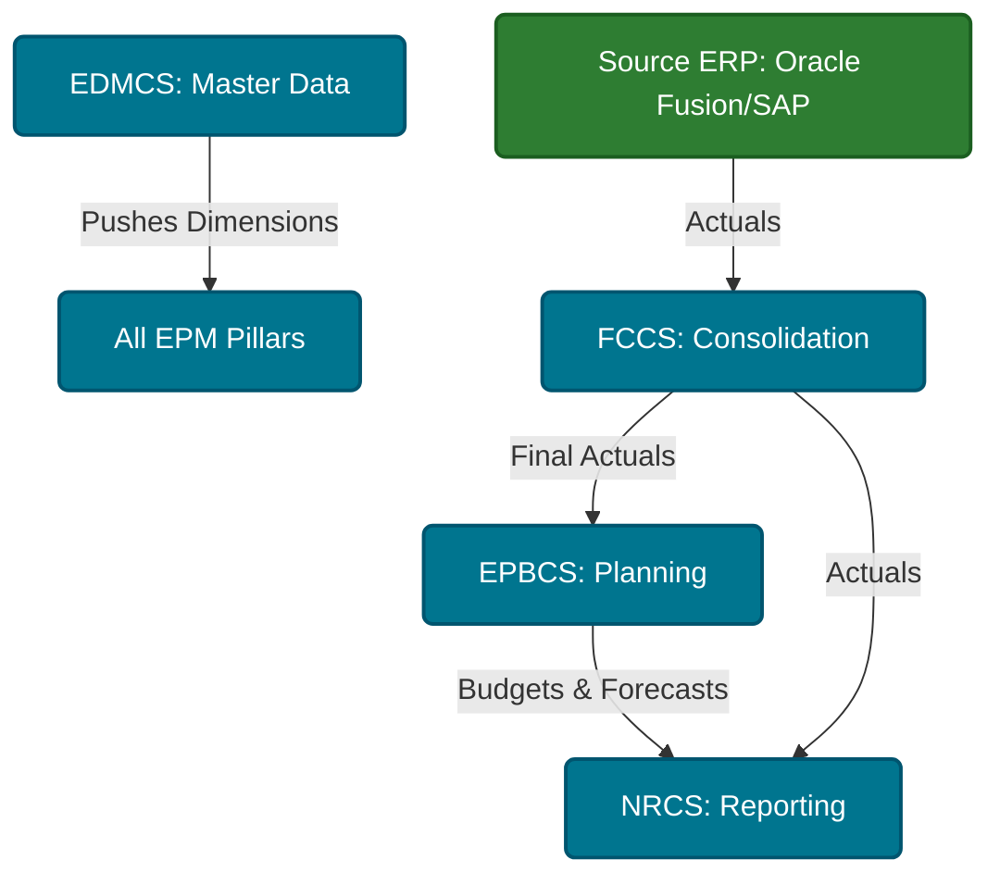

# 02 — The 7 Pillars of Oracle EPM Cloud

> **Module:** 00_Foundation  
> **Last Updated:** 2026-07-23  
> **Oracle Cloud Version:** 24.10+  
> **Difficulty:** Beginner  

## 📑 Table of Contents
- [Overview](#overview)
- [Business Purpose](#business-purpose)
- [Business Problem](#business-problem)
- [Where Used](#where-used)
- [Navigation Path](#navigation-path)
- [Prerequisites](#prerequisites)
- [Architecture](#architecture)
- [Concept Explanation](#concept-explanation)
- [Configuration](#configuration)
- [Properties & Options](#properties-options)
- [Step-by-Step Instructions](#step-by-step-instructions)
- [Examples](#examples)
- [Hands-on Exercise](#hands-on-exercise)
- [Real Client Scenario](#real-client-scenario)
- [Implementation Notes](#implementation-notes)
- [Production Support Notes](#production-support-notes)
- [Troubleshooting](#troubleshooting)
- [Performance](#performance)
- [Common Errors](#common-errors)
- [Debugging](#debugging)
- [Best Practices](#best-practices)
- [Interview Questions](#interview-questions)
- [Oracle Documentation](#oracle-documentation)
- [Related Topics](#related-topics)
- [Summary](#summary)

---

## 🏢 Overview

Oracle EPM Cloud is not just one monolithic product—it is a comprehensive suite of distinct applications, often referred to as the "7 Pillars." Each pillar is purpose-built to solve a specific financial or operational business problem within the enterprise performance management lifecycle.

---

## 🎯 Business Purpose

Large Fortune 100 enterprises have highly complex financial ecosystems. A single software module cannot optimally perform planning, statutory consolidation, tax reporting, and account reconciliations simultaneously. Oracle designed EPM Cloud as a suite of integrated modules to ensure that each business process is handled by a specialized engine designed specifically for that task.

---

## 🚨 Business Problem

Before the "7 Pillars" architecture (or in legacy on-premises systems), companies either tried to force a planning tool to do financial consolidation, resulting in severe compliance and performance issues, or they bought 7 different software products from 7 different vendors, resulting in integration nightmares and massive IT overhead.

---

## 📍 Where Used

The pillars are used across the entire Office of the CFO:
- **FP&A:** Uses EPBCS for planning.
- **Corporate Controllers:** Uses FCCS and ARCS for month-end close.
- **Tax Department:** Uses TRCS for tax provisioning.
- **IT / EPM CoE:** Uses EDMCS for master data governance.

---

## 🧭 Navigation Path

You access the different pillars via the Oracle Cloud My Services portal, or directly via the specific pod URLs assigned to each pillar.

```text
Web Browser → EPM Cloud URL → Select Specific Pillar (e.g., Planning or Consolidation)
```

> [!NOTE]
> **Screenshots Placeholder:**  
> [Oracle Cloud Infrastructure My Services dashboard showing multiple EPM instances (e.g., one for EPBCS, one for FCCS)]

---

## 📚 Prerequisites

Before reading this document, you should understand:
- Concepts of Enterprise Performance Management: [01 EPM Foundations](./01_EPM_Foundations.md)
- Understanding of the basic financial close cycle.

---

## 🏗️ Architecture

These pillars form an interconnected web of data, heavily integrated with source ERP systems like Oracle Fusion or SAP.



---

## 💡 Concept Explanation

### The 7 Pillars Detailed

| Acronym | Full Name | Purpose | Nature |
|---------|-----------|---------|--------|
| **EPBCS** | Enterprise Planning & Budgeting Cloud Service | **Planning** | Forward-looking. Budgeting, forecasting, and workforce/capital planning. Uses BSO and ASO Essbase cubes. |
| **FCCS** | Financial Consolidation & Close Cloud Service | **Consolidation** | Backward-looking. Combines actual financial results from global subsidiaries, handles eliminations. |
| **ARCS** | Account Reconciliation Cloud Service | **Matching** | Ensures the numbers in the ERP system actually match external sources (e.g., bank statements). |
| **EDMCS** | Enterprise Data Management Cloud Service | **Master Data** | Centralizes the management of dimensions (metadata) so all systems use the exact same Chart of Accounts. |
| **NRCS** | Narrative Reporting Cloud Service | **Reporting** | Combines financial numbers with written text (narratives) to create publishable annual reports. |
| **PCMCS** | Profitability & Cost Management Cloud Service | **Allocations** | Complex allocation engine to determine the true cost and profitability of a product or customer. |
| **TRCS** | Tax Reporting Cloud Service | **Tax** | Calculates corporate tax provisions according to international laws. |

### 🌀 Confusion Resolution
> **Misconception:** "We bought EPM Cloud Enterprise, so we should just build our Consolidation, Planning, and Master Data inside a single EPBCS application to save time."
> **Reality:** Do NOT mix pillars! Each pillar has a specialized backend architecture. EPBCS is tuned for rapid, forward-looking driver calculations (what-if scenarios). FCCS has strict, pre-built rules for statutory eliminations and currency translations required by law. Mixing them into one pod will destroy performance, violate audit compliance, and break future Oracle patches. 

### 😈 Twisted Interview Question
**Question:** A client wants to allocate IT expenses across 500 departments based on square footage, headcount, and revenue percentages. Should they build this massive allocation engine in EPBCS or PCMCS?
> **Answer:** If the allocation is simple (e.g., just distributing rent based on headcount), EPBCS can handle it via Business Rules. However, if the allocation requires a complex "waterfall" methodology (e.g., IT allocates to HR, HR allocates to Finance, Finance allocates to Operations) with high transparency for audit traceability, they must use PCMCS. EPBCS will choke on massive, multi-tiered waterfall allocations.

### ⚖️ Comparison / Difference
**EPBCS vs FCCS**
- **EPBCS (Planning):** Uses flexible Essbase (BSO/ASO). You can build any dimension structure you want. Focuses on the *future*.
- **FCCS (Consolidation):** Uses a heavily restricted, out-of-the-box dimension structure mandated by GAAP/IFRS. Focuses on the *past*.

## 🛠️ Configuration

When procuring EPM Cloud, companies typically buy the "Enterprise EPM Cloud" license, which grants access to all pillars. 
Configuration requires spinning up individual "environments" (pods) for each pillar, rather than trying to cram all features into a single application.

---

## 🎛️ Properties & Options

*Note: This is a conceptual foundation document. Specific properties for configuring each pillar are covered in their respective technical modules.*

---

## 📝 Step-by-Step Instructions

**How to navigate between different pillars in a connected environment:**
1. Open the EPM Springboard.
2. Click the **Navigator** icon (hamburger menu in the top left).
3. Under the **Connections** tab, click the link to the target pillar (e.g., navigating from Planning directly to Consolidation).
*(Note: This requires Cross-Environment SSO configuration).*

---

## 📊 Examples

**Data Flow Example between Pillars:**
1. **EDMCS**: An admin creates a new Account member `1001_Cash`.
2. **FCCS**: The system loads actuals into `1001_Cash` from the ERP and translates EUR to USD.
3. **EPBCS**: Reads the final USD actuals from `1001_Cash` via a Data Map to forecast next year's cash position.

---

## 🏋️ Hands-on Exercise

**Objective:** Understand the purpose of each pillar in a real-world scenario.
1. Write down a list of 5 tasks a Finance department does (e.g., "Create a budget", "Reconcile a bank account", "Publish an annual report").
2. Next to each task, write down the EPM Cloud acronym (EPBCS, ARCS, NRCS) that solves it.
3. **Expected Result:** You will memorize the functional purpose of the core pillars.

---

## 🏢 Real Client Scenario

> [!NOTE]
> **Client:** Global Manufacturing Company  
> **Challenge:** Siloed financial processes causing a 40-day month-end close.  
> **EPM Solution:** Implemented multiple pillars seamlessly integrated. 
> 1. Used **EDMCS** to ensure all 50 global branches used the same Account names.
> 2. Used **FCCS** to close the books and automate intercompany eliminations.
> 3. Used **EPBCS** to take those actuals and generate next year's budget.
> 4. Used **NRCS** to generate the final PDF report for shareholders.
> **Result:** Reduced month-end close from 40 days to 5 days.

---

## 🏗️ Implementation Notes

> [!TIP]
> Implement in phases. Trying to implement EPBCS, FCCS, and ARCS simultaneously ("Big Bang") usually leads to project failure due to business resource constraints.

---

## 🏥 Production Support Notes

> [!TIP]
> When data is missing in Planning (EPBCS), check the upstream pillar first (usually FCCS or the source ERP) to ensure the data was pushed successfully before troubleshooting the Planning application itself.

---

## 🔧 Troubleshooting

- **Issue:** Cross-environment navigation links fail between pillars.
- **Resolution:** Verify that Identity Domain setups match across environments and that **Connections** are defined correctly in `Tools -> Connections`.

---

## âš¡ Performance

Keeping applications separate across the 7 pillars actually *improves* performance. By separating the Consolidation (FCCS) Essbase cube from the Planning (EPBCS) Essbase cube, you prevent intensive reporting calculations from slowing down the users who are actively running forecasting rules.

---

## ⚠️ Common Errors

| Error Code / Message | Root Cause | Resolution |
|----------------------|------------|------------|
| Connection Refused | Identity Domain mismatch or expired password on the integration user. | Re-enter credentials in `Tools -> Connections` and verify SSO IDP sync. |

---

## 🐛 Debugging

If data mapping between pillars is failing (e.g., FCCS to EPBCS), use EPM Data Integration's **Process Details** log to debug which specific member is failing validation. It is usually a missing metadata sync from EDMCS.

---

## ⭐ Best Practices

### Do
- Treat EDMCS as the single source of truth for metadata if implementing multiple pillars.
- Keep the number of custom dimensions in FCCS to an absolute minimum to preserve performance, but expand them in EPBCS for detailed planning.

### Don't
- Don't use EPBCS to do complex statutory consolidations. That is what FCCS is for.
- Don't use FCCS to do complex forward-looking what-if modeling. That is what EPBCS is for.

---

## 🎓 Interview Questions

- **Q: Name 4 modules within Oracle EPM Cloud and their primary purpose.**
  - *A: EPBCS (Planning/Budgeting), FCCS (Consolidation/Close), ARCS (Account Reconciliations), EDMCS (Master Data Management).*

- **Q: What is the main difference between EPBCS and FCCS?**
  - *A: EPBCS is forward-looking (budgets, forecasts, what-if scenarios). FCCS is backward-looking (taking actuals, consolidating them, eliminating intercompany transactions, and closing the books).*

---

## 📖 Oracle Documentation

### Page-Level References


### Concept-Level Oracle References — Individual Pillars

#### EPBCS (Enterprise Planning & Budgeting Cloud Service)

#### FCCS (Financial Consolidation & Close Cloud Service)

#### ARCS (Account Reconciliation Cloud Service)

#### EDMCS (Enterprise Data Management Cloud Service)

#### NRCS (Narrative Reporting Cloud Service)

#### PCMCS (Profitability & Cost Management Cloud Service)

#### TRCS (Tax Reporting Cloud Service)

### Workflow-Level Oracle References

#### Cross-Environment Navigation

---

## 🔗 Related Topics

### Internal Repository Links
- [01 EPM Foundations](./01_EPM_Foundations.md) — What EPM is and why it exists.
- [03 Product History](./03_Hyperion_Evolution.md) — How the 7 pillars evolved from legacy Hyperion.
- [04 EPM Architecture](./04_EPM_Cloud_Architecture.md) — Infrastructure that hosts the pillars.

### Related Concepts
- [01 Financial Statements](../01_Finance/01_Finance_Basics.md) — Financial outputs produced by EPBCS and FCCS.
- [01 Essbase Complete Guide](../02_Essbase/01_Essbase_Complete_Guide.md) — The Essbase engine underlying EPBCS and FCCS.
- [01 Applications & Cubes](../03_Planning/01_Applications_and_Cubes.md) — EPBCS application types.

### Related Functions
- [04 Essbase Functions](../02_Essbase/05_Essbase_Calculations.md) — Calc functions used across pillars.

### Related APIs
- [04 REST API via Groovy](../13_REST_API/01_REST_API_Complete_Guide.md) — Cross-pillar data integration via API.

### Related Workflows
- [01 ERP Integration](../11_Data_Integration/01_ERP_Integration.md) — Loading data into FCCS and EPBCS.
- [02 Data Maps](../11_Data_Integration/02_Data_Maps.md) — Moving data between pillars.
- [01 EPM Automate Complete Guide](../14_EPM_Automate/01_EPM_Automate_Complete_Guide.md) — Automating cross-pillar operations.

### Related Best Practices
- [01 Performance Complete Guide](../15_Performance/01_Performance_Complete_Guide.md) — Pillar-level performance isolation.
- [01 Access Control](../12_Security/01_Security_Complete_Guide.md) — Security across multiple pillars.

### Related Troubleshooting
- [01 Debugging Complete Guide](../17_Debugging/01_Debugging_Complete_Guide.md) — Debugging cross-pillar data issues.

---

## 📝 Summary

| Key Point | Detail |
|-----------|--------|
| **What** | The 7 distinct modules of EPM Cloud (EPBCS, FCCS, ARCS, EDMCS, NRCS, PCMCS, TRCS). |
| **Why** | To solve specific financial problems (planning, consolidation, reporting) with tailored engines rather than a one-size-fits-all approach. |

