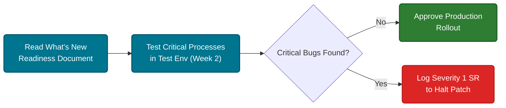

# Center of Excellence (CoE) & Governance — Oracle Deep Reference

> **Module:** 00_Foundation  
> **Last Updated:** 2026-07-23  
> **Oracle Cloud Version:** 24.10+  
> **Difficulty:** Advanced (Management/Architecture level)  
> **Source:** Creating_and_Running_an_EPM_Center_of_Excellence.pdf (8.7MB)  

## 📑 Table of Contents
- [What is an EPM CoE?](#what-is-an-epm-coe)
- [CoE Team Structure](#coe-team-structure-the-hidden-roles)
- [CoE Best Practices & Governance](#coe-best-practices--governance)
- [Hands-On Exercises](#hands-on-exercises--coe-governance)
- [Interview Questions](#interview-questions-coe--governance)

---

## 🏛️ 1. What is an EPM CoE?

A Center of Excellence (CoE) is a centralized, dedicated team of EPM experts within an organization. They ensure that the Oracle EPM investment is maximized, governed properly, and adopted fully across the business.

**Why it matters in interviews:** Many companies fail at EPM because they treat it as an IT project instead of a business transformation. The CoE bridges Business and IT.

---

## 👥 2. CoE Team Structure (The "Hidden" Roles)

Oracle defines specific roles that MUST exist for a successful EPM deployment:

| Role | Responsibilities | Hidden Interview Question |
|------|------------------|---------------------------|
| **Executive Sponsor** | Funds the project, drives adoption at C-level | "How do you handle severe user resistance?" (Answer: Escalate to Exec Sponsor) |
| **EPM Product Owner** | Owns the backlog, prioritizes enhancements | "Who decides if a requested rule gets built?" (Answer: Product Owner) |
| **EPM Administrator** | Manages metadata, security, patches, daily ops | "Who manages the monthly Oracle patch?" |
| **Data Steward** | Owns data quality and integration (FDMEE/DM) | "Who fixes unmapped accounts in the ERP load?" |
| **Change Agent** | Manages training, communication, UAT | "How do you ensure users actually use the new forms?" |

---

## 📜 3. CoE Best Practices & Governance

### The Monthly Release Cycle
Oracle patches EPM Cloud on the **first Friday of the month** (test environments) and **third Friday** (production).



### 💡 Logic & Purpose
The CoE must have a strict 14-day regression testing protocol. Because Oracle forces the patch on the 3rd Friday, the CoE has exactly two weeks to ensure the new Oracle code doesn't break their custom Business Rules or Forms.

### 🌀 Confusion Resolution
> **Misconception:** "Oracle's monthly patches only add new features, so we don't need to test anything if we aren't using the new features."
> **Reality:** Patches frequently include "Changed Behavior" updates to the underlying Essbase engine or Groovy API. A calculation that worked in August might fail in September due to a strict syntax enforcement update. Regression testing your *existing* core processes is mandatory.

### 😈 Twisted Interview Question
**Question:** It is the second Friday of the month. Your CoE discovers that the new Oracle patch applied to the Test environment completely breaks your core Currency Translation rule. Production is scheduled to be patched next Friday. What is the immediate CoE protocol?
> **Answer:** The CoE must immediately open a **Severity 1 Service Request (SR)** with Oracle Support, explicitly stating that the upcoming Production patch will cause a critical business failure. The CoE must request a "Patch Delay" for Production while Oracle investigates the regression bug in the Test pod.

### ⚖️ Comparison / Difference
**IT-Driven vs Business-Driven CoE**
- **IT-Driven:** Focuses only on uptime, backups, and patching. Often fails to drive user adoption because they don't understand the finance process.
- **Business-Driven (Best Practice):** Led by a Finance executive (like the VP of FP&A). IT handles the technical integrations, but Finance owns the forms, rules, and user training.

### Metadata Governance
> [!TIP]
> **Hidden Gem:** Never let users manually type in metadata changes. Use **EPM Automate** to sync metadata from a centralized Master Data Management (MDM) system (like Oracle **EDMCS**) nightly.

---

## 🏋️ 4. Hands-On Exercises — CoE Governance

### Exercise 1: Build a CoE Charter
```
1. Create a 1-page document outlining your EPM governance.
2. Define: Who approves a new Entity member?
3. Define: What is the SLA (Service Level Agreement) for a password reset vs a broken calc script?
4. Define: Who reviews the monthly Oracle update document?
```

### Exercise 2: Simulate a Monthly Patch Audit
```
1. Go to Oracle Cloud Readiness (web).
2. Download the latest EPM "What's New" document.
3. Identify 1 new feature you would recommend to the business.
4. Identify 1 "Changed Behavior" that requires you to test a form or rule.
```

---

## 🎓 5. Interview Questions (CoE & Governance)

**Q: You are hired as a Lead EPM Architect. The client complains that EPM is "too hard to use" and they want to go back to Excel. What do you do?**
> [!NOTE]
> **Hidden Answer:** Do NOT jump into changing forms. This is a Change Management / CoE issue. I would form a CoE steering committee, identify super-users to act as champions, create targeted training sessions, and gather feedback on exactly *which* forms are difficult. EPM is a business process change, not just a software install.

**Q: How do you handle metadata requests (e.g., adding a new cost center)?**
> [!NOTE]
> Establish a strict governance workflow. The business user requests it via a ticketing system. Finance approves it. The Data Steward ensures it maps correctly to the ERP. The EPM Admin adds it (preferably automated via **EDMCS**/**EPM Automate**), tests the aggregation, and promotes it to Production.

---
