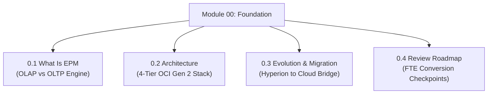

# Module 00: Foundation & Core Cloud EPM Architecture

## Navigation & Module Overview

This module establishes the foundational technical architecture of Oracle Enterprise Performance Management (EPM) Cloud on Oracle Cloud Infrastructure (OCI Gen 2).

---

<!-- ===================================================================== -->
<!-- 🎯 LIVE INTERACTIVE VISUAL CARD: MODULE 00 ARCHITECTURE -->
<!-- ===================================================================== -->

<b>🎯 Live Interactive Architecture Card: Foundation Architecture (Click to Collapse / Expand)</b>

 

> [!TIP]
> **Interactive Standalone Dashboard:** Open [`card_kb_01_ecosystem_architecture.html`](../interactive_cards/card_kb_01_ecosystem_architecture.html) in your browser for a live interactive architecture explorer!

| Document | Primary Domain | Core Focus | Direct Link |
| :--- | :--- | :--- | :--- |
| **0.1 What Is EPM** | Platform Fundamentals | Multidimensional OLAP vs Relational ERP, Analytical Pipeline | [01_What_Is_EPM.md](01_What_Is_EPM.md) |
| **0.2 Architecture** | Cloud Infrastructure | 4-Tier OCI Gen 2 Architecture, Pods, Relational HSP vs Essbase Kernel | [02_EPM_Architecture.md](02_EPM_Architecture.md) |
| **0.3 Evolution & Migration** | Migration Architecture | Hyperion 11.1.2.4 to Cloud EPM, Tool translation, MaxL to EPM Automate | [03_EPM_History.md](03_EPM_History.md) |
| **0.4 Review Roadmap** | FTE Conversion Track | 4-Stage Review Readiness, Storage physics, Troubleshooting drills | [04_Study_Path_and_Learning_Roadmap.md](04_Study_Path_and_Learning_Roadmap.md) |

---

## Module Documents

1. **[0.1 What Is Oracle EPM Cloud: The Technical Consultant Foundation](01_What_Is_EPM.md)**
   * Multidimensional OLAP vs. Relational ERP.
   * Core Business Processes: Planning, FCCS, ARCS, EDMCS, PCMCS, Narrative Reporting.
   * End-to-end analytical data flow pipeline.
   * Tough & twisted review questions with consultant model answers.

2. **[0.2 Oracle EPM Cloud Architecture: Infrastructure, Tiers & OCI Gen 2](02_EPM_Architecture.md)**
   * 4-Tier cloud stack: Client, Gateway, Application Server, Dual Storage.
   * Dual-engine storage: Relational HSP tables vs. Essbase multidimensional page files.
   * Maintenance window, 28-day monthly update cadence, and automated snapshots.

3. **[0.3 Cloud EPM Evolution & Hyperion On-Premises Migration Architecture](03_EPM_History.md)**
   * On-premises Hyperion (11.1.2.4) vs. Cloud EPM.
   * Tool translation: MaxL to EPM Automate, EAS to Web Essbase, FDMEE to Data Integration.
   * Enterprise migration pipeline and critical technical differences.

4. **[0.4 Technical Consultant Review Mastery Roadmap (FTE Conversion Track)](04_Study_Path_and_Learning_Roadmap.md)**
   * 4-Stage technical readiness framework for FTE conversion.
   * Competency matrix for freshers and consultants.
   * Key scenario drills (Block sizing, Implied shares, Lock contention).

---
*Return to [Knowledge Base Master Index](../README.md) or advance to [Module 01: Security and Access Control](../01_Security_and_Access/00_INDEX.md).*
