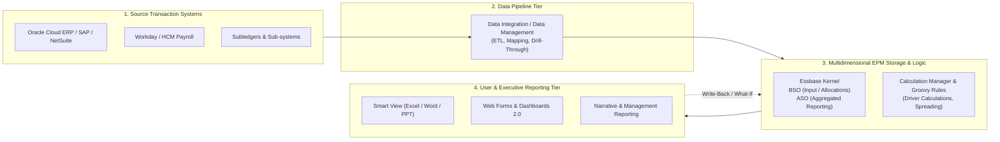
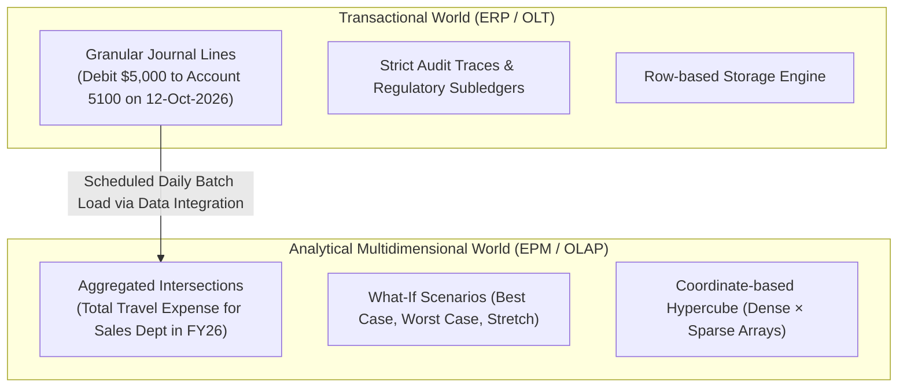

# 0.1 What Is Oracle EPM Cloud: The Technical Consultant Foundation

## Table of Contents
1. [Core Consultant Mental Model](#1-core-consultant-mental-model)
2. [EPM Ecosystem: The Core Business Processes](#2-epm-ecosystem-the-core-business-processes)
3. [Transactional ERP vs. Multidimensional EPM](#3-transactional-erp-vs-multidimensional-epm)
4. [The EPM Analytical Pipeline](#4-the-epm-analytical-pipeline)
5. [Tough & Twisted Review Questions with Consultant Model Answers](#5-tough--twisted-review-questions-with-consultant-model-answers)

---

<!-- ===================================================================== -->
<!-- 🎯 LIVE INTERACTIVE VISUAL CARD: EPM ECOSYSTEM & MULTIDIMENSIONAL PIPELINE -->
<!-- ===================================================================== -->

<b>🎯 Live Interactive Architecture Card: EPM Ecosystem & Multidimensional Engine (Click to Collapse / Expand)</b>

 

> [!TIP]
> **Interactive Standalone Dashboard:** Open [`card_kb_01_ecosystem_architecture.html`](../interactive_cards/card_kb_01_ecosystem_architecture.html) in your browser for a live interactive architecture explorer!

| Architectural Dimension | Transactional ERP (Oracle Fusion / SAP) | Multidimensional EPM (Planning, FCCS) |
| :--- | :--- | :--- |
| **Primary Objective** | Record transactional facts (Invoices, POs, GL Journals) | Forward-looking Modeling, Forecasting, Allocations & Consolidation |
| **Data Structure** | 2D Relational Tables (Normalized rows & columns) | N-Dimensional Hypercubes (Dense × Sparse Cartesian Arrays) |
| **Query Engine** | Relational SQL (JOIN, GROUP BY over millions of rows) | O(1) Multidimensional Block Pointer Index (Essbase Kernel) |
| **Write-Back Mechanism** | Row INSERT / UPDATE with ACID relational locking | Cell-level grid write-back with dynamic parent calculation & spreading |
| **Time Horizon** | Historical reality (Sub-ledger transactions) | Past Actuals + Current Budget + Multi-Year Rolling Forecasts |

---

## 1. Core Consultant Mental Model

When entering a technical review or client-facing project, consultants must never describe EPM as *"just finance software"* or *"fancy spreadsheets"*. 

**The Technical Definition:**
> **Oracle Enterprise Performance Management (EPM) Cloud** is a unified suite of software-as-a-service (SaaS) applications powered by a high-speed **multidimensional analytical storage engine (Essbase)** and a **relational application repository**. It enables enterprise organizations to plan, budget, forecast, consolidate, reconcile, and report on financial and operational performance across dozens of dimensions in real time.

### The Business Reality
An enterprise with 50 entities across 15 countries operating in 8 currencies cannot run multi-year strategic scenarios in an ERP. Running a query like:
*"Show total operating margin by Product line across Europe for Q3 Budget vs. Q2 Forecast in Constant USD currency"* 
in a relational ERP requires joining millions of journal entry lines across 12 relational tables, causing massive query latency and locking database tables.

In Oracle Cloud EPM, that query hits a **single pre-indexed coordinate intersection in Essbase**, retrieving the calculated number in **under 200 milliseconds**.

---

## 2. EPM Ecosystem: The Core Business Processes

In modern Oracle Cloud EPM, capabilities are organized into modular **Business Processes**:

| Business Process | Acronym / Heritage | Primary Analytical Purpose | Underlying Storage Mechanics |
| :--- | :--- | :--- | :--- |
| **Planning** | PBCS / EPBCS | Operational & Financial Planning, Driver-based forecasting, Workforce, Capex, Projects | BSO / Hybrid BSO write-back cubes + ASO reporting cubes |
| **Financial Consolidation and Close** | FCCS | Legal entity statutory consolidation, multi-currency translation, intercompany eliminations | Hybrid BSO Consol cube + Rates cube (pre-seeded dimensions) |
| **Account Reconciliation** | ARCS | Automated balance sheet reconciliation, transaction matching | Relational repository + data import engine |
| **Enterprise Data Management** | EDMCS | Enterprise master data governance, dimension synchronization, alternate hierarchy mapping | Node-based graph repository (validates and pushes to EPM/ERP) |
| **Profitability and Cost Management** | PCMCS / Enterprise PCM | High-volume multi-step driver allocations, activity-based costing | ASO cube engine optimized for multi-million cell allocations |
| **Narrative Reporting** | EPRCS | Report packages, collaborative financial document authoring, disclosure management | Metadata bridge connecting to Smart View and web doclets |

---

## 3. Transactional ERP vs. Multidimensional EPM

Reviewers will frequently test whether you understand the architectural boundary between ERP and EPM:

### Key Differences
1. **Granularity:** ERP stores transaction-level facts (individual POs, vendor invoices). EPM stores periodic summary intersections (monthly balances by entity, account, and cost center), with drill-through links back to ERP transactions.
2. **Directionality:** ERP is backward-looking (what *happened*). EPM is forward-looking (what *will happen* under 10% inflation or shifting FX rates).
3. **Write-Back:** ERP entries require balanced journal entries (Debit = Credit). EPM allows top-down grid adjustments, breakback allocations, and driver adjustments that immediately cascade through calculation rules.

---

## 4. The EPM Analytical Pipeline

The lifecycle of data inside Oracle Cloud EPM follows an end-to-end pipeline:

1. **Extraction & Ingestion:** Data Integration (formerly Data Management / FDMEE) extracts general ledger balances from Oracle Fusion Cloud ERP, SAP, or flat files.
2. **Dimension Mapping & Transformation:** Accounts and Cost Centers are transformed via mapping rules (Explicit, In, Between, Multi-Dim, Like) into standard EPM chart of accounts.
3. **Cube Load:** Data is loaded to the Level 0 leaf cells of Essbase storage cubes.
4. **Calculation & Allocations:** Calculation Manager business rules or Groovy scripts calculate drivers, benefit rates, depreciation schedules, and overhead allocations.
5. **Aggregation & Reporting:** Hybrid BSO dynamic vectors calculate parent nodes on the fly, or Data Maps / Smart Push push consolidated data to an ASO cube for high-concurrency executive querying via Smart View.

---

## 5. Tough & Twisted Review Questions with Consultant Model Answers

### Question 1: "Why can't an enterprise simply run their financial budgeting and forecasting directly inside Oracle Fusion Cloud ERP Financials?"
**Consultant Model Answer:**
> "Fusion ERP Financials is an OLTP (Online Transaction Processing) system optimized for high-volume row-level transaction logging, relational integrity, and strict legal auditing. Budgeting and forecasting require multidimensional OLAP capabilities: iterative what-if scenario modeling, driver-based calculations across 15+ dimensions, rapid aggregation of non-stored parent hierarchies, and cell-level write-back. Running millions of what-if calculations inside an operational ERP would degrade transactional throughput, lock database tables, and lack Essbase's sub-second slice aggregation and dynamic spreading engines."

### Question 2: "In a planning application, when should a client use an ASO cube versus a BSO cube?"
**Consultant Model Answer:**
> "Use **BSO (or Modern Hybrid BSO)** whenever users need to input data at leaf levels, perform procedural calculations (such as employee-by-employee payroll tax calculations or recursive allocations via `@LOOP`), and execute write-back spreads. Use **ASO (Aggregate Storage)** when the business requires high-concurrency read-only reporting across massive dimensionality (e.g., 20+ dimensions, millions of SKU members) where upper-level aggregations must evaluate in sub-seconds without taking up disk storage or requiring lengthy batch consolidation runs."

### Question 3: "A client insists on loading every individual vendor invoice and purchase order directly into their Planning Essbase cube. How do you advise them?"
**Consultant Model Answer:**
> "I advise strictly against loading individual transaction records into Essbase. Loading transactional rows with distinct invoice numbers creates catastrophic dimensional explosion, expanding the sparse index, detonating cube size, and severely slowing down calculation rules. The architectural best practice is to load summarized balances (by Account, Period, Entity, Cost Center) into the Essbase cube, and configure **Drill-Through** in Data Integration so users can click on an aggregated cell in Smart View or a Web Form and view the underlying transactional invoice detail hosted in Fusion ERP or an operational data lake."

---
*Proceed to [0.2 EPM Cloud Architecture: Infrastructure, Tiers & OCI Gen 2](02_EPM_Architecture.md).*
