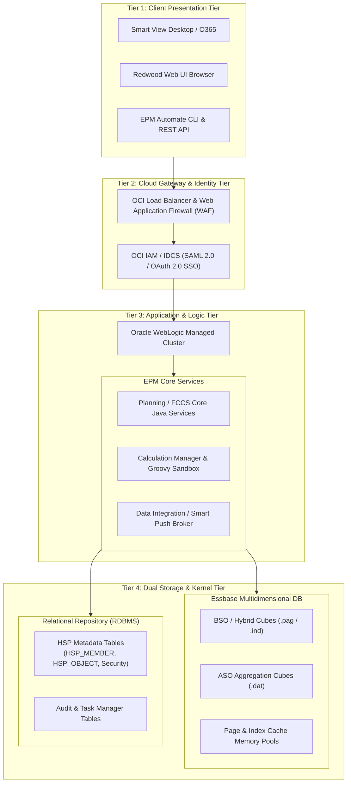

# 0.2 Oracle EPM Cloud Architecture: Infrastructure, Tiers & OCI Gen 2

## Table of Contents
1. [Core Consultant Mental Model](#1-core-consultant-mental-model)
2. [The 4-Tier Cloud EPM Architecture](#2-the-4-tier-cloud-epm-architecture)
3. [OCI Gen 2 Infrastructure & Tenancy Pod Mechanics](#3-oci-gen-2-infrastructure--tenancy-pod-mechanics)
4. [Maintenance, Patching & High Availability](#4-maintenance-patching--high-availability)
5. [Tough & Twisted Review Questions with Consultant Model Answers](#5-tough--twisted-review-questions-with-consultant-model-answers)

---

<!-- ===================================================================== -->
<!-- 🎯 LIVE INTERACTIVE VISUAL CARD: 4-TIER ARCHITECTURE & OCI GEN 2 -->
<!-- ===================================================================== -->

<b>🎯 Live Interactive Architecture Card: 4-Tier Cloud Architecture & Infrastructure (Click to Collapse / Expand)</b>

 

> [!TIP]
> **Consultant High-Yield Summary:** Oracle Cloud EPM runs on **Oracle Cloud Infrastructure (OCI) Gen 2**. It is a fully managed SaaS platform where the client owns application design, metadata, and calculation scripts, while Oracle manages operating systems, WebLogic application servers, Essbase instances, automated backups, and patching.

| Architectural Layer | Physical Components | Security & Operational Controls |
| :--- | :--- | :--- |
| **Tier 1: Client Tier** | Smart View (Excel, Word, PPT), Web Browsers, EPM Automate CLI, REST Clients | TLS 1.3 encrypted transit, OAuth 2.0 / SAML 2.0 SSO |
| **Tier 2: Presentation & Gateway** | OCI Load Balancer, WebGate, Oracle Identity Cloud Service (IDCS/OCI IAM) | Domain routing, Multi-Factor Authentication (MFA), IP allowlisting |
| **Tier 3: Application Server** | WebLogic Cluster, Planning / FCCS Java Business Logic, Calc Manager, Data Integration | Managed thread pools, automated task execution, Groovy sandbox |
| **Tier 4: Storage & Data Engine** | **Dual Data Store:** 1. **Essbase Kernel** (.pag, .ind files for multidimensional data) 2. **Oracle Autonomous / Enterprise RDBMS** (HSP tables for metadata, security, forms) | AES-256 encryption at rest, automated nightly snapshot export |

---

## 1. Core Consultant Mental Model

When reviewing or presenting architecture to enterprise architects, you must distinguish between the **Multidimensional Store (Essbase)** and the **Relational Application Repository (RDBMS)**.

- **The Dual-Database Nature of EPM Planning:**
  - Many junior consultants assume that *everything* in Planning lives inside Essbase. **This is false.**
  - **Relational Repository (RDBMS):** Stores dimensional definitions, member aliases, form definitions, task lists, user preferences, security mappings, and audit logs (the `HSP_*` tables).
  - **Essbase Kernel:** Stores the actual numeric cell data, dense blocks, index pointers, and executes business rules and dynamic calculations.
  - When an administrator runs **Refresh Database**, the application synchronizes structural metadata from the relational repository into the Essbase outline (`.otl`) file.

---

## 2. The 4-Tier Cloud EPM Architecture

### Tier 1: Client Interfaces
* **Smart View for Office:** Native Microsoft Office add-in connecting via HTTP/HTTPS XML/JSON over port 443. Supports ad-hoc multidimensional grids, form input, and Smart Push invocation.
* **Redwood Web Interface:** HTML5 responsive web portal rendered in modern browsers.
* **Automation & Scripting:** `epm-automate` CLI client and HTTP REST endpoints for automated scheduling, batch data loading, and LCM migration.

### Tier 2: Presentation & Gateway Tier
* **OCI Load Balancers:** Handle traffic routing, SSL offloading, and DDoS mitigation.
* **Identity Management:** OCI IAM (Identity and Access Management) or IDCS authenticates users via corporate Identity Providers (Active Directory, Okta, Azure AD) using SAML 2.0.

### Tier 3: Application Logic Tier
* **Clustered WebLogic Instances:** Run Planning business logic, form validation, workflow state machines, and approval units.
* **Groovy Script Execution Engine:** Executes event-driven scripts before/after grid saves with memory-isolated JVM runtime limits (e.g., maximum memory allocation and timeout thresholds).

### Tier 4: Data Engine Tier
* **Essbase Server:** Runs the BSO, ASO, and Hybrid Essbase kernel. Reads and writes data blocks from high-performance OCI block volumes.
* **Relational Repository Database:** Oracle Autonomous Database / Enterprise RDBMS storing application structural definitions.

---

## 3. OCI Gen 2 Infrastructure & Tenancy Pod Mechanics

All modern Oracle Cloud EPM environments are provisioned on **OCI Gen 2 (Oracle Cloud Infrastructure)** data centers:

| Feature | Technical Specification | Operational Impact |
| :--- | :--- | :--- |
| **Tenancy Isolation** | Dedicated logical pod per environment | Full network and data isolation; no shared memory or disk |
| **Standard Environments** | Two pods per subscription: **Test** and **Production** | Test environment used for monthly patch validation and staging |
| **Encryption at Rest** | Transparent Data Encryption (TDE) AES-256 | Disk volumes, database backups, and snapshot artifacts encrypted |
| **Encryption in Transit** | TLS 1.3 / 1.2 | All browser, Smart View, and API traffic secured over port 443 |
| **Daily Maintenance Window** | 1-hour automated blackout window (client-selected time) | Daily maintenance runs automated database backup, Essbase restructuring, and snapshot export |

---

## 4. Maintenance, Patching & High Availability

### The 28-Day Monthly Cadence
Oracle updates Cloud EPM on a strict monthly cadence:
1. **First Friday of the Month:** Update applied to **Test** environments.
2. **Third Friday of the Month (two weeks later):** Update applied to **Production** environments.
3. **Consultant Responsibility:** Freshers and consultants must validate business-critical calculations, forms, and integrations in Test during the two-week window before Production updates occur.

### Disaster Recovery & Backup
* **Nightly Snapshot:** During the daily 1-hour maintenance window, the system automatically runs an export of the entire application metadata and data into an LCM snapshot named `Artifact Snapshot`.
* **Oracle Backup Retention:** Oracle retains daily maintenance backups for disaster recovery. Consultants can download `Artifact Snapshot` locally or push it to external cloud storage via EPM Automate.

---

## 5. Tough & Twisted Review Questions with Consultant Model Answers

### Question 1: "If an administrator changes an account member's property from 'Stored' to 'Dynamic Calc' in the web interface, why do users still see it behaving as Stored in Smart View?"
**Consultant Model Answer:**
> "Because modifying a member property in the Planning web interface only updates the **Relational Application Repository (the HSP database)**. The Essbase outline (`.otl`) that Smart View queries has not received the structural change yet. To propagate the change to Essbase, the administrator must execute a **Refresh Database (Cube Refresh)**. Once refreshed, Essbase updates its outline, clears affected stored blocks, and marks the member as Dynamic Calc."

### Question 2: "What occurs physically during the Daily 1-Hour Maintenance Window in Oracle Cloud EPM?"
**Consultant Model Answer:**
> "During the daily maintenance window, all active user sessions are disconnected and new logins are blocked. The system performs:
> 1. Automated generation of the comprehensive **Artifact Snapshot** (LCM backup).
> 2. Database index reorganization and temporary file purging.
> 3. Essbase process recycling and cache cleanup.
> 4. Application of bug fixes and monthly patches (if scheduled).
> If a long-running business rule or data integration job is running when the maintenance window triggers, the system will terminate the job to complete maintenance."

### Question 3: "A security reviewer asks: Can we install third-party antivirus software or access the operating system file system of our Cloud EPM instance?"
**Consultant Model Answer:**
> "No. Oracle Cloud EPM is a Software-as-a-Service (SaaS) offering built on OCI Gen 2. The host operating system, WebLogic application server, and underlying Linux kernel are fully managed and secured by Oracle under SOC 1, SOC 2, and ISO 27001 compliance standards. Customers have no root, OS, or file-system-level access. All administrative operations are conducted through the Planning web UI, EPM Automate CLI, or REST API endpoints."

---
*Proceed to [0.3 Cloud EPM Evolution & Hyperion Migration Architecture](03_EPM_History.md).*
