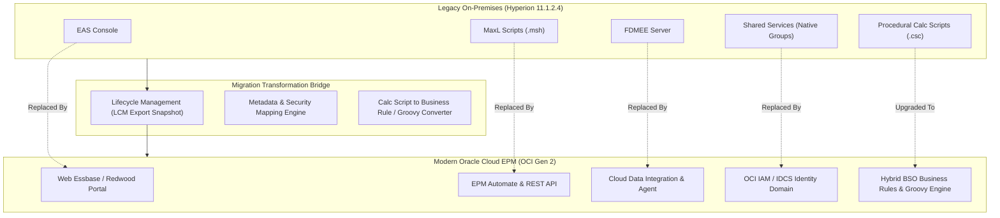

# 0.3 Cloud EPM Evolution & Hyperion On-Premises Migration Architecture

## Table of Contents
1. [Core Consultant Mental Model](#1-core-consultant-mental-model)
2. [Architectural Shift: On-Premises Hyperion vs. Oracle Cloud EPM](#2-architectural-shift-on-premises-hyperion-vs-oracle-cloud-epm)
3. [Tooling Translation Matrix (On-Premises to Cloud)](#3-tooling-translation-matrix-on-premises-to-cloud)
4. [Enterprise Migration Pipeline](#4-enterprise-migration-pipeline)
5. [Tough & Twisted Review Questions with Consultant Model Answers](#5-tough--twisted-review-questions-with-consultant-model-answers)

---

<!-- ===================================================================== -->
<!-- 🎯 LIVE INTERACTIVE VISUAL CARD: ON-PREMISES TO CLOUD EVOLUTION -->
<!-- ===================================================================== -->

<b>🎯 Live Interactive Architecture Card: On-Premises Hyperion vs. Cloud EPM Evolution (Click to Collapse / Expand)</b>

 

> [!TIP]
> **Consultant High-Yield Summary:** More than 80% of enterprise EPM Cloud implementations are migrations from legacy **Hyperion on-premises (11.1.2.4)** environments. Senior reviewers test freshers extensively on what tools were replaced, how security maps, and why legacy scripts cannot run directly in the cloud.

| Architectural Feature | Hyperion On-Premises (11.1.2.4) | Modern Oracle Cloud EPM (OCI Gen 2) |
| :--- | :--- | :--- |
| **Essbase Administration** | Essbase Administration Services (EAS Desktop Console) | Redwood Web Interface, Cube Designer, REST APIs |
| **Scripting & Script Engine** | MaxL command-line scripts, Windows Batch / Bash | **EPM Automate CLI**, REST APIs, Groovy rules |
| **Security & Directory** | Hyperion Shared Services (Native Directory + MS AD) | **OCI IAM / IDCS** (SAML 2.0 SSO, Identity Domains) |
| **Calculation Engine** | Classic Calc Scripts (.csc), Calc Manager | **Calculation Manager, Groovy Scripting**, Hybrid BSO |
| **ETL & Data Loading** | FDMEE (Financial Data Quality Management Enterprise Edition) | **Data Integration** (Cloud EPM Data Management + Pipeline) |
| **Hardware & Infrastructure** | Customer-managed physical/VM Windows/Linux servers | Fully managed Oracle Cloud Infrastructure (OCI Gen 2) |

---

## 1. Core Consultant Mental Model

When a client or senior reviewer brings up Hyperion history, they do not care about 1990s corporate mergers. They care about **migration risk and technical coexistence**.

In legacy on-premises environments, administrators had direct access to the filesystem (`C:\Oracle\Middleware\...`), could run raw SQL updates against the Planning relational database, and could execute arbitrary MaxL scripts on the operating system.

In **Oracle Cloud EPM**, all direct server access is gone. Everything must flow through sanctioned, secure interfaces:
1. **EPM Automate** replaces operating system batch scripts and MaxL.
2. **Groovy Rules** replace operating system shell execution and complex Calc Script workarounds.
3. **OCI IAM / IDCS** replaces Hyperion Shared Services.
4. **Data Integration Agent** replaces direct database links between on-premises databases and the cloud.

---

## 2. Architectural Shift: On-Premises Hyperion vs. Oracle Cloud EPM

### Physical Storage & Memory Management
* **On-Premises:** Administrators tuned memory by editing `essbase.cfg` manually (setting `MEMCACHESIZE`, `PAGEALLOCATEMIN`, `NETDELAY`). If memory was exhausted, the Essbase server crashed.
* **Cloud EPM:** Oracle manages `essbase.cfg` dynamically. The cloud infrastructure automatically sizes caches based on cube density, data volume, and hardware allocation.

### The Rise of Hybrid BSO as Standard
* **On-Premises 11.1.2.4:** Cubes were predominantly **Classic BSO** (Block Storage). All upper parent members were stored (`+`), requiring lengthy `CALC ALL` or `CALC DIM` consolidation batch jobs every night.
* **Cloud EPM:** **Hybrid BSO** is the default standard. Level 0 leaf cells store physical data, but all upper parent members are **Dynamic Calc (`~`)**, calculated in memory in sub-seconds by the ASO dynamic vector engine without consuming disk storage or batch calculation time.

---

## 3. Tooling Translation Matrix (On-Premises to Cloud)

| Legacy Tool | Cloud EPM Replacement | Key Architectural Differences |
| :--- | :--- | :--- |
| **MaxL (`alter database...`)** | **EPM Automate & REST API** | Commands execute via secure HTTPS REST calls; no direct TCP socket to Essbase port 1423. |
| **Shared Services Console** | **OCI IAM / IDCS + Access Control** | Authentication is externalized to Cloud Identity Provider; Application Roles assigned via web portal. |
| **FDMEE (ODI-based)** | **Data Integration** | Web-based interface; runs on Oracle cloud servers. Uses EPM Integration Agent to query on-prem SQL. |
| **Financial Reporting Studio (Desktop Client)** | **Reports / Narrative Reporting (Web Studio)** | Desktop thick-client deprecated; 100% web-based report designer with native HTML5 and PDF export. |
| **Calc Scripts (`.csc`)** | **Calculation Manager & Groovy Rules** | Graphical or text rules stored in the HSP relational repository, validated against metadata, and pushed to Essbase. |

---

## 4. Enterprise Migration Pipeline

When executing a lift-and-shift or phased migration from Hyperion 11.1.2.4 to Oracle Cloud EPM, consultants follow a 5-stage pipeline:

1. **Metadata Optimization & Clean-Up:**
   * Remove invalid characters in member names (e.g., commas, quotes, ampersands).
   * Evaluate upper-level members and flip stored rollup parents to Dynamic Calc for Hybrid BSO.
2. **Artifact Export via LCM:**
   * Export dimensions, forms, rules, and security groups using Lifecycle Management (LCM) into `.zip` packages.
3. **ETL & Data Cleansing:**
   * Export Level 0 leaf data using native Essbase export or column-format text files.
4. **Cloud Import & Dimension Refresh:**
   * Import LCM zip package into Cloud EPM instance via Migration console.
   * Run **Refresh Database** to construct Essbase outlines.
5. **Rule & Automation Refactoring:**
   * Re-write legacy MaxL batch scripts into parameterized **EPM Automate** shell scripts.
   * Replace legacy monolithic calculation scripts with modular rules and event-driven Groovy scripts.

---

## 5. Tough & Twisted Review Questions with Consultant Model Answers

### Question 1: "A client is migrating from Hyperion Planning 11.1.2.4 to Cloud EPM. They have 25 MaxL batch scripts running on a Windows server. Can they run these MaxL scripts in Cloud EPM?"
**Consultant Model Answer:**
> "No. Cloud EPM does not expose the Essbase MaxL command shell or open listening port 1423 over the public internet. All MaxL commands must be refactored into **EPM Automate CLI** commands or REST API invocations. For example, a MaxL statement like `import database App.Cube data from local text data_file 'data.txt';` is replaced by uploading the file via `epm-automate uploadfile` and executing `epm-automate importdata`."

### Question 2: "In on-premises Hyperion, an administrator frequently wrote direct SQL queries against the underlying relational tables (`HSP_MEMBER`, `HSP_ACCOUNT`). Why is this strictly impossible in Cloud EPM, and what is the cloud alternative?"
**Consultant Model Answer:**
> "In Cloud EPM, the underlying Autonomous RDBMS is enclosed inside Oracle's secure OCI SaaS boundary. Customers are not granted SQL database connections or JDBC credentials. The cloud alternative for extracting or validating metadata is to:
> 1. Export dimension hierarchies to `.csv` or `.zip` via the Dimension Editor or EPM Automate `exportdim`.
> 2. Query application metadata programmatically using Cloud EPM REST APIs.
> 3. Use Enterprise Data Management (EDMCS) for centralized metadata governance."

### Question 3: "Why did legacy on-premises applications require hours of nightly batch calculations (`CALC ALL` or `CALC DIM(Entity, Period)`), whereas modern Cloud EPM applications often require zero batch consolidation time for rollups?"
**Consultant Model Answer:**
> "Legacy applications relied on Classic BSO where upper parent members were marked as 'Stored' (`+`), requiring physical calculation passes to compute and store Cartesian blocks on disk for every summary entity and period. Modern Cloud EPM utilizes **Hybrid BSO** by default, where upper parent members are configured as 'Dynamic Calc' (`~`). Summary aggregations are calculated dynamically in memory at query time using the multi-threaded ASO vector engine, eliminating the need to pre-calculate and store parent blocks during nightly batch windows."

---
*Proceed to [0.4 Learning Roadmap & FTE Conversion Review Track](04_Study_Path_and_Learning_Roadmap.md).*
