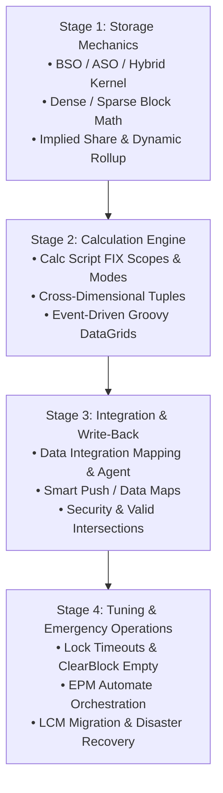

# 0.4 Technical Consultant Review Mastery Roadmap (FTE Conversion Track)

## Table of Contents
1. [Core Consultant Mental Model](#1-core-consultant-mental-model)
2. [The 4-Stage FTE Review Readiness Framework](#2-the-4-stage-fte-review-readiness-framework)
3. [Technical Competency Matrix for Freshers](#3-technical-competency-matrix-for-freshers)
4. [Mastery Checkpoints & Panel Review Drills](#4-mastery-checkpoints--panel-review-drills)
5. [Tough & Twisted Review Questions with Consultant Model Answers](#5-tough--twisted-review-questions-with-consultant-model-answers)

---

<!-- ===================================================================== -->
<!-- 🎯 LIVE INTERACTIVE VISUAL CARD: FTE REVIEW MASTERY ROADMAP -->
<!-- ===================================================================== -->

<b>🎯 Live Interactive Architecture Card: FTE Review Mastery Roadmap (Click to Collapse / Expand)</b>

 

> [!TIP]
> **Consultant High-Yield Summary:** To successfully convert from Fresher to Full-Time Employee (FTE) in an Oracle EPM practice, reviewers evaluate whether you understand **how the engine works under the hood** (storage physics, block creation, calculation execution order, and Groovy pipelines) rather than memorizing UI buttons.

| Stage | Focus Domain | Key Mechanics to Master | Panel Review Trap / Verification Test |
| :--- | :--- | :--- | :--- |
| **Stage 1: Storage Mechanics** | Essbase Kernel (BSO/ASO/Hybrid) | Dense/Sparse mathematics, Block Sizing (8 KB - 100 KB), Implied Share triggers | "Why did block count jump 10x after changing 1 property?" |
| **Stage 2: Calculation Engine** | Calc Manager & Groovy Rules | FIX scoping, Top-Down vs Bottom-Up, `@CALCMODE`, `DataGridBuilder` | "Why did a simple assignment statement calculate 0 cells?" |
| **Stage 3: Integration & Write-Back** | Smart View, Grids & Data Integration | Cell-level security vs Valid Intersections, Smart Push, Form locking | "Why can a Power User edit a cell in Smart View but not on the web form?" |
| **Stage 4: Tuning & Troubleshooting** | Production Crises & Maintenance | Lock timeouts, Block explosion deflation, LCM cloning, EPM Automate | "A batch rule hung for 3 hours locking all users. Walk me through your debug steps." |

---

## 1. Core Consultant Mental Model

Technical interviewers and review panels evaluate junior consultants on three core criteria:
1. **Physical Understanding:** Can you explain what physically happens to data files on disk when an action is executed?
2. **Root Cause Analysis:** When a user reports an error (e.g., `#Error`, form read-only, calculation timeout), do you guess randomly or systematically isolate the failure layer?
3. **Architectural Best Practices:** Do your design recommendations prevent performance bottlenecks before they hit production?

---

## 2. The 4-Stage FTE Review Readiness Framework

### Stage 1: Storage Mechanics & Outline Architecture
* **Block Size Calculation:** Master the exact formula `(Number of Dense Cells) × 8 bytes`. Keep block sizes strictly between 8 KB and 100 KB.
* **Dense vs. Sparse Setting:** Understand why changing a dimension from Sparse to Dense forces a full outline restructuring and page file rewrite.
* **Hybrid BSO Rules:** Know which calculation functions force Hybrid BSO to fall back to slow procedural mode (`@CURRMBRRANGE`, complex cross-dimensional assignments).

### Stage 2: Calculation & Business Rule Engineering
* **FIX Statement Scoping:** Understand how Essbase filters blocks. FIX statements evaluate sparse combinations; dense logic executes inside the block.
* **Calculation Modes:** Understand the difference between `SET CALCMODE BLOCK;` and `SET CALCMODE CELL;`.
* **Groovy Automation:** Why Groovy rules that target only edited cells (`operation.grid.dataCellIterator({it.edited})`) outperform legacy calc scripts by 99%.

### Stage 3: Write-Back, Data Integration & Security
* **Data Flow Mechanics:** Map data from ERP General Ledger -> Data Integration -> Planning BSO -> Smart Push -> Reporting ASO.
* **Security Precedence:** Group Security (None > Write > Read), Cell-Level Security overrides, and Valid Intersection filtering.

### Stage 4: Production Support & Performance Troubleshooting
* **Block Explosion Remediation:** Using `CLEARBLOCK EMPTY;` to purge zero-cell ghost blocks created by faulty calc formulas.
* **Lock Management:** Diagnosing block lock contention during budget submission windows.

---

## 3. Technical Competency Matrix for Freshers

| Competency Area | Beginner / Fresher Level | Consultant Conversion Level (FTE Ready) |
| :--- | :--- | :--- |
| **Essbase Architecture** | Knows BSO is for planning and ASO is for reporting. | Calculates exact block size, designs Hybrid BSO outlines, explains vector rollup execution. |
| **Business Rules** | Creates simple graphical rules in Calc Manager. | Writes optimized script rules, configures `@CALCPARALLEL`, handles dynamic member write-backs via Groovy. |
| **Security** | Assigns predefined roles in Access Control. | Resolves multi-group permission conflicts, configures Cell-Level Security with slice constraints. |
| **Integration** | Runs manual Data Management imports via web. | Configures EPM Integration Agent for on-premises SQL extraction; automates pipelines via EPM Automate. |

---

## 4. Mastery Checkpoints & Panel Review Drills

To crack your FTE review, drill the following scenarios until answers are instinctive:
1. **The Block Sizing Drill:** Given an application with 5 dense dimensions (Accounts: 200, Period: 17, View: 3, HSP_Rates: 4, Scenario: 3), calculate the block size and evaluate if it is within optimal range.
2. **The Implied Share Trap:** A parent member has only one child member. Why does Essbase mark it as an Implied Share, and what error occurs if a user attempts to write to both?
3. **The Lock Contention Scenario:** 50 users submit forecasts simultaneously at 4:30 PM. Forms freeze with timeout errors. Walk through the architectural triage steps.

---

## 5. Tough & Twisted Review Questions with Consultant Model Answers

### Question 1: "How do you determine whether an outline restructuring will be an 'Index Restructure', 'Dense Restructure', or 'Sparse Restructure'?"
**Consultant Model Answer:**
> "The type of restructure depends on which dimension properties were modified:
> 1. **Index Restructure:** Occurs when changes affect only the sparse dimension member names or hierarchies without altering dense calculations. Only the `.ind` index files are recreated; `.pag` page files remain untouched. Fast.
> 2. **Sparse Restructure:** Occurs when sparse members are deleted or moved. Essbase updates index pointers and may reorganize existing blocks on disk.
> 3. **Dense Restructure (Full Restructure):** Occurs when any Dense dimension is added, deleted, or reordered, or when dense member counts change. Because the dense dimensions define the internal matrix of every physical data block, Essbase must rewrite every single `.pag` block on disk. Slowest and requires maximum temporary disk space."

### Question 2: "What is the single most critical reason to avoid assigning formula logic to sparse dimension members in Essbase?"
**Consultant Model Answer:**
> "Assigning formulas to sparse members forces Essbase to locate and bring data blocks into the memory cache simply to evaluate whether the formula needs to run. If an upper-level sparse parent contains a formula, Essbase cannot use its fast vector consolidation and must calculate block-by-block, causing massive I/O thrashing and severe performance degradation. Best practice is to keep sparse members as standard consolidations (`+`, `~`) and place all calculation logic in Dense account formulas or procedural business rules."

---
*Proceed to [Module 1: Security and Access Control](../01_Security_and_Access/00_INDEX.md).*
