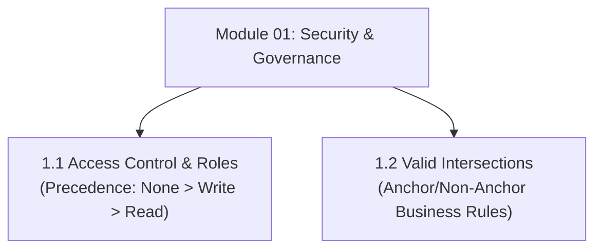

# Module 01: Security, Access Control & Valid Intersections

## Navigation & Module Overview

This module covers identity management, multi-group collision precedence, cell-level security, and dimensional validation in Oracle Enterprise Performance Management (EPM) Cloud.

---

<!-- ===================================================================== -->
<!-- 🎯 LIVE INTERACTIVE VISUAL CARD: MODULE 01 SECURITY -->
<!-- ===================================================================== -->

<b>🎯 Live Interactive Architecture Card: Security & Governance (Click to Collapse / Expand)</b>

 

> [!TIP]
> **Interactive Standalone Dashboard:** Open [`card_kb_02_security_intersections.html`](../interactive_cards/card_kb_02_security_intersections.html) in your browser for a live interactive security & valid intersections simulator!

| Document | Primary Domain | Core Focus | Direct Link |
| :--- | :--- | :--- | :--- |
| **1.1 Access Control & Roles** | Security Architecture | 4-Layer Security, Multi-Group Precedence (None > Write > Read), CLS vs Member Grants | [01_Access_Control_and_Roles.md](01_Access_Control_and_Roles.md) |
| **1.2 Valid Intersections** | Dimensional Validation | Anchor vs Non-Anchor Rules, Usability vs Security, Form Suppression | [02_Valid_Intersections.md](02_Valid_Intersections.md) |

---

## Module Documents

1. **[1.1 Oracle EPM Security, Access Control & Role Precedence](01_Access_Control_and_Roles.md)**
   * Layered security architecture: OCI IAM, Artifacts, Dimension Members, Cell-Level Security (CLS).
   * Multi-group permission collision resolution (`NONE > WRITE > READ`).
   * Diagnostic pipeline for read-only cell issues.
   * Tough & twisted review questions with consultant model answers.

2. **[1.2 Valid Intersections: Filtering Dimensional Combinations](02_Valid_Intersections.md)**
   * Architectural difference between Valid Intersections (Data Integrity) and Security (Authorization).
   * Anchor and Non-Anchor dimension design rules.
   * Performance optimization using "Suppress Invalid Combinations".
   * Tough & twisted review questions with consultant model answers.

---
*Return to [Knowledge Base Master Index](../README.md) or advance to [Module 02: Finance Concepts & UI Navigation](../02_Finance_Concepts/00_INDEX.md).*
