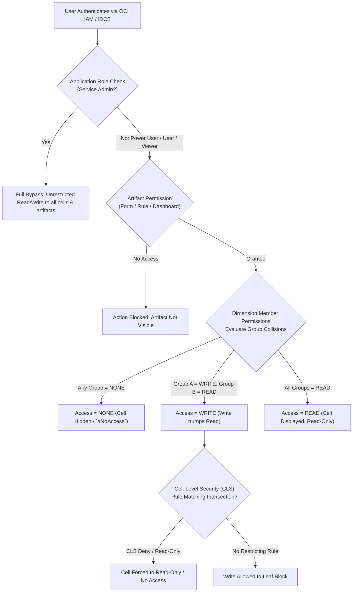

# 1.1 Oracle EPM Security, Access Control & Role Precedence

## Table of Contents
1. [Core Consultant Mental Model](#1-core-consultant-mental-model)
2. [The 4-Layer Security Architecture](#2-the-4-layer-security-architecture)
3. [Predefined Roles vs. Application Permissions](#3-predefined-roles-vs-application-permissions)
4. [Multi-Group Collision Resolution & Precedence Mechanics](#4-multi-group-collision-resolution--precedence-mechanics)
5. [Cell-Level Security (CLS) vs. Dimension Member Security](#5-cell-level-security-cls-vs-dimension-member-security)
6. [Tough & Twisted Review Questions with Consultant Model Answers](#6-tough--twisted-review-questions-with-consultant-model-answers)

---

<!-- ===================================================================== -->
<!-- 🎯 LIVE INTERACTIVE VISUAL CARD: MULTI-LAYER SECURITY & COLLISION ENGINE -->
<!-- ===================================================================== -->

<b>🎯 Live Interactive Architecture Card: Security Architecture & Collision Matrix (Click to Collapse / Expand)</b>

 

> [!TIP]
> **Interactive Standalone Dashboard:** Open [`card_kb_02_security_intersections.html`](../interactive_cards/card_kb_02_security_intersections.html) in your browser for a live interactive security & valid intersections simulator!

| Layer | Enforcement Point | Collision Resolution Rule | Key Consultant Gotcha |
| :--- | :--- | :--- | :--- |
| **1. Identity / Global Role** | OCI IAM / IDCS | Highest role wins (e.g., Power User trumps User) | Global roles do NOT bypass dimensional security except for Service Admin! |
| **2. Artifact Permission** | HSP Relational Tables | Group assignment (Read / Write) | Users cannot launch a rule or open a form without artifact permission. |
| **3. Member Security** | Essbase Security Cache | **NONE > WRITE > READ** (Least-Privilege Override) | If any group grants **NONE**, the effective permission is **NONE**. |
| **4. Cell-Level Security** | Dimension Intersections | **RESTRICTIVE OVERRIDE** (Read-Only / No Access) | Restricts cell write-back even if member permissions are WRITE. |

---

## 1. Core Consultant Mental Model

When a client or senior reviewer asks: *"Why can't User X edit cell Y on Form Z?"*, a junior consultant will randomly guess. An FTE-ready technical consultant evaluates the **5-layer gatekeeping pipeline in exact order**:

1. **Role Check:** Does the user have `User` or `Power User` role? (Viewers can never write).
2. **Artifact Check:** Does the user's group have `Write` permission on the Form?
3. **Dimensional Member Check:** Does the user have `Write` access to *every single* dimension member defining the coordinate intersection? (Account, Entity, Version, Scenario, Cost Center, etc.).
4. **Cell-Level Security (CLS):** Is there an active CLS rule restricting the specific slice?
5. **Form / Application Design Locks:** Is the cell dynamic calc? Is the version locked by Approval Unit workflow? Is the cell locked by a Valid Intersection rule?

---

## 2. The 4-Layer Security Architecture

### Layer 1: Identity & Provisioning (OCI IAM / IDCS)
* Manages user credentials, password policies, MFA, and SSO federation.
* Predefined global roles:
  * **Service Administrator:** Full administrative bypass across all security slices and metadata.
  * **Power User:** Can create personal forms/reports, manage task lists, and run calculations.
  * **User:** Can enter data, run assigned business rules, and view assigned forms.
  * **Viewer:** Strictly read-only query access; cannot submit cell edits.

### Layer 2: Artifact Access Permissions
* Controls visibility and execution rights on application artifacts:
  * **Data Forms & Folders:** Read, Write (Design), None.
  * **Business Rules:** Launch, None.
  * **Task Lists / Dashboards:** View, Manage.

### Layer 3: Dimensional Data Grants
* Assigned directly on dimension members in the Dimension Editor or Access Control:
  * **Read:** User can retrieve and view numeric data in forms, Smart View, and reports.
  * **Write:** User can input, submit, and write back data to Level 0 blocks.
  * **None:** User cannot see data; queries return `#NoAccess` or cell is suppressed.

### Layer 4: Cell-Level Security (CLS)
* Enables granular multidimensional slice restrictions without exploding member-level security.
* Can define rules such as: *Allow Write to 'Entity_US' for all accounts EXCEPT 'Executive Salary' (Account 5120), which is restricted to Read-Only.*

---

## 3. Predefined Roles vs. Application Permissions

A common interview trap is conflating **Power User** with **Service Administrator**:

| Capability | Service Administrator | Power User | Standard User |
| :--- | :---: | :---: | :---: |
| **Refresh Database (Cube Restructure)** | ✅ Yes | ❌ No | ❌ No |
| **Bypass Dimension Member Security** | ✅ Yes (Automatic) | ❌ No (Subject to grants) | ❌ No (Subject to grants) |
| **Deploy / Modify Calculation Rules** | ✅ Yes | ❌ Only rules they own | ❌ No |
| **Create Public Forms & Folders** | ✅ Yes | ✅ Yes | ❌ No |
| **Execute EPM Automate `recreate`** | ✅ Yes | ❌ No | ❌ No |

---

## 4. Multi-Group Collision Resolution & Precedence Mechanics

Enterprise users typically belong to multiple identity groups. How does Cloud EPM resolve conflicting permissions?

### The Golden Laws of Collision Resolution:
1. **User Direct vs. Group:** If a permission is assigned directly to a user, the direct assignment takes precedence over group assignments.
2. **Multi-Group Dimensional Precedence:** When a user inherits permissions through multiple groups:
   $$\text{NONE} \succ \text{WRITE} \succ \text{READ}$$
   * If **Group A** grants `WRITE` and **Group B** grants `READ`, the effective access is **WRITE**.
   * If **Group C** grants `NONE` on the same member, **NONE always wins**, immediately revoking access.
3. **Multidimensional Intersection Rule:** To write to a data cell, the user must possess `WRITE` permission on **EVERY single dimension member** in the coordinate. If even one dimension member is `READ`, the cell evaluates to `READ-ONLY`.

---

## 5. Cell-Level Security (CLS) vs. Dimension Member Security

| Feature | Dimension Member Security | Cell-Level Security (CLS) |
| :--- | :--- | :--- |
| **Scope** | Evaluates a single dimension in isolation (e.g., Entity = US) | Evaluates multidimensional tuples (e.g., Entity = US AND Account = Bonus) |
| **Storage Impact** | Replicated to Essbase security cache | Evaluated at query/write-back runtime |
| **Resolution Type** | Grants access (Read / Write) | **Restricts** access (Read-Only / No Access) |
| **Maintenance** | Requires maintaining security across multiple dimensions | Centralized rules targeting specific sensitive cross-sections |

---

## 6. Tough & Twisted Review Questions with Consultant Model Answers

### Question 1: "User Sarah belongs to Group 'Finance_Analyst' (Write on Entity 'UK') and Group 'Global_Auditors' (Read on Entity 'UK'). What is Sarah's effective access? What if she is also added to 'Contractors' with 'None' on 'UK'?"
**Consultant Model Answer:**
> "Under the two-group scenario (Finance_Analyst + Global_Auditors), Sarah's effective access on Entity 'UK' is **WRITE**. In Cloud EPM dimensional security, `WRITE` trumps `READ` across group assignments. 
> However, if she is added to 'Contractors' where 'UK' is set to `NONE`, her effective access drops immediately to **NONE**. The least-privilege security rule dictates that `NONE` strictly overrules all `WRITE` and `READ` assignments across any inherited groups."

### Question 2: "A Power User is granted 'Write' access to Account 'Revenue' and 'Write' access to Entity 'US_Sales'. However, on a web form, the Revenue cell for US_Sales appears grayed out and cannot be edited. List all possible root causes."
**Consultant Model Answer:**
> "To diagnose why a user with Write permissions on Account and Entity sees a read-only cell, I systematically check:
> 1. **Other Dimensions in the Tuple:** Check if any other dimension in the form POV/Rows/Columns has `READ` or `NONE` permission (e.g., Version = 'Final' is Read-Only, or Scenario = 'Actual' is Read-Only).
> 2. **Cell-Level Security (CLS):** Check if a CLS rule explicitly flags the specific intersection as Read-Only.
> 3. **Valid Intersection Rule:** Check if a Valid Intersection rule marks the Entity and Product/CostCenter combination as invalid/read-only.
> 4. **Member Storage Property:** Check if Account or Version is configured as `Dynamic Calc` without a Groovy write-back rule.
> 5. **Approval Unit Status:** Check if the Entity's Planning unit has been promoted/locked in the Approval Workflow.
> 6. **Form Grid Design:** Check if the form administrator checked the 'Read Only' box on that column or row."

### Question 3: "Why does assigning 'Service Administrator' to a user create a compliance and audit violation during financial forecasting?"
**Consultant Model Answer:**
> "Because the Service Administrator role **completely bypasses all dimensional member security, cell-level security, and approval unit locks**. An administrator can directly overwrite approved financial forecasts, modify locked actuals, and view sensitive executive salary data without any security restriction. In production enterprise applications, segregation of duties (SoD) requires that functional planners and analysts be provisioned as `User` or `Power User`, reserving `Service Administrator` strictly for technical platform administrators."

---
*Proceed to [1.2 Valid Intersections: Filtering Dimensional Combinations](02_Valid_Intersections.md).*
