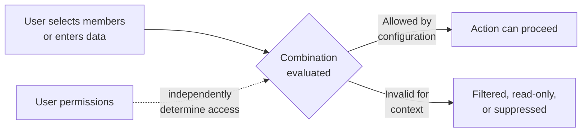

# Valid Intersections — Filtering Dimensional Combinations

> **Folder:** 01_Security_and_Access | **Audience:** Beginner → Architect
>
> **Provenance:** Merged from ChatGPT `Oracle_EPM_Valid_Intersections_Master_Guide.md`; Claude `12_Security/*.md`; Gemini `01_Security_and_Access/Oracle_EPM_Valid_Intersections_Master_Guide.md`

---

## Core Idea

A valid intersection group **filters which dimensional combinations** are offered or accepted in Planning data-entry and member-selection contexts.

**Plain language:** A planning cube may contain combinations that don't make business sense (e.g., "Marketing Expense" for a manufacturing plant). Valid intersections guide users toward allowed combinations by hiding or locking invalid ones.

> **Critical:** Valid intersections are NOT user permissions. They filter combinations, not identities. A valid intersection does not grant access. See [Creating Valid Intersections](https://docs.oracle.com/en/cloud/saas/planning-budgeting-cloud/pfusa/creating_valid_intersections.html).

---

## How It Works

---

## The Group Model

A valid intersection group contains:

| Component | What It Is |
|-----------|-----------|
| **Definition type** | Valid Intersection or Invalid Intersection |
| **Anchor dimension** | Required dimension for evaluation |
| **Nonanchor dimensions** | Optional dimensions (can be required or not-required) |
| **Rules** | Member selections defining allowed/rejected combinations |

### Anchor Dimension Behavior

- The anchor dimension is **required** for evaluation in the cube
- Unselected anchor members are **valid by default** — unless you clear "Unselected Members are Valid"
- If a required nonanchor dimension is missing from the cube, the entire group is ignored for that cube

---

## Valid vs Invalid — Which to Choose?

| Definition | Use When | Question to Answer |
|---|---|---|
| **Valid Intersection** | The rule describes combinations to ALLOW | What happens to anchor members NOT listed? |
| **Invalid Intersection** | The rule describes combinations to REJECT | Which other combinations remain valid? |

> **Recommendation:** Choose based on the actual rule and tested outcomes. Do not assume one type is always faster without evidence.

---

## How Overlaps Are Evaluated

| Scenario | Behavior |
|---|---|
| **Overlapping rules within the SAME group** | Intersection is valid if EITHER rule condition is met |
| **Rules across DIFFERENT groups** | Must satisfy ALL applicable groups |
| **Any group marks intersection invalid** | Invalid result **overrides** another group's valid result |

> This is NOT a simple "first match wins" evaluation. Test overlaps with actual members and cube dimensionality.

---

## Design and Testing Process

### Before Implementation

Create a **truth table** of expected valid/invalid cases:

| Case | Expected Result |
|------|----------------|
| Listed Entity + Listed Product | Valid / Invalid (per rule) |
| Listed Entity + Unlisted Product | ? |
| Unlisted Entity + Listed Product | ? |
| Cube missing the nonanchor dimension | ? |
| Overlapping rules with shared members | ? |

### Configuration Steps

1. Confirm the Planning service, cube, dimensions, and interface where the rule is needed
2. Translate the business rule into explicit expected valid/invalid member combinations
3. Choose the anchor dimension deliberately; document required/nonrequired dimensions and the unselected-member setting
4. Select Valid or Invalid definition type based on the actual rule
5. Add rules and member selections; review exclusions and overlaps
6. Test representative combinations in forms and runtime prompts
7. Check form behavior: invalid intersections may be read-only; suppression can hide invalid rows/columns
8. Check users with different permissions separately — the feature does not grant access
9. Record test cases, expected/actual results, cube, form, and release

---

## Troubleshooting

| Symptom | What to Inspect |
|---|---|
| Too many combinations disappear | Anchor dimension, unselected members setting, required dimensions, overlapping groups |
| Invalid cells remain visible | Form suppression/display settings; visibility does not mean the combination is valid |
| Member selector shows unexpected choices | Which dimensions are on the page/selector and whether the group applies in that cube |
| Rule behaves differently in another cube | Cube dimensionality and required/nonrequired nonanchor settings |
| User cannot enter an otherwise valid combination | Member permissions, cell-level security, workflow state, form design — separate from valid intersections |
| Existing data in newly invalid cells | Data may be stored from before the rule was created. Determine cleanup process with impact review and backup |

---

## 🧠 Self-Check Questions

1. **What does the valid intersections feature filter?**
2. **What does the anchor dimension control?**
3. **What's the difference between same-group and cross-group overlap behavior?**
4. **Does a valid intersection authorize a user? Why not?**
5. **What happens to unselected anchor members by default?**

> **Teach-back prompt:** Explain one allowed and one blocked case for a valid intersection rule. Then explain how you would distinguish a valid-intersection issue from a permission issue in troubleshooting.

---

## Oracle Sources

- [Creating Valid Intersections](https://docs.oracle.com/en/cloud/saas/planning-budgeting-cloud/pfusa/creating_valid_intersections.html)
- [Valid Intersection Rules](https://docs.oracle.com/en/cloud/saas/planning-budgeting-cloud/pfusa/valid_intersection_rules.html)
- [Valid Intersection Examples](https://docs.oracle.com/en/cloud/saas/planning-budgeting-cloud/pfusa/valid_intersection_examples.html)
- [Dimension Design Considerations](https://docs.oracle.com/en/cloud/saas/planning-budgeting-cloud/pfusa/dimension_design_considerations.html)

