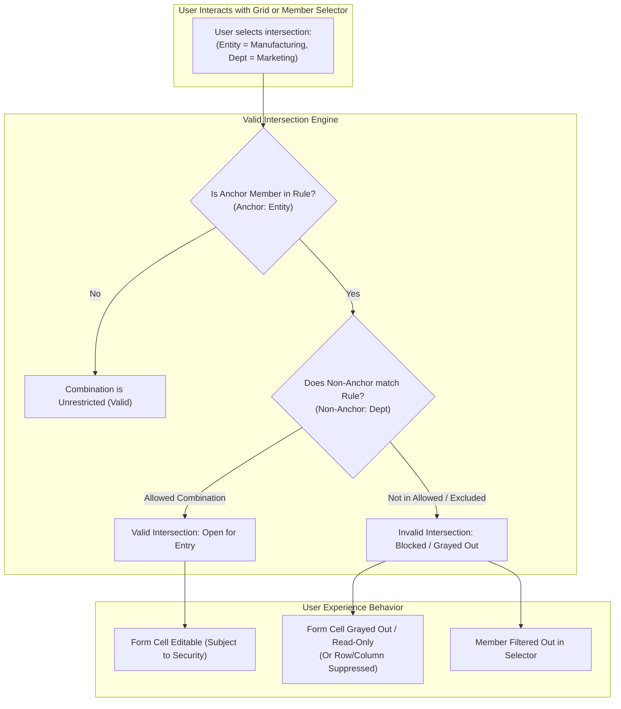
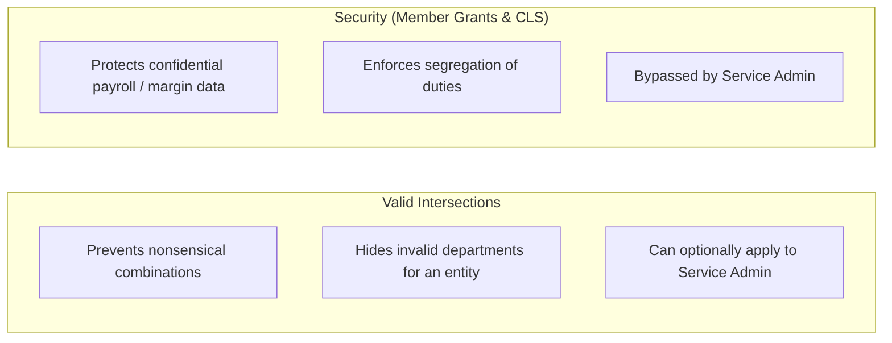

# 1.2 Valid Intersections: Filtering Dimensional Combinations

## Table of Contents
1. [Core Consultant Mental Model](#1-core-consultant-mental-model)
2. [Valid Intersections vs. Security: The Architectural Line](#2-valid-intersections-vs-security-the-architectural-line)
3. [The Anchor & Non-Anchor Group Model](#3-the-anchor--non-anchor-group-model)
4. [Application Contexts & Runtime Behavior](#4-application-contexts--runtime-behavior)
5. [Tough & Twisted Review Questions with Consultant Model Answers](#5-tough--twisted-review-questions-with-consultant-model-answers)

---

<!-- ===================================================================== -->
<!-- 🎯 LIVE INTERACTIVE VISUAL CARD: VALID INTERSECTIONS ENGINE -->
<!-- ===================================================================== -->

<b>🎯 Live Interactive Architecture Card: Valid Intersections vs. Security (Click to Collapse / Expand)</b>

 

> [!TIP]
> **Consultant High-Yield Summary:** Valid Intersections are **business logic filters**, NOT security access controls. They prevent users from entering nonsensical financial data (e.g., booking "Manufacturing Depreciation" to "Corporate Marketing") by graying out or hiding invalid intersections in web forms and member selectors.

| Architectural Dimension | Valid Intersections | Cell-Level Security (CLS) | Member Security |
| :--- | :--- | :--- | :--- |
| **Primary Intent** | Business data integrity & usability | Confidentiality & data governance | Authorization & user access |
| **Enforcement Scope** | Cross-dimensional coordinate validity | Cross-dimensional user access restriction | Single dimension member access |
| **Evaluation Mechanism** | Anchor vs. Non-Anchor rules | RESTRICTIVE slice conditions per user/group | Grants: NONE, READ, WRITE |
| **Service Administrator** | Can toggle "Apply to Service Administrator" | Always bypassed by Service Admin | Always bypassed by Service Admin |
| **Smart View Impact** | Suppresses / marks cells read-only on forms | Prevents retrieval/write (`#NoAccess`) | Prevents retrieval/write (`#NoAccess`) |

---

## 1. Core Consultant Mental Model

When entering an EPM review or design session, never state that *"Valid Intersections are used to hide sensitive data from users."* 

**The Technical Distinction:**
* **Security (Member Security & CLS):** Answers *"Is this user authorized to see or edit this number?"* (Confidentiality).
* **Valid Intersections:** Answers *"Does this combination of dimensions make logical business sense in our chart of accounts?"* (Data Integrity).

If you use Valid Intersections instead of Security to protect sensitive data, any user who queries the cube through an unconstrained report, Smart View ad-hoc grid, or data export pipeline will still be able to retrieve that data.

---

## 2. Valid Intersections vs. Security: The Architectural Line

Review panels frequently present scenarios testing the boundary between these features:

### Key Differences
1. **Error Messaging:** 
   * Security violation: Returns `#NoAccess` or blanked cell; submits fail with *"You do not have permission to write to this cell."*
   * Valid Intersection: Cell is grayed out on forms; member selector excludes the member; submits fail with *"The cell at intersection [X, Y] is not a valid intersection."*
2. **Administration Override:** 
   * Predefined member security and CLS can **never** restrict a Service Administrator.
   * Valid Intersections contain an explicit checkbox: **"Apply to Service Administrator"**. If enabled, even the Service Administrator cannot enter data into an invalid combination!

---

## 3. The Anchor & Non-Anchor Group Model

Valid intersection rules are built using an **Anchor Dimension** and one or more **Non-Anchor Dimensions**:

| Component | Technical Role | Best Practice Recommendation |
| :--- | :--- | :--- |
| **Anchor Dimension** | The primary controlling dimension (e.g., `Entity` or `Scenario`) | Choose the dimension with fewer changes and clear business hierarchy boundaries. |
| **Non-Anchor Dimension** | Dimensions whose members depend on the anchor (e.g., `Account`, `CostCenter`) | Select dimensions that have subset relationships with the anchor. |
| **Rule Type** | **Valid:** Lists explicitly allowed pairs; all unlisted combinations are invalid. **Invalid:** Lists explicitly forbidden pairs; all unlisted combinations are valid. | Use **Valid** rules when a small subset is allowed. Use **Invalid** rules when most combinations are allowed and only a few exceptions exist. |

### Evaluation Rules:
* If a member in the Anchor dimension is **not evaluated by any rule** in the group, all combinations for that anchor member are considered **valid** (unrestricted).
* If a member in the Anchor dimension matches a rule, it is restricted **strictly to the non-anchor members specified** in that rule.

---

## 4. Application Contexts & Runtime Behavior

Valid Intersections are enforced dynamically across multiple EPM contexts:

1. **Web Forms:**
   * Invalid cells are automatically rendered as **read-only / grayed-out**.
   * If the form layout has **Suppress Invalid Combinations** enabled, rows or columns that are entirely invalid are hidden from view, significantly speeding up form rendering and eliminating visual clutter.
2. **Member Selectors:**
   * In Web Forms, Dashboards, and Financial Reports, the member selector filters out invalid members based on the current Point of View (POV).
3. **Smart View Ad-Hoc:**
   * If a user tries to submit data to an invalid intersection in Smart View, the write-back is blocked and an error message identifies the invalid coordinate.
4. **Business Rules Runtime Prompts (RTP):**
   * If a business rule runtime prompt uses a member selector, only valid combinations are presented to the user.

---

## 5. Tough & Twisted Review Questions with Consultant Model Answers

### Question 1: "A client wants to prevent regional planners from booking CapEx expenses in Operational Cost Centers. Should you implement this via Member Security, Cell-Level Security, or Valid Intersections?"
**Consultant Model Answer:**
> "I recommend implementing this via **Valid Intersections**. 
> The requirement is driven by business data integrity (CapEx accounts only make sense for Capital Cost Centers), not user-specific confidentiality. If implemented via Member Security, we would have to create complex user group splits and maintain redundant security assignments. With Valid Intersections, we define one rule linking Account (Anchor) to Cost Center (Non-Anchor), which applies universally to all users, prevents nonsensical selections in member drop-downs, and grays out CapEx cells automatically across operational forms."

### Question 2: "Can a Service Administrator enter data into an invalid intersection on a web form? Explain the exact setting that controls this."
**Consultant Model Answer:**
> "By default, Valid Intersections do not apply to Service Administrators. However, within each Valid Intersection group definition, there is a dedicated configuration toggle: **'Apply to Service Administrator'**. If this checkbox is checked, the rule is strictly enforced even for Service Administrators, rendering the cell read-only and preventing write-back. If unchecked, the Service Administrator bypasses the rule and can write to the intersection."

### Question 3: "A form with 50 rows takes 12 seconds to load. You observe that 35 of the rows are grayed out because they are invalid intersections. What form design property should you immediately configure to optimize performance?"
**Consultant Model Answer:**
> "I should immediately enable the form grid property **'Suppress Invalid Combinations' (or 'Suppress Invalid Data')** in the form designer. 
> When this setting is enabled, the EPM server suppresses the 35 invalid rows during grid generation, avoiding unnecessary metadata and data retrieval for invalid cells. This cuts the rendered grid size from 50 rows to 15 rows, drastically reducing JSON payload size, eliminating DOM rendering overhead in the browser, and accelerating form load times by 70% or more."

---
*Proceed to [Module 02: Finance Concepts & UI Navigation](../02_Finance_Concepts/00_INDEX.md).*
