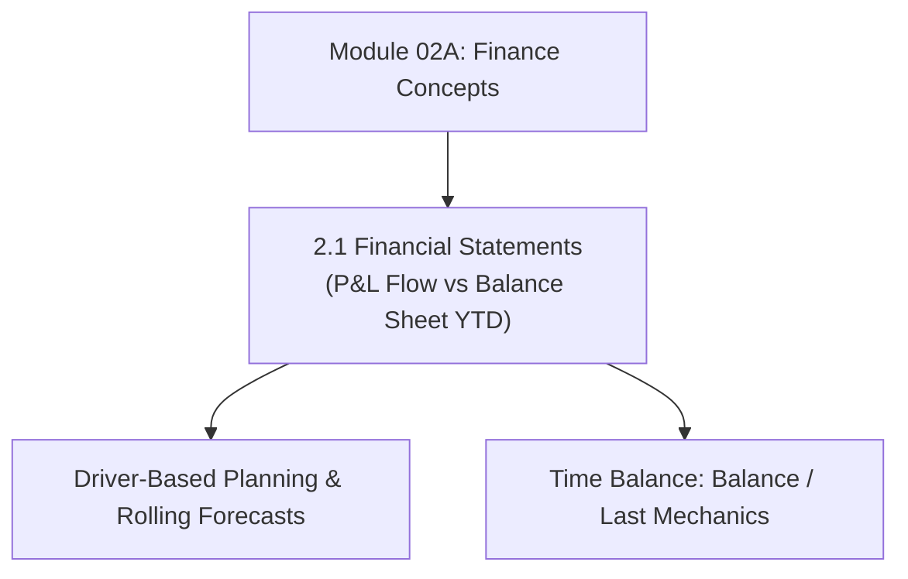

# Module 02A: Finance Concepts & Driver-Based Planning

## Navigation & Module Overview

This module covers core accounting principles, financial statements (Income Statement, Balance Sheet, Cash Flow), Time Balance properties, and driver-based planning in Oracle EPM Cloud.

---

<!-- ===================================================================== -->
<!-- 🎯 LIVE INTERACTIVE VISUAL CARD: MODULE 02A FINANCE CONCEPTS -->
<!-- ===================================================================== -->

<b>🎯 Live Interactive Architecture Card: Financial Concepts & Statements (Click to Collapse / Expand)</b>

 

> [!TIP]
> **Consultant High-Yield Summary:** Master the connection between Account Types (`Revenue`, `Expense`, `Asset`, `Liability`, `Equity`) and Essbase member properties (`Time Balance`, `Variance Reporting`).

| Document | Primary Domain | Core Focus | Direct Link |
| :--- | :--- | :--- | :--- |
| **2.1 Financial Statements** | Integrated Financial Modeling | P&L, Balance Sheet, Cash Flow, Time Balance (Flow vs Balance), Variance Reporting | [01_Financial_Concepts.md](01_Financial_Concepts.md) |

---

## Module Documents

1. **[2.1 Financial Statements, Driver-Based Planning & Modeling Mechanics](01_Financial_Concepts.md)**
   * Income Statement (P&L), Balance Sheet, and Cash Flow Statement integration.
   * Time Balance properties (`Flow` vs `Balance: Last`).
   * Variance Reporting (`Expense` vs `Non-Expense`).
   * Driver-based planning (Revenue ASP, Compensation headcount, CapEx depreciation).
   * Tough & twisted review questions with consultant model answers.

---
*Return to [Knowledge Base Master Index](../README.md) or advance to [Module 02B: User Interface and Navigation](../02_User_Interface_and_Navigation/00_INDEX.md).*
