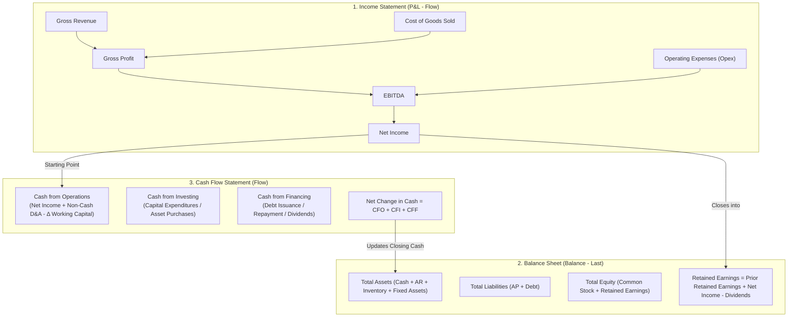
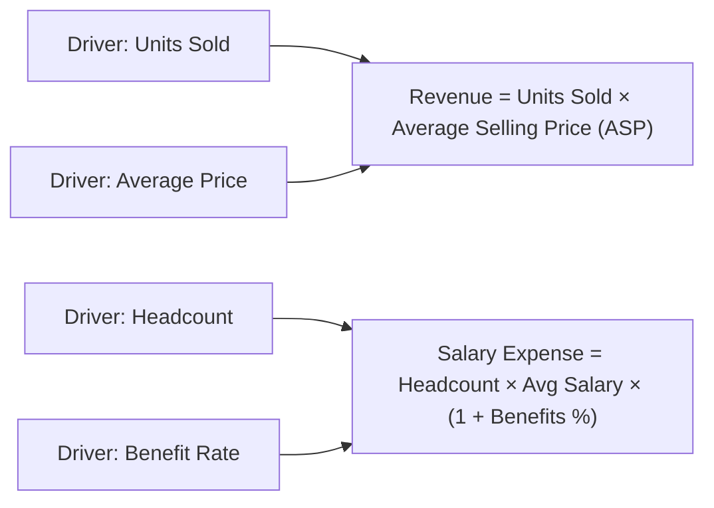

# 2.1 Financial Statements, Driver-Based Planning & Modeling Mechanics

## Table of Contents
1. [Core Consultant Mental Model](#1-core-consultant-mental-model)
2. [The Three Financial Statements & Integrated Financial Modeling](#2-the-three-financial-statements--integrated-financial-modeling)
3. [Driver-Based Planning & Rolling Forecast Architecture](#3-driver-based-planning--rolling-forecast-architecture)
4. [Balance Sheet & Cash Flow Integration Mechanics](#4-balance-sheet--cash-flow-integration-mechanics)
5. [Tough & Twisted Review Questions with Consultant Model Answers](#5-tough--twisted-review-questions-with-consultant-model-answers)

---

<!-- ===================================================================== -->
<!-- 🎯 LIVE INTERACTIVE VISUAL CARD: INTEGRATED FINANCIAL STATEMENTS -->
<!-- ===================================================================== -->

<b>🎯 Live Interactive Architecture Card: Integrated Financial Statements & Drivers (Click to Collapse / Expand)</b>

 

> [!TIP]
> **Consultant High-Yield Summary:** An EPM technical consultant must understand how the three financial statements interconnect in Essbase cubes: **Net Income** from the Income Statement rolls into **Retained Earnings** on the Balance Sheet; **Non-Cash Depreciation** and **Working Capital deltas** drive the **Cash Flow Statement**.

| Financial Statement | Key Account Types | Time Balance Behavior | Essbase Aggregation / Storage |
| :--- | :--- | :--- | :--- |
| **Income Statement (P&L)** | Revenue, Expense, COGS, Tax | `Flow` (Sum across periods) | Consolidated via standard addition/subtraction |
| **Balance Sheet** | Asset, Liability, Equity | `Balance` (`Last` or `Average`) | Year-to-Date (YTD) cumulative balance; not summed |
| **Cash Flow Statement** | Operating, Investing, Financing | `Flow` (Net cash movement) | Calculated dynamically from P&L net income & BS deltas |

---

## 1. Core Consultant Mental Model

Technical consultants frequently fail client interviews because they treat EPM accounts as arbitrary text strings. In Oracle Cloud EPM:
* **Account Type Matters Mechanically:** If you configure an Asset account as `Expense`, Essbase consolidates it correctly in addition, but financial variance reporting will calculate upside-down.
* **Variance Reporting Property:**
  * For **Expense accounts:** Variance = Budget - Actual (favorable when actual spending is less than budget).
  * For **Revenue accounts:** Variance = Actual - Budget (favorable when actual revenue exceeds budget).
* **Time Balance Property:**
  * P&L accounts use `Time Balance: None / Flow` (Q1 = Jan + Feb + Mar).
  * Balance Sheet accounts use `Time Balance: Balance` with `Skip: None` and `First / Last` (Ending Cash for Q1 is March ending cash, NOT the sum of Jan + Feb + Mar!).

---

## 2. The Three Financial Statements & Integrated Financial Modeling

### 1. Income Statement (Profit & Loss)
Measures economic performance over a specified time horizon:
$$\text{Gross Profit} = \text{Revenue} - \text{COGS}$$
$$\text{EBITDA} = \text{Gross Profit} - \text{Operating Expenses (Opex)}$$
$$\text{Operating Income (EBIT)} = \text{EBITDA} - \text{Depreciation \& Amortization}$$
$$\text{Net Income} = \text{EBIT} - \text{Interest Expense} - \text{Income Taxes}$$

### 2. Balance Sheet
A snapshot of financial position at a single point in time, governed by the fundamental accounting equation:
$$\text{Assets} = \text{Liabilities} + \text{Shareholders' Equity}$$

### 3. Cash Flow Statement (Indirect Method)
Derives net cash generated during the period:
* **Operating Cash Flow (CFO):** Net Income + Depreciation (non-cash add-back) - $\Delta$ Accounts Receivable - $\Delta$ Inventory + $\Delta$ Accounts Payable.
* **Investing Cash Flow (CFI):** - Capital Expenditures (CapEx purchases).
* **Financing Cash Flow (CFF):** New Debt - Debt Repayments - Dividends Paid.

---

## 3. Driver-Based Planning & Rolling Forecast Architecture

### Why Driver-Based Planning?
Enterprise planners do not forecast line-item dollar amounts directly. They forecast **operational business drivers**, and Calculation Manager / Groovy rules compute the financial impact:

### Rolling Forecast Architecture
* **Traditional Budgeting:** Fixed 12-month fiscal year view (Jan to Dec). Once June arrives, the company only forecasts 6 months into the future.
* **Rolling Forecast:** Continuously projects 4 to 8 quarters (12 to 24 months) ahead, regardless of fiscal year boundaries. When Q1 Actuals close, Q1 drops from input and a new future quarter (e.g., Q1 of next fiscal year) is opened for forecasting.
* **Essbase Implication:** The `Scenario` dimension is paired with dynamic `Version` and `Period` substitution variables (e.g., `&CurPeriod`, `&CurYear`) to determine whether a cell is editable (Forecast months) or read-only (Actuals months).

---

## 4. Balance Sheet & Cash Flow Integration Mechanics

In an integrated planning model (e.g., EPBCS Financials), modules share data via automated **Data Maps** or **Smart Push**:

1. **Capital Expenditure (Capex) Integration:**
   * User adds a new manufacturing machine in the Capital module (\$100,000 cost, 5-year straight-line depreciation).
   * Capital module calculates monthly depreciation (\$1,666.67/month) and asset net book value.
   * Smart Push pushes \$1,666.67 to the Financials cube under P&L `Depreciation Expense`, while pushing \$100,000 to Balance Sheet `Fixed Assets`.
2. **Working Capital Drivers:**
   * **Days Sales Outstanding (DSO):** Calculates Accounts Receivable from Revenue:
     $$\text{Accounts Receivable} = \frac{\text{Revenue}}{365} \times \text{DSO}$$
   * **Days Payable Outstanding (DPO):** Calculates Accounts Payable from Cost of Goods Sold:
     $$\text{Accounts Payable} = \frac{\text{COGS}}{365} \times \text{DPO}$$

---

## 5. Tough & Twisted Review Questions with Consultant Model Answers

### Question 1: "Why does summing monthly Balance Sheet accounts across quarters result in financial catastrophe, and which Essbase member property prevents this?"
**Consultant Model Answer:**
> "Balance Sheet accounts represent point-in-time cumulative balances, not cumulative flows. For example, if a company has \$10M in its bank account at the end of January, \$12M in February, and \$11M in March, its Q1 ending cash balance is \$11M (March end), NOT \$33M (the sum of the three months). 
> In Essbase, this is controlled by the **Time Balance** property on the Account dimension. Balance Sheet accounts must be set to `Time Balance: Balance` with `Time Balance Skip: None` (or `Skip: Missing`) and `First / Last: Last`. This instructs Essbase to populate upper-level time periods (Q1, FY24) with the value of the last open child period rather than adding them together."

### Question 2: "In a P&L planning form, why is Net Income modeled as a Dynamic Calc member rather than a stored member?"
**Consultant Model Answer:**
> "Net Income is a calculated summary node representing Gross Profit minus Operating Expenses, Depreciation, Interest, and Taxes. If Net Income were configured as 'Stored', every time a planner updated an operational expense cell, Net Income would become stale and display incorrect figures until a batch calculation rule was executed. 
> By setting Net Income to **Dynamic Calc (`~`)**, Essbase computes the formula in memory on the fly whenever the cell is retrieved, ensuring that users in Web Forms and Smart View instantly see their updated bottom line upon saving."

### Question 3: "A client reports that when Actual revenue is \$120M and Budget was \$100M, Smart View shows a negative variance (-\$20M). What is the root cause?"
**Consultant Model Answer:**
> "The root cause is an incorrect **Variance Reporting** property on the Account dimension member. In Essbase, Account members have a `Variance Reporting` attribute configured as either `Non-Expense` or `Expense`. 
> * For `Non-Expense` (Revenue) accounts: Variance = Actual - Budget (\$120M - \$100M = +\$20M, favorable).
> * For `Expense` accounts: Variance = Budget - Actual.
> If the Revenue account was accidentally configured with the `Expense` property, Essbase evaluated Budget - Actual (\$100M - \$120M = -\$20M), displaying a negative variance for higher revenue. Changing the member property to `Non-Expense` and refreshing the database resolves the issue."

---
*Proceed to [2.2 Forms, Navigation Flows & User Interface Architecture](../02_User_Interface_and_Navigation/01_Forms_and_Navigation.md).*
