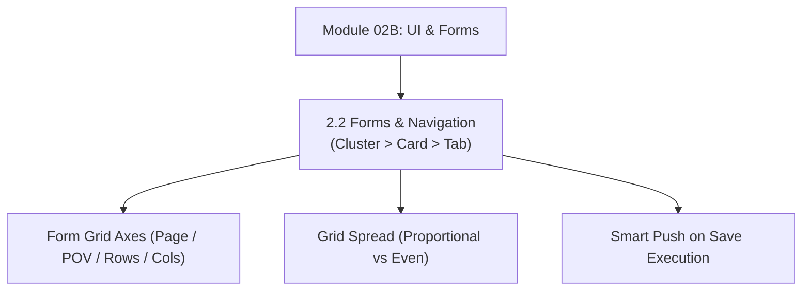

# Module 02B: User Interface, Forms & Navigation Architecture

## Navigation & Module Overview

This module covers the Redwood user interface, role-based navigation flows, data form layout mechanics, grid spread, data validation rules, and on-save integration.

---

<!-- ===================================================================== -->
<!-- 🎯 LIVE INTERACTIVE VISUAL CARD: MODULE 02B UI & FORMS -->
<!-- ===================================================================== -->

<b>🎯 Live Interactive Architecture Card: Forms & Redwood Navigation (Click to Collapse / Expand)</b>

 

> [!TIP]
> **Consultant High-Yield Summary:** Master form layout optimization (Page/POV vs Row/Column Cartesian products), Grid Spread allocation mechanics, and Smart Push on Save.

| Document | Primary Domain | Core Focus | Direct Link |
| :--- | :--- | :--- | :--- |
| **2.2 Forms & Navigation** | User Interface & Forms | Redwood Navigation Flows, Form Layout Grid Axes, Grid Spread, Smart Push on Save | [01_Forms_and_Navigation.md](01_Forms_and_Navigation.md) |

---

## Module Documents

1. **[2.2 Forms, Navigation Flows & User Interface Architecture](01_Forms_and_Navigation.md)**
   * Redwood Navigation Flow hierarchy: Clusters, Cards, Vertical Tabs, Horizontal Tabs.
   * Form layout architecture: Page, POV, Row, and Column Cartesian product optimization.
   * Grid Spread mechanics (Proportional, Even, Locked cell exclusion).
   * Data validation rules and conditional cell formatting.
   * Smart Push on Save and right-click Action Menus.
   * Tough & twisted review questions with consultant model answers.

---
*Return to [Knowledge Base Master Index](../README.md) or advance to [Module 03A: Groovy Scripting](../03_Groovy_Scripting/00_INDEX.md).*
