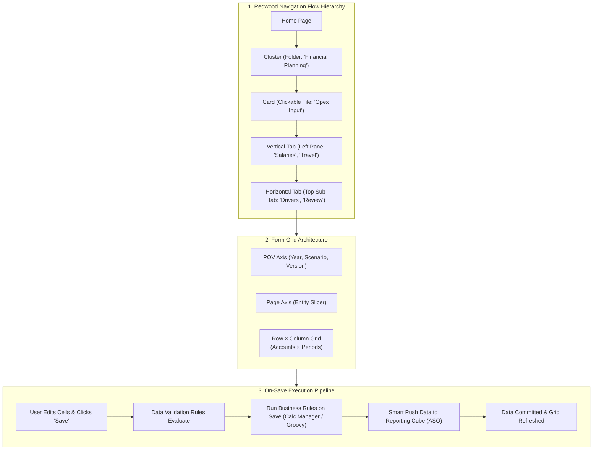
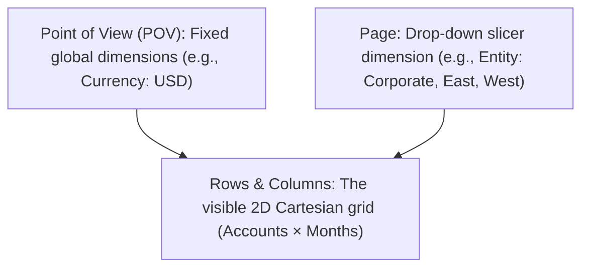

# 2.2 Forms, Navigation Flows & User Interface Architecture

## Table of Contents
1. [Core Consultant Mental Model](#1-core-consultant-mental-model)
2. [Redwood UI & Navigation Flow Hierarchy](#2-redwood-ui--navigation-flow-hierarchy)
3. [Data Form Architecture & Grid Layout Principles](#3-data-form-architecture--grid-layout-principles)
4. [Grid Spread Physics & Data Validation Rules](#4-grid-spread-physics--data-validation-rules)
5. [Smart Push on Save & Action Menus Integration](#5-smart-push-on-save--action-menus-integration)
6. [Tough & Twisted Review Questions with Consultant Model Answers](#6-tough--twisted-review-questions-with-consultant-model-answers)

---

<!-- ===================================================================== -->
<!-- 🎯 LIVE INTERACTIVE VISUAL CARD: FORMS & NAVIGATION ARCHITECTURE -->
<!-- ===================================================================== -->

<b>🎯 Live Interactive Architecture Card: Redwood Navigation & Web Form Layout (Click to Collapse / Expand)</b>

 

> [!TIP]
> **Consultant High-Yield Summary:** A high-performing EPM application balances user experience and query latency. Designing forms with 50,000 cells or unnecessary dynamic calc columns degrades performance. Best practice: keep active web forms under **500 rows and 30 columns**, enable **Suppress Missing / Invalid Data**, and trigger **Smart Push on Save**.

| UI Component | Structural Role | Performance & Configuration Impact |
| :--- | :--- | :--- |
| **Navigation Flow** | Role-based portal experience | Clusters, Cards, and Tabs mapped to specific user groups |
| **Page / POV Axis** | Global slicers outside the grid | Reduces rendered Cartesian product; users select 1 coordinate at a time |
| **Row / Column Axis** | Two-dimensional visible grid | Cartesian product of row members × column members determines block fetch volume |
| **Grid Spread** | Top-down parent/summary input | Allocates entered parent amounts down to Level 0 descendants proportionally or evenly |
| **Smart Push on Save** | Real-time BSO to ASO push | Synchronizes edited leaf cells into reporting cubes upon clicking "Save" |

---

## 1. Core Consultant Mental Model

When a user complains that *"The application is slow and forms freeze when saving"*, freshers often assume Essbase is broken. In 90% of cases, the bottleneck is **poor form design**:
1. **Unbounded Cartesian Product:** Placing 4 sparse dimensions on rows without member restrictions forces the web application server to fetch thousands of empty blocks.
2. **Missing Suppression:** Failing to enable `Suppress Missing Data` forces the browser DOM to render 10,000 blank cells.
3. **Heavy Save Operations:** Attaching a monolithic calculation script (e.g., `CALC ALL;`) to "Run on Save" causes 30-second delays every time a user saves a single cell.

---

## 2. Redwood UI & Navigation Flow Hierarchy

Oracle Cloud EPM uses the **Redwood Design System**, governed by role-based **Navigation Flows**:

* **Cluster:** High-level grouping of related business processes (e.g., *Financials*, *Workforce*, *System Administration*).
* **Card:** Clickable tile inside a cluster representing a specific functional task (e.g., *Expense Planning*, *Revenue Modeling*).
* **Vertical Tab:** Left-hand navigation panel within a card separating major phases (e.g., *Inputs*, *Calculations*, *Reports*).
* **Horizontal Tab:** Top-level secondary tabs within a vertical tab (e.g., *Base Salary*, *Overtime*, *Taxes*).

### Role-Based Navigation Best Practice:
* **Planner Navigation Flow:** Tailored exclusively for business users. Strips away all administrative menus, showing only their specific task cards.
* **Reviewer / Executive Flow:** Displays executive Dashboards 2.0, Infolets, and Financial Reports; hides input forms.
* **Default Admin Flow:** Reserved for Service Administrators for system maintenance.

---

## 3. Data Form Architecture & Grid Layout Principles

Every EPM data form organizes dimensions into three distinct structural axes:

### Grid Layout Rules:
1. **Dense Dimensions on Columns/Rows:** Dense dimensions (e.g., `Period`, `Account`) are ideal for columns and rows because all dense cells reside inside the same memory block.
2. **Sparse Dimensions on Page/POV:** Placing large sparse dimensions (e.g., `Entity`, `Cost Center`, `Product`) on Page or POV ensures that opening the form only queries blocks for that single coordinate rather than attempting to retrieve the entire multidimensional database.
3. **Suppression Settings:**
   * **Suppress Missing Data:** Hides rows or columns where every cell is `#Missing`.
   * **Suppress Invalid Combinations:** Hides rows or columns filtered out by Valid Intersection rules.

---

## 4. Grid Spread Physics & Data Validation Rules

### Grid Spread
When a user types a summary amount into an upper-level parent member on a form (e.g., changing Q1 Total Expense from \$30,000 to \$60,000), Cloud EPM executes **Grid Spread**:
* **Proportional Spread (Default):** Distributes the \$30,000 increase proportionally across Jan, Feb, and Mar based on their existing ratio.
* **Even Spread:** Divides the amount equally (\$20,000 each) across the open leaf periods.
* **Locked Cell Spread:** If a user locks February (e.g., holding \$10,000), the spread distributes the remaining balance strictly across January and March.

### Data Validation Rules
Administrators can configure conditional validation rules that trigger visual formatting:
* If `Operating Margin % < 10%`, format the cell background as **Red** and display a tooltip warning.
* Validation rules can prevent form saving if critical business constraints are violated (e.g., *Total Allocation % must equal 100%*).

---

## 5. Smart Push on Save & Action Menus Integration

### Smart Push on Save
In a modern hybrid planning architecture, users input data into a BSO/Hybrid cube, but reporting and dashboards query an ASO cube.
* Attaching **Smart Push** to the form with the **"Run on Save"** option automatically pushes only the edited cell intersections from BSO to ASO the instant the user hits "Save".
* Planners get sub-second write-back, and executive dashboards update instantaneously.

### Action Menus
Right-click context menus configured on forms allow users to:
1. Launch specific business rules passing the clicked cell's POV as Runtime Prompts.
2. Drill through to source ERP general ledger journal lines.
3. Open a secondary form filtered to the current entity/account context.

---

## 6. Tough & Twisted Review Questions with Consultant Model Answers

### Question 1: "A user enters \$120,000 at the 'Q1' parent period cell on a web form and clicks Save. The cell reverts back to its original value of \$90,000. Why did Grid Spread fail to update the child periods?"
**Consultant Model Answer:**
> "Grid Spread fails and reverts the parent value under three primary conditions:
> 1. **All Children are Missing / Zero with Proportional Spread:** If January, February, and March cells are all `#Missing` or `0`, a proportional spread has no existing baseline ratio to allocate against. Without a ratio, the calculation cannot divide by zero and reverts. The user must manually input into at least one child cell or select 'Spread Evenly'.
> 2. **Child Periods are Locked or Read-Only:** If the child periods are closed for input (e.g., January Actuals is Read-Only due to Scenario/Version security or Approval Unit status), the system cannot write back to closed periods.
> 3. **The Parent Period is Stored instead of Dynamic Calc:** If Q1 is configured as a Stored member in a Classic BSO cube, direct write-back to a stored parent without a spreading rule is blocked."

### Question 2: "What is the physical architectural difference between placing a dimension on the 'Page' axis versus the 'Point of View (POV)' axis of a form?"
**Consultant Model Answer:**
> "Architecturally:
> * **Page Axis:** When a dimension is placed on Page, the web server retrieves the list of page members into memory and allows the user to quickly cycle through them via a drop-down menu on the web form. In Smart View, page members appear as a drop-down selector above row 1.
> * **POV Axis:** Dimensions on the POV act as global context anchors for the entire grid. While users can select members via the POV bar, POV members do not generate individual page cache segments in the web form. Placing high-cardinality dimensions on POV rather than Page reduces the initial form initialization footprint."

### Question 3: "A form that queries a Hybrid BSO cube takes 25 seconds to open. The administrator has 15 sparse dimensions on the form rows. What architectural change will reduce load time to under 2 seconds?"
**Consultant Model Answer:**
> "Placing 15 sparse dimensions on rows creates an explosive Cartesian product, forcing the WebLogic server to evaluate millions of potential cell combinations against Essbase index files. To optimize:
> 1. Move static or context dimensions (e.g., Scenario, Version, Currency, Year, and high-level Entity nodes) to the **POV or Page axis**.
> 2. Limit the visible row axis to 1 or 2 core operational dimensions (e.g., `Account` and `CostCenter`).
> 3. Enable **'Suppress Missing Data'** and **'Suppress Invalid Combinations'** on the form layout.
> 4. Restrict member selections from `@DESCENDANTS` to `@RELATIVE` or specific user-entry Level 0 members.
> This slashes the query footprint, reducing the rendered grid from tens of thousands of coordinate checks to a compact, sub-second block lookup."

---
*Proceed to [Module 03: Groovy Scripting & Business Rules](../03_Groovy_Scripting/00_INDEX.md).*
