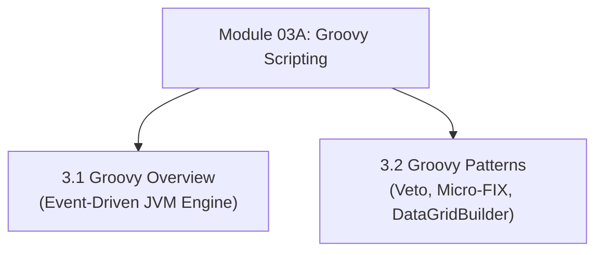

# Module 03A: Groovy Scripting Architecture & Patterns

## Navigation & Module Overview

This module covers the modern Java-based Groovy scripting engine in Oracle Cloud EPM, event-driven execution, dynamic Micro-FIX calculations, pre-save validation vetoes, and high-speed write-back pipelines.

---

<!-- ===================================================================== -->
<!-- 🎯 LIVE INTERACTIVE VISUAL CARD: MODULE 03A GROOVY -->
<!-- ===================================================================== -->

<b>🎯 Live Interactive Architecture Card: Groovy Scripting Suite (Click to Collapse / Expand)</b>

 

> [!TIP]
> **Interactive Standalone Dashboard:** Open [`card_kb_03_groovy_rule_builder.html`](../interactive_cards/card_kb_03_groovy_rule_builder.html) in your browser for a live interactive Groovy rule builder & performance visualizer!

| Document | Primary Domain | Core Focus | Direct Link |
| :--- | :--- | :--- | :--- |
| **3.1 Groovy Overview** | Architecture & APIs | Groovy vs Calc Scripts, EPM Java API Contexts, Micro-FIX Concept | [01_Groovy_Overview.md](01_Groovy_Overview.md) |
| **3.2 Groovy Patterns** | Production Implementation | 5 Key Patterns: Micro-FIX, Veto, DataGridBuilder, Dynamic Smart Push, REST Calls | [02_Groovy_Patterns.md](02_Groovy_Patterns.md) |

---

## Module Documents

1. **[3.1 Groovy Scripting Architecture: Fundamentals & Micro-FIX Engine](01_Groovy_Overview.md)**
   * Monolithic Calc Scripts vs. Event-Driven Groovy Rules.
   * Core API objects: `operation`, `operation.grid`, `operation.cube`, `DataGridBuilder`.
   * Dynamic Micro-FIX calculation scoping (98% performance speedup).
   * Tough & twisted review questions with consultant model answers.

2. **[3.2 Production Groovy Patterns: Veto, DataGridBuilder & Smart Push](02_Groovy_Patterns.md)**
   * Pattern 1: Dynamic Micro-FIX on edited cells (`dataCellIterator`).
   * Pattern 2: Pre-save data validation and user alert popup via `throwVetoException()`.
   * Pattern 3: High-speed write-back via `DataGridBuilder`.
   * Pattern 4: Targeted Smart Push slice override.
   * Pattern 5: Cross-pod REST API invocation.
   * Tough & twisted review questions with consultant model answers.

---
*Return to [Knowledge Base Master Index](../README.md) or advance to [Module 03B: Workflow and Task Management](../03_Workflow_and_Task_Management/00_INDEX.md).*
