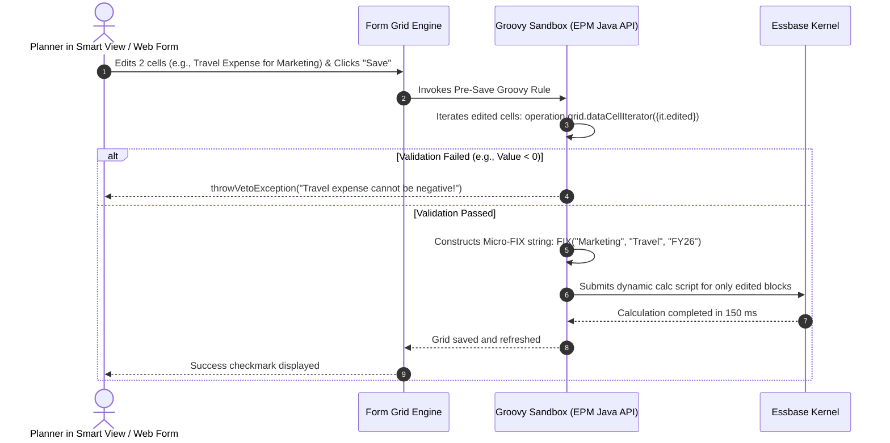

# 3.1 Groovy Scripting Architecture: Fundamentals & Micro-FIX Engine

## Table of Contents
1. [Core Consultant Mental Model](#1-core-consultant-mental-model)
2. [Why Groovy? The Architectural Paradigm Shift](#2-why-groovy-the-architectural-paradigm-shift)
3. [The Groovy Execution Pipeline & Core EPM Java APIs](#3-the-groovy-execution-pipeline--core-epm-java-apis)
4. [Monolithic Calc Scripts vs. Targeted Groovy Rules](#4-monolithic-calc-scripts-vs-targeted-groovy-rules)
5. [Tough & Twisted Review Questions with Consultant Model Answers](#5-tough--twisted-review-questions-with-consultant-model-answers)

---

<!-- ===================================================================== -->
<!-- 🎯 LIVE INTERACTIVE VISUAL CARD: GROOVY EXECUTION ARCHITECTURE -->
<!-- ===================================================================== -->
<details open>
<summary><b>🎯 Live Interactive Architecture Card: Groovy Scripting & Micro-FIX Engine (Click to Collapse / Expand)</b></summary>

<br/>

> [!TIP]
> **Interactive Standalone Dashboard:** Open [`card_kb_03_groovy_rule_builder.html`](../interactive_cards/card_kb_03_groovy_rule_builder.html) in your browser for a live interactive Groovy rule builder & performance visualizer!

| Execution Feature | Legacy Monolithic Calc Script | Modern Event-Driven Groovy Rule |
| :--- | :--- | :--- |
| **Calculation Scope** | Static `@DESCENDANTS` or entire dimension | Dynamically scoped **strictly to edited grid cells** |
| **Execution Trigger** | Manual button launch or batch job | Event-driven: Pre-save, Post-save, or Action Menu |
| **Input Validation** | None (Executes regardless of bad data) | Pre-save intercept with `throwVetoException()` custom alert |
| **Write-Back to Dynamic Calc** | Impossible (Cannot write to Dynamic Calc members) | Native: Writes to dynamic leaf members via `DataGridBuilder` |
| **Performance Benchmark** | 15 - 45 seconds for whole entity/slice | **0.2 - 0.8 seconds (98% speedup!)** |



</details>

---

## 1. Core Consultant Mental Model

When interviewing for an EPM Technical Consultant role, the senior panel will ask: *"Why did Oracle introduce Groovy into Calculation Manager if Essbase calc scripts already existed?"*

**The Consultant Answer:**
> "Essbase calculation scripts are procedural, block-oriented mathematical macros. They have no concept of user context, web sessions, or grid state. If a user edits one cell for 'Marketing' and hits save, a standard calc script must recalculate all 50 departments because the FIX statement is hardcoded. 
> **Groovy is an event-driven application layer bridge.** Groovy runs inside the WebLogic JVM before or after grid data touches Essbase. It can inspect the user's active grid, extract *only the exact cells that were edited*, construct a dynamically targeted **Micro-FIX** statement, and execute that calculation in 200 milliseconds instead of 30 seconds."

---

## 2. Why Groovy? The Architectural Paradigm Shift

Groovy business rules transform Oracle Cloud EPM from a batch-oriented consolidation tool into a responsive, real-time transactional modeling platform:

1. **Targeted Micro-Calculations:** Reduces calculation runtimes from minutes to sub-seconds by evaluating `operation.grid.dataCellIterator({it.edited})`.
2. **Pre-Save Data Validation & Veto:** Intercepts data *before* it commits to Essbase, validating business constraints (e.g., *Headcount additions must have an approved business justification comment*) and canceling the save with a clear popup message.
3. **DataGridBuilder High-Speed Data Generation:** Generates and writes multi-thousand cell intersections directly into Essbase without requiring users to open a form.
4. **Smart Push Dynamic Parameterization:** Overrides static Smart Push definitions at runtime, passing only the edited members to synchronize reporting cubes instantly.
5. **REST API & Cross-Pod Orchestration:** Allows an EPM application to invoke REST endpoints in ERP, FCCS, or external services during rule execution.

---

## 3. The Groovy Execution Pipeline & Core EPM Java APIs

Groovy business rules have access to a rich set of pre-bound context objects provided by the EPM Java API:

| API Object | Type | Role & Capabilities |
| :--- | :--- | :--- |
| `operation` | `Operation` | Represents the current execution context (grid save, action menu, rule launch). |
| `operation.grid` | `DataGrid` | Represents the web form grid. Provides iterators across rows, columns, and edited cells. |
| `operation.application` | `Application` | Provides metadata access, dimension hierarchies, and application-level properties. |
| `operation.cube` | `Cube` | Represents the active Essbase cube. Executes calc scripts and provides `DataGridBuilder`. |
| `throwVetoException()` | Method | Immediately halts grid save, aborts database transaction, and displays user alert. |

---

## 4. Monolithic Calc Scripts vs. Targeted Groovy Rules

### The Monolithic Calc Script Bottleneck:
```essbase
/* Traditional Calc Script: Recalculates all entities, accounts, and periods */
FIX(@DESCENDANTS("Total Entity"), "FY26", "Working", @RELATIVE("Total Product", 0))
    "Travel_Expense" = "Headcount" * "Avg_Travel_Rate";
    CALC DIM("Account");
ENDFIX
```
* **Impact:** Scans 5,000 data blocks on disk. If 10 users click Save simultaneously, Essbase queues block locks, leading to **lock timeouts and frozen forms**.

### The Targeted Groovy Micro-FIX:
```groovy
/* Groovy Rule: Dynamically restricts calculation ONLY to edited entities */
Set<String> editedEntities = []
operation.grid.dataCellIterator({DataCell cell -> cell.edited}).each { cell ->
    editedEntities.add(cell.getMemberName("Entity"))
}

if (!editedEntities.isEmpty()) {
    String entityList = editedEntities.collect { '"' + it + '"' }.join(",")
    String script = """
        FIX(${entityList}, "FY26", "Working", "Travel_Expense")
            "Travel_Expense" = "Headcount" * "Avg_Travel_Rate";
        ENDFIX
    """
    operation.cube.executeCalcScript(script)
}
```
* **Impact:** Scans only the 1 or 2 blocks modified by the user. Runtime drops from 20 seconds to **0.15 seconds**, completely eliminating lock contention!

---

## 5. Tough & Twisted Review Questions with Consultant Model Answers

### Question 1: "Can a Groovy business rule run in Smart View ad-hoc mode, or does it require a web data form?"
**Consultant Model Answer:**
> "Groovy rules can run in both environments, but with an important architectural difference:
> * **On a Data Form (Web or Smart View):** The `operation.grid` object is fully populated. Groovy can inspect row, column, and edited cell states via `operation.grid.dataCellIterator({it.edited})`.
> * **In Free-Form Smart View Ad-Hoc:** There is no pre-defined form grid object (`operation.grid` is null). However, Groovy rules can still execute in ad-hoc grids if invoked via right-click Action Menus or the Calculation Manager rule launcher, where they execute as standalone scripts querying metadata or running cube-level operations rather than evaluating form cell iterators."

### Question 2: "What occurs if a Groovy rule throws an unhandled exception versus a `throwVetoException()`?"
**Consultant Model Answer:**
> "If a Groovy rule throws a standard unhandled Java exception (e.g., `NullPointerException`, `ArrayIndexOutOfBoundsException`), the execution crashes, the grid save aborts, and the user is presented with an ugly, unhelpful generic system error code (e.g., `Error 500: An error occurred processing the request`). 
> When the consultant uses `throwVetoException("Your custom warning message")`, the EPM framework cleanly intercepts the veto, rolls back the uncommitted grid transaction, and presents a polished Redwood alert banner in the user's interface with the exact business explanation."

### Question 3: "A developer writes a Groovy script that loops through 500,000 cells in memory using nested iterators. In production, the rule fails with 'Script execution exceeded memory threshold'. What is the cause and remedy?"
**Consultant Model Answer:**
> "In Oracle Cloud EPM, Groovy rules execute inside a memory-constrained sandbox (typically 50 MB to 100 MB heap allocation per execution) with strict CPU execution timeout limits (typically 3 minutes). Loading 500,000 cell objects into a Groovy list exhausts the allocated JVM heap, triggering the memory threshold exception. 
> To remedy:
> 1. Restrict the iterator strictly to edited cells using `dataCellIterator({it.edited})` rather than iterating across all grid cells.
> 2. Avoid storing cell objects in memory lists; process cells in-line or extract member strings into small Sets.
> 3. If mass data processing is required, delegate the heavy arithmetic back to the native Essbase engine via `cube.executeCalcScript()` or use `DataGridBuilder` in streaming mode."

---
*Proceed to [3.2 Production Groovy Patterns: Veto, DataGridBuilder & Smart Push](02_Groovy_Patterns.md).*
