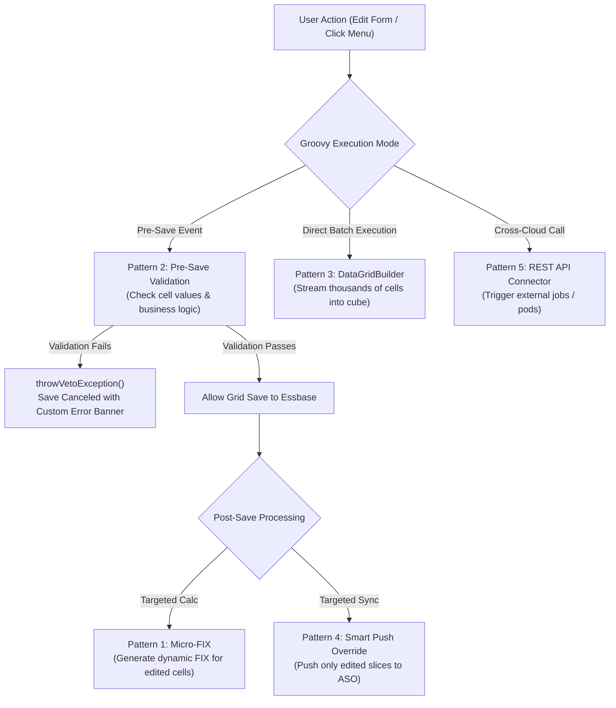

# 3.2 Production Groovy Patterns: Veto, DataGridBuilder & Smart Push

## Table of Contents
1. [Core Consultant Mental Model](#1-core-consultant-mental-model)
2. [Pattern 1: Dynamic Micro-FIX Calculation on Edited Cells](#2-pattern-1-dynamic-micro-fix-calculation-on-edited-cells)
3. [Pattern 2: Pre-Save Business Rule Data Validation & Veto](#3-pattern-2-pre-save-business-rule-data-validation--veto)
4. [Pattern 3: High-Speed Write-Back via DataGridBuilder](#4-pattern-3-high-speed-write-back-via-datagridbuilder)
5. [Pattern 4: Dynamic Smart Push Parameterization](#5-pattern-4-dynamic-smart-push-parameterization)
6. [Pattern 5: Cross-Environment REST API Invocation](#6-pattern-5-cross-environment-rest-api-invocation)
7. [Tough & Twisted Review Questions with Consultant Model Answers](#7-tough--twisted-review-questions-with-consultant-model-answers)

---

<!-- ===================================================================== -->
<!-- 🎯 LIVE INTERACTIVE VISUAL CARD: PRODUCTION GROOVY PATTERNS -->
<!-- ===================================================================== -->
<details open>
<summary><b>🎯 Live Interactive Architecture Card: Production Groovy Patterns Matrix (Click to Collapse / Expand)</b></summary>

<br/>

> [!TIP]
> **Consultant High-Yield Summary:** Master these 5 production Groovy patterns. In FTE conversion reviews, you will often be asked to write or debug a pre-save validation rule or explain how `DataGridBuilder` writes to cells without triggering form save cycles.

| Pattern Name | Execution Context | Core Method / Class Used | Architectural Benefit |
| :--- | :--- | :--- | :--- |
| **1. Dynamic Micro-FIX** | Run on Save (Post-Save) | `operation.grid.dataCellIterator({it.edited})` | Recalculates only modified blocks; sub-second response |
| **2. Pre-Save Veto** | Run on Save (Pre-Save) | `throwVetoException("Message")` | Blocks invalid submissions before database commit |
| **3. DataGridBuilder** | Standalone / Action Menu | `cube.dataGridBuilder("GridName")` | High-speed multi-cell creation without opening forms |
| **4. Dynamic Smart Push** | Post-Save Grid Event | `smartPush.execute(Map<String, String>)` | Syncs only modified slices from BSO to ASO |
| **5. REST API Client** | Background Automation | `HttpResponse response = operation.application.getConnection("Conn").post()` | Orchestrates cross-pod data flows and jobs |



</details>

---

## 1. Core Consultant Mental Model

When writing Groovy in Oracle Cloud EPM, remember:
* **Pre-Save Rules (`Before Save`):** The data has been typed into the browser, but **has NOT been written to Essbase yet**. The cells in the grid carry an `edited` flag. If you throw a veto exception here, zero database transactions take place.
* **Post-Save Rules (`After Save`):** The grid data has already been committed to Essbase. This is where you trigger targeted **Micro-FIX calculations** and **Smart Push** synchronization.

---

## 2. Pattern 1: Dynamic Micro-FIX Calculation on Edited Cells

```groovy
/* Pattern 1: Extracts edited entities and accounts to build an ultra-fast FIX statement */
def editedEntities = [] as Set
def editedAccounts = [] as Set

// Iterate strictly over edited cells in the active form grid
operation.grid.dataCellIterator({DataCell cell -> cell.edited}).each { cell ->
    editedEntities.add(cell.getMemberName("Entity"))
    editedAccounts.add(cell.getMemberName("Account"))
}

// If no cells were edited, exit immediately without executing Essbase scripts
if (editedEntities.isEmpty()) {
    println("No cells edited. Skipping calculation.")
    return
}

// Format comma-delimited strings wrapped in quotes
String entityScope = editedEntities.collect { '"' + it + '"' }.join(",")
String accountScope = editedAccounts.collect { '"' + it + '"' }.join(",")

// Execute dynamic Micro-FIX in Essbase
String calcScript = """
    SET UPDATECALC OFF;
    FIX(${entityScope}, ${accountScope}, "FY26", "Working")
        "Operating_Expense" = "Expense_Driver" * "Expense_Rate";
    ENDFIX
"""
operation.cube.executeCalcScript(calcScript)
```

---

## 3. Pattern 2: Pre-Save Business Rule Data Validation & Veto

```groovy
/* Pattern 2: Validates business rules and halts execution if constraints are broken */
def validationErrors = []

operation.grid.dataCellIterator().each { DataCell cell ->
    String account = cell.getMemberName("Account")
    String entity = cell.getMemberName("Entity")
    
    // Constraint 1: Headcount additions cannot be negative
    if (account == "New_Headcount" && cell.data < 0) {
        validationErrors.add("Entity [${entity}]: New Headcount cannot be negative (${cell.data}).")
    }
    
    // Constraint 2: Travel expense exceeding $50,000 requires justification in cell comment
    if (account == "Travel_Expense" && cell.data > 50000 && !cell.hasCellNote()) {
        validationErrors.add("Entity [${entity}]: Travel expense over $50k requires a cell note.")
    }
}

// If errors exist, cancel save and show formatted error banner
if (!validationErrors.isEmpty()) {
    String combinedMessage = validationErrors.join("\n")
    throwVetoException(combinedMessage)
}
```

---

## 4. Pattern 3: High-Speed Write-Back via DataGridBuilder

```groovy
/* Pattern 3: Writes multiple data intersections directly to Essbase using DataGridBuilder */
Cube cube = operation.application.getCube("Plan1")
DataGridBuilder builder = cube.dataGridBuilder("Grid1")

// Define grid dimensions (Slicers, Rows, Columns)
builder.addPov("FY26", "Working", "USD", "Final")
builder.addColumn("Jan", "Feb", "Mar")

// Add rows with coordinate members and data cell values
builder.addRow(["E01_US", "Acc_Salary"], [15000, 15000, 15000])
builder.addRow(["E01_US", "Acc_Bonus"],  [2500,  2500,  5000])
builder.addRow(["E02_UK", "Acc_Salary"], [12000, 12000, 12000])

// Build and save data grid directly to Essbase
DataGridBuilder.Status status = new DataGridBuilder.Status()
DataGrid grid = builder.build(status)
operation.application.saveData(grid)

println("Successfully saved ${status.cellsSaved} cells with 0 errors.")
```

---

## 5. Pattern 4: Dynamic Smart Push Parameterization

```groovy
/* Pattern 4: Dynamically overrides Smart Push slice to push only edited intersections */
def editedEntities = [] as Set

operation.grid.dataCellIterator({DataCell cell -> cell.edited}).each { cell ->
    editedEntities.add(cell.getMemberName("Entity"))
}

if (!editedEntities.isEmpty()) {
    // Obtain Smart Push mapping from form
    SmartPush smartPush = operation.grid.getSmartPush("Push_To_Reporting")
    
    // Override the Entity dimension slice dynamically
    Map<String, String> overrides = [
        "Entity": editedEntities.collect { '"' + it + '"' }.join(",")
    ]
    
    // Execute targeted Smart Push
    smartPush.execute(overrides)
    println("Targeted Smart Push executed for: ${overrides['Entity']}")
}
```

---

## 6. Pattern 5: Cross-Environment REST API Invocation

```groovy
/* Pattern 5: Calls external EPM / ERP REST endpoint using named connection */
Connection connection = operation.application.getConnection("FCCS_Prod_Connection")

// Construct payload to launch a consolidation job in FCCS
String payload = """{
    "jobType": "Consolidate",
    "jobName": "Consol_Europe",
    "parameters": {
        "scenario": "Actual",
        "year": "FY26",
        "period": "Jan",
        "entity": "FCCS_Europe"
    }
}"""

// Submit POST request to EPM REST endpoint
HttpResponse<String> response = connection.post("/HyperionPlanning/rest/v3/applications/FCCS/jobs")
                                          .body(payload)
                                          .asString()

if (response.status == 200 || response.status == 201) {
    println("Consolidation job successfully launched in FCCS.")
} else {
    throwVetoException("Failed to launch FCCS consolidation: ${response.body}")
}
```

---

## 7. Tough & Twisted Review Questions with Consultant Model Answers

### Question 1: "Why does `operation.grid.dataCellIterator()` without a closure cause performance issues, and what is the optimal filtering syntax?"
**Consultant Model Answer:**
> "`operation.grid.dataCellIterator()` without a filtering predicate instantiates a heavy Java `DataCell` object in memory for **every single cell on the web form** (e.g., 500 rows × 12 columns = 6,000 cells). If only 2 cells were edited, creating 6,000 Java objects wastes JVM memory and CPU cycles. 
> The optimal syntax is passing a filtering closure directly into the iterator:
> `operation.grid.dataCellIterator({DataCell cell -> cell.edited})`
> This causes the underlying Java engine to evaluate cell state before object instantiation, returning an iterator containing strictly the 2 modified cells."

### Question 2: "What is the difference between `cube.executeCalcScript(script)` and `operation.application.saveData(grid)` inside Groovy?"
**Consultant Model Answer:**
> "* `cube.executeCalcScript(script)` sends a procedural calc script string directly to the **Essbase calculation engine**. It computes numbers using Essbase block algebra, evaluates `@` functions, and updates blocks on disk.
> * `operation.application.saveData(grid)` uses the **Planning Web Application Server pipeline**. It writes cells via `DataGridBuilder`, which performs form validation rules, evaluates cell-level security, creates audit logs, and triggers Smart Push mappings.
> For pure numerical calculation speed, `executeCalcScript` is faster; for audited, validated write-backs that respect Planning security, `saveData` is required."

### Question 3: "A consultant writes a Groovy script to push data to an ASO reporting cube. Why is dynamic Smart Push override superior to running a full Data Map?"
**Consultant Model Answer:**
> "A full Data Map extracts and pushes the entire pre-configured dimensional slice (e.g., all 50 entities, all 12 periods, all accounts) from BSO to ASO. This creates unnecessary slice fragmentation in ASO, takes 10 to 30 seconds to run, and consumes significant network bandwidth. 
> Dynamic Smart Push override in Groovy evaluates `cell.edited`, overrides the Entity and Account dimensions with strictly the 1 or 2 members changed by the user, and pushes an ultra-compact coordinate slice in under 200 milliseconds."

---
*Proceed to [Module 03B: Workflow and Task Management](../03_Workflow_and_Task_Management/00_INDEX.md).*
