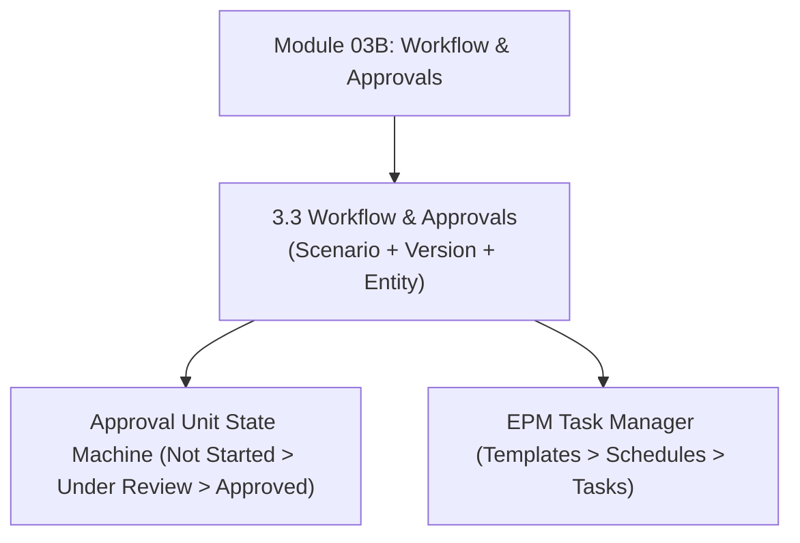

# Module 03B: Workflow, Approvals & Task Management

## Navigation & Module Overview

This module covers the Approval Unit Hierarchy (AUH), promotional state machines, workflow security locks, and EPM Task Manager orchestration.

---

<!-- ===================================================================== -->
<!-- 🎯 LIVE INTERACTIVE VISUAL CARD: MODULE 03B WORKFLOW -->
<!-- ===================================================================== -->

<b>🎯 Live Interactive Architecture Card: Approval Workflows & Task Management (Click to Collapse / Expand)</b>

 

> [!TIP]
> **Consultant High-Yield Summary:** Master Approval Units (Scenario + Version + Entity), promotion lock dynamics, and the operational differences between Classic Task Lists and EPM Task Manager.

| Document | Primary Domain | Core Focus | Direct Link |
| :--- | :--- | :--- | :--- |
| **3.3 Workflow & Approvals** | Approval Units & Task Management | AUH State Machine, Promotional Locking, Classic Task Lists vs EPM Task Manager | [01_Workflow_and_Approvals.md](01_Workflow_and_Approvals.md) |

---

## Module Documents

1. **[3.3 Workflow Architecture: Approval Units, Promotion Paths & Task Manager](01_Workflow_and_Approvals.md)**
   * Approval Unit Hierarchy (AUH) design and promotional paths.
   * State machine dynamics and cell-level write locks upon promotion.
   * Classic Task Lists vs. Modern EPM Task Manager.
   * Irreversible conversion caution and migration steps.
   * Tough & twisted review questions with consultant model answers.

---
*Return to [Knowledge Base Master Index](../README.md) or advance to [Module 04A: REST API](../04_REST_API/00_INDEX.md).*
