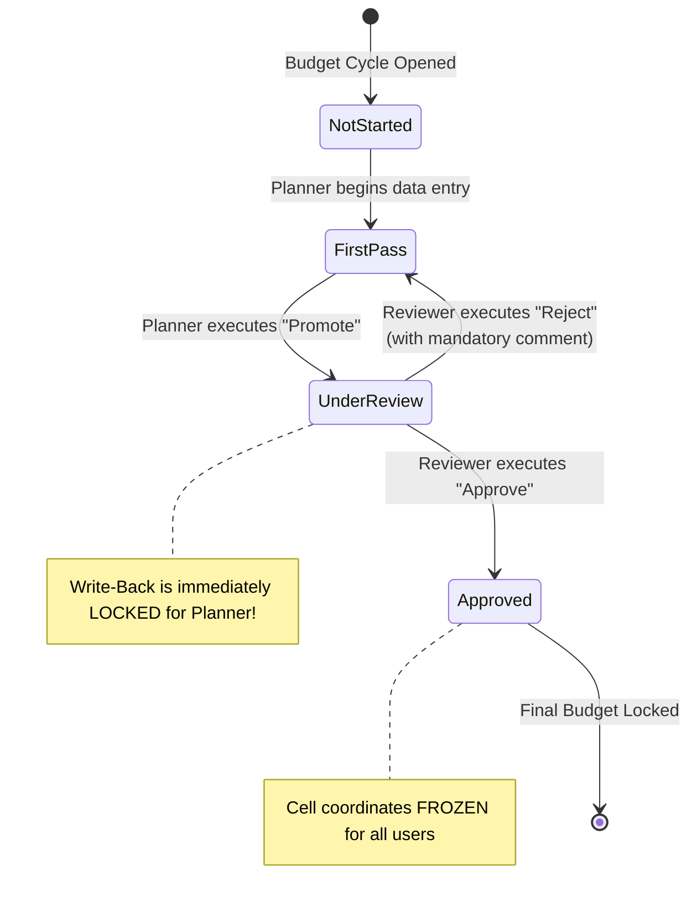

# 3.3 Workflow Architecture: Approval Units, Promotion Paths & Task Manager

## Table of Contents
1. [Core Consultant Mental Model](#1-core-consultant-mental-model)
2. [Approval Unit Hierarchy (AUH) Architecture](#2-approval-unit-hierarchy-auh-architecture)
3. [Promotional State Machine & Security Lock Dynamics](#3-promotional-state-machine--security-lock-dynamics)
4. [Classic Task Lists vs. EPM Task Manager](#4-classic-task-lists-vs-epm-task-manager)
5. [Tough & Twisted Review Questions with Consultant Model Answers](#5-tough--twisted-review-questions-with-consultant-model-answers)

---

<!-- ===================================================================== -->
<!-- 🎯 LIVE INTERACTIVE VISUAL CARD: APPROVAL WORKFLOW STATE MACHINE -->
<!-- ===================================================================== -->

<b>🎯 Live Interactive Architecture Card: Approval Units & Promotion State Machine (Click to Collapse / Expand)</b>

 

> [!TIP]
> **Consultant High-Yield Summary:** An **Approval Unit** is a unique multidimensional combination of **Scenario, Version, and Entity**. When an owner promotes an approval unit, the underlying cell intersections become **read-only** for that owner, preventing unapproved edits while the budget is under managerial review.

| State Machine Phase | Current Owner | Actions Allowed | Data Write-Back Status |
| :--- | :--- | :--- | :--- |
| **1. Not Started** | Initial Owner (Planner) | Start, Edit, Submit | Editable by Owner (if security allows) |
| **2. First Pass** | Planner / Analyst | Edit cells, Run rules, Promote | Full Write-Back permitted |
| **3. Under Review** | Reviewer / Finance Manager | Approve, Reject (with reason), Promote | **Locked for Planner**; Editable by Reviewer |
| **4. Approved / Freeze** | Service Administrator / CFO | Lock, Unlock, Reopen | **Fully Locked** across all standard users |

---

## 1. Core Consultant Mental Model

When an enterprise budget cycle begins, organizations cannot allow hundreds of planners to modify numbers concurrently without governance. 

**The Technical Definition:**
> The **Approval Workflow** is an asynchronous state machine that coordinates budget submission, managerial validation, and audit sign-off. It binds together **Scenario, Version, and Entity** dimensions into an **Approval Unit**.

The most critical technical takeaway:
* **Promoting an approval unit dynamically modifies cell-level write permissions.**
* When an entity is promoted from Planner to Manager, the EPM server automatically locks data entry on forms for that planner, even though their native group security on Entity and Account is still `WRITE`.

---

## 2. Approval Unit Hierarchy (AUH) Architecture

An **Approval Unit Hierarchy (AUH)** defines who reviews what, and in what sequence:

| Component | Technical Role | Best Practice Rule |
| :--- | :--- | :--- |
| **Scenario & Version** | The operational scope of the workflow | Typically applied to `Budget` and `Forecast` with `Bottom-Up` versions. |
| **Entity Dimension** | Defines the hierarchical review tree | Entities roll up along standard statutory or operational reporting lines. |
| **Owner** | The individual or group responsible for data entry | Planners responsible for drafting initial operational budgets. |
| **Reviewer** | The individual or group authorized to approve/reject | Department managers, regional controllers, corporate FP&A. |
| **Promotional Path** | Order of operations in the hierarchy | Bottom-up: Leaf entities must be approved before parent entities can be signed off. |

---

## 3. Promotional State Machine & Security Lock Dynamics

1. **Bottom-Up Version Rules:**
   * In a `Bottom-Up` version, each entity has its own approval state. Child entities can be promoted independently to their parent's reviewer.
2. **Target Version Rules:**
   * In a `Target` version, top-down allocation targets are established by corporate executives and pushed down without individual child sign-off.
3. **Rejection & Audit Log:**
   * When a reviewer clicks **Reject**, the system requires a mandatory explanation comment. The approval state rolls back down the tree to the planner, restoring their `WRITE` access.
   * Every promote, approve, and reject action is logged in the Planning audit repository with precise timestamps and user IDs.

---

## 4. Classic Task Lists vs. EPM Task Manager

Oracle Cloud EPM provides two distinct mechanisms for operational guidance:

| Architectural Feature | Classic Task Lists | Modern EPM Task Manager |
| :--- | :--- | :--- |
| **Nature** | Simple static checklist | Enterprise-grade orchestration engine |
| **Dependencies & Predecessors**| None (tasks cannot enforce prerequisite steps) | Native Gantt-style predecessor/successor dependencies |
| **Automated Actions** | Manual clicks only | Automated execution: triggers EPM Automate jobs, Data Integrations |
| **Monitoring & Dashboards** | No operational dashboards | Real-time status dashboards, late alerts, aging reports |
| **Architectural Caution** | Deprecated in new implementations | **Enabling Task Manager permanently disables Classic Task Lists!** |

> [!CAUTION]
> Switching an application from Classic Task Lists to Task Manager is **strictly irreversible**. An administrator must back up the entire application via LCM snapshot before enabling Task Manager.

---

## 5. Tough & Twisted Review Questions with Consultant Model Answers

### Question 1: "A planner reports that yesterday they were able to enter travel expenses for Entity 'US_Sales', but today the cells are read-only. Group security grants them Write access to all dimensions. What happened?"
**Consultant Model Answer:**
> "The most probable root cause is that the **Approval Unit** for Entity 'US_Sales' (in the active Scenario and Version) was **promoted to the next review level** (or marked as Approved). 
> When an approval unit transitions from 'First Pass' to 'Under Review', the Planning workflow engine dynamically overrides dimensional write grants, locking the cells as read-only for the original owner until the reviewer either rejects the unit back down or the administrator reopens it."

### Question 2: "Can an administrator configure an approval workflow on a dynamic parent entity before all of its leaf child entities are submitted?"
**Consultant Model Answer:**
> "In a standard **Bottom-Up Approval Unit Hierarchy**, no. A parent entity represents the consolidated sum of its leaf children. Cloud EPM enforces structural promotional integrity: a parent entity cannot be promoted or approved until **all child entities in its branch have been promoted** by their respective owners. Attempting to approve the parent beforehand triggers an error: *'Cannot promote parent approval unit: One or more descendants are still in First Pass state.'*"

### Question 3: "A project manager asks to migrate 20 existing Classic Task Lists into EPM Task Manager. How do you execute this migration?"
**Consultant Model Answer:**
> "Classic Task Lists **cannot be automatically converted or migrated** into EPM Task Manager. The two engines have completely different underlying relational schemas. To transition:
> 1. Export an LCM backup of the application.
> 2. Document the task definitions, instructions, and target artifacts from the existing task lists.
> 3. Delete all Classic Task Lists and tasks from the application.
> 4. Enable Task Manager in application settings (noting that this is an irreversible setting).
> 5. Recreate the workflow inside Task Manager using Templates, Task Types, and Schedules, adding dependencies and automated alerts."

---
*Proceed to [Module 04: REST API & System Administration](../04_REST_API/00_INDEX.md).*
