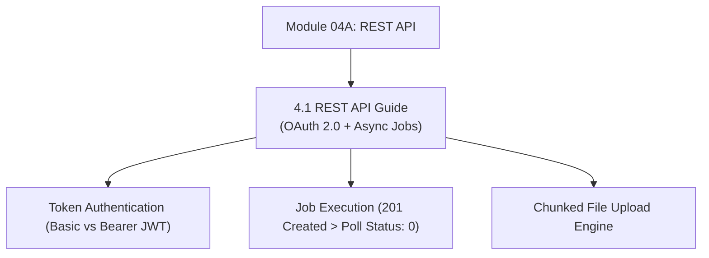

# Module 04A: REST API Architecture & Programmatic Integration

## Navigation & Module Overview

This module covers programmatic automation, OAuth 2.0 authentication, asynchronous job execution pipelines, and chunked file transfer in Oracle Cloud EPM.

---

<!-- ===================================================================== -->
<!-- 🎯 LIVE INTERACTIVE VISUAL CARD: MODULE 04A REST API -->
<!-- ===================================================================== -->

<b>🎯 Live Interactive Architecture Card: REST API Engine (Click to Collapse / Expand)</b>

 

> [!TIP]
> **Consultant High-Yield Summary:** Master asynchronous job polling (`jobStatus: -1` -> `0`), OAuth 2.0 authentication, and the core job payload structures.

| Document | Primary Domain | Core Focus | Direct Link |
| :--- | :--- | :--- | :--- |
| **4.1 REST API Guide** | Programmatic Automation | OAuth 2.0 / Bearer Tokens, Asynchronous Polling, Core Job Endpoints | [01_REST_API_Guide.md](01_REST_API_Guide.md) |

---

## Module Documents

1. **[4.1 Oracle EPM Cloud REST API: Architecture, Authentication & Job Execution](01_REST_API_Guide.md)**
   * Basic Authentication vs. OAuth 2.0 Client Credentials.
   * Asynchronous Job Execution pattern and polling codes (`-1`, `0`, `2`).
   * Core REST endpoints for rules, data import, cube refresh, and metadata.
   * Chunked upload mechanics for large files (> 50 MB).
   * Tough & twisted review questions with consultant model answers.

---
*Return to [Knowledge Base Master Index](../README.md) or advance to [Module 04B: System Administration](../04_System_Administration/00_INDEX.md).*
