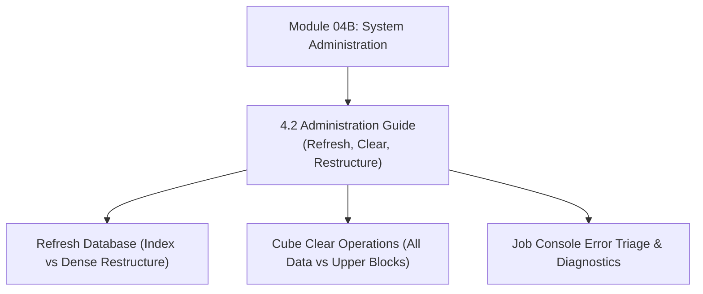

# Module 04B: System Administration, Operations & Platform Governance

## Navigation & Module Overview

This module covers administrative operations, Refresh Database compilation mechanics, cube clear operations, Job Console diagnostics, and compliance audit tracking.

---

<!-- ===================================================================== -->
<!-- 🎯 LIVE INTERACTIVE VISUAL CARD: MODULE 04B SYSTEM ADMINISTRATION -->
<!-- ===================================================================== -->

<b>🎯 Live Interactive Architecture Card: System Administration (Click to Collapse / Expand)</b>

 

> [!TIP]
> **Consultant High-Yield Summary:** Master the physical mechanics of Cube Refresh (Index vs Dense Restructures), exclusive application locks, and disaster recovery via Artifact Snapshots.

| Document | Primary Domain | Core Focus | Direct Link |
| :--- | :--- | :--- | :--- |
| **4.2 Administration Guide** | Platform Administration | Refresh Database, Cube Clears, Restructure Types, Job Console Diagnostics | [01_Administration_Guide.md](01_Administration_Guide.md) |

---

## Module Documents

1. **[4.2 System Administration: Operations, Cube Refresh & Platform Governance](01_Administration_Guide.md)**
   * Refresh Database: Relational repository to Essbase outline compilation.
   * Restructure physics: Index Restructure vs. Dense (Full) Restructure.
   * Cube clear types and storage impact (`CLEAR ALL DATA` vs `CLEAR UPPER-LEVEL BLOCKS`).
   * Job Console error triage and diagnostic codes.
   * SOX compliance audit tracking.
   * Tough & twisted review questions with consultant model answers.

---
*Return to [Knowledge Base Master Index](../README.md) or advance to [Module 05: Calc Manager and Business Rules](../05_Calc_Manager_and_Business_Rules/00_INDEX.md).*
