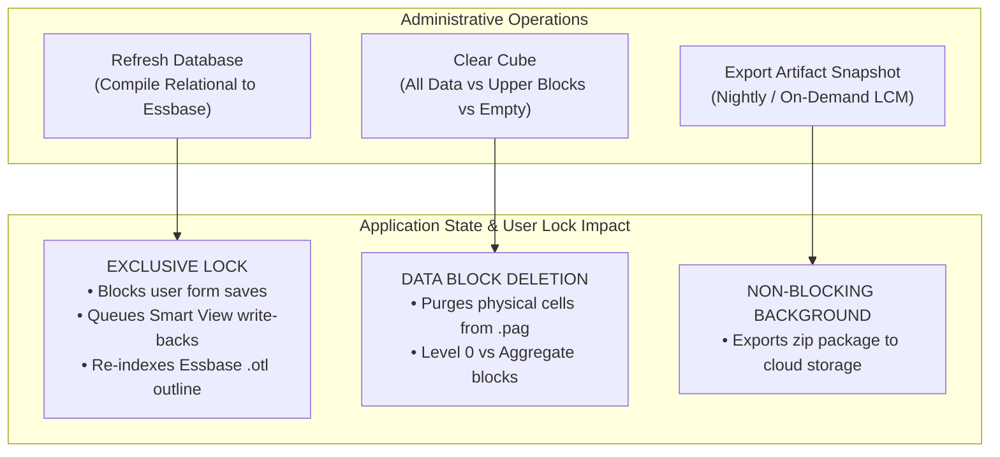
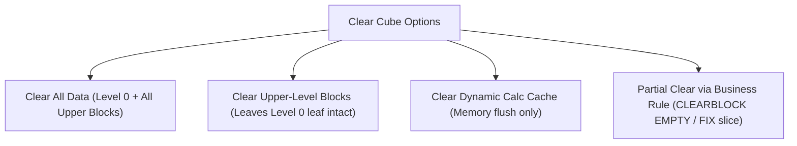

# 4.2 System Administration: Operations, Cube Refresh & Platform Governance

## Table of Contents
1. [Core Consultant Mental Model](#1-core-consultant-mental-model)
2. [Refresh Database: Relational-to-Essbase Compilation](#2-refresh-database-relational-to-essbase-compilation)
3. [Cube Clear Operations & Storage Impact](#3-cube-clear-operations--storage-impact)
4. [Job Console Diagnostics & Error Triage](#4-job-console-diagnostics--error-triage)
5. [Audit Compliance & Activity Tracking](#5-audit-compliance--activity-tracking)
6. [Tough & Twisted Review Questions with Consultant Model Answers](#6-tough--twisted-review-questions-with-consultant-model-answers)

---

<!-- ===================================================================== -->
<!-- 🎯 LIVE INTERACTIVE VISUAL CARD: SYSTEM ADMINISTRATION & OPERATIONS -->
<!-- ===================================================================== -->

<b>🎯 Live Interactive Architecture Card: System Administration & Operations (Click to Collapse / Expand)</b>

 

> [!TIP]
> **Consultant High-Yield Summary:** An administrator must know the operational blast radius of every administrative action. Running **Refresh Database** places an exclusive lock on the application, kicking off active web form saves; running **Clear Cube** without understanding block types can wipe out entire historical actuals.

| Administrative Action | Target Layer | User Impact / Lock Status | Reversibility |
| :--- | :--- | :--- | :--- |
| **Refresh Database** | Relational Repository -> Essbase Outline | **Application Locked** (Forms read-only; no saves permitted) | Fully compiled outline; cannot abort mid-refresh |
| **Clear Cube (All Data)** | Essbase Page Files (`.pag`) | Clears all data blocks across all scenarios/versions | **IRREVERSIBLE** (Requires restoring Artifact Snapshot) |
| **Clear Upper-Level Blocks** | Upper parent stored blocks | Leaves Level 0 intact; deletes aggregate blocks | Safe; recalculated via rollup or Dynamic Calc |
| **Clear Dynamic Calc Cache** | Memory cache pool | Flushes dynamic calc memory; frees RAM | Non-destructive; re-cached on next query |
| **Artifact Snapshot Export** | Application LCM Zip | Background task; users can continue working | Safe read-only export of metadata and data |

---

## 1. Core Consultant Mental Model

As an Oracle Cloud EPM technical consultant, you must understand the distinction between:
* **The Planning Relational Database (Repository):** Holds metadata edits, form definitions, and security groups in relational tables (`HSP_*`).
* **The Essbase Analytic Engine (Kernel):** Holds the multidimensional outline (`.otl`) and data page files (`.pag`).

When you create a new member in the web interface, **Essbase knows nothing about it** until you execute a **Refresh Database**. 

---

## 2. Refresh Database: Relational-to-Essbase Compilation

### What Physically Happens During a Cube Refresh:
1. **Application Validation:** Checks for duplicate aliases, missing mandatory parents, cyclic formulas, and invalid dimension properties.
2. **Lock Application:** Disconnects active web data saves to prevent data corruption during outline restructuring.
3. **Essbase Outline Rewrite:** Compiles the relational metadata into the Essbase binary outline (`.otl`).
4. **Restructure Type Determination:**
   * **Index Restructure:** Changes sparse members only; fast index rewrite.
   * **Dense Restructure:** Changes dense members or adds dense dimensions; completely rewrites `.pag` data files block by block.
5. **Security Push:** Pushes user and group dimensional grants into the Essbase security cache.

---

## 3. Cube Clear Operations & Storage Impact

When clearing data in Planning or FreeForm applications, choose the exact clear scope:

* **Clear All Data:** Completely truncates all physical blocks in the cube. Use only during initial setup or full reload.
* **Clear Upper-Level Blocks:** Deletes stored upper summary blocks in Classic BSO cubes. Level 0 input data remains 100% safe.
* **`CLEARBLOCK EMPTY;`:** Essbase calc command that scans the database and deletes "ghost blocks" containing all `#Missing` cells, reclaiming disk space and deflating block explosion.

---

## 4. Job Console Diagnostics & Error Triage

When an automated script or user reports a failure, the **Job Console** is the primary diagnostic center:

| Job Status | Meaning | Immediate Triage Action |
| :--- | :--- | :--- |
| **In Progress** | Job is currently executing | Check start time. If running > 1 hour, check for block locks or infinite loops. |
| **Completed** | Job finished successfully | Verify row/block counts in job details. |
| **Completed with Errors** | Job finished but encountered fatal issues | Click on Job Details to inspect the exact error log and stack trace. |
| **Error (Red Banner)** | Job crashed before completing | Check member formula syntax, missing substitution variables, or memory limits. |

---

## 5. Audit Compliance & Activity Tracking

For SOX compliance and enterprise data governance, the **Audit Module** tracks all operational activities:
* **Data Audit:** Logs historical cell value changes (Old Value vs. New Value, User ID, Timestamp, Form used).
* **Metadata Audit:** Records member creation, property modifications, and member deletions.
* **Security Audit:** Tracks role assignments, group additions, and access grant changes.

---

## 6. Tough & Twisted Review Questions with Consultant Model Answers

### Question 1: "An administrator initiates a Refresh Database during business hours. 50 planners are actively submitting forecasts. What happens to the planners' submissions?"
**Consultant Model Answer:**
> "During a Refresh Database, Cloud EPM places an exclusive write lock on the application to prevent outline corruption. Any planner attempting to submit data or save a web form while the refresh is running receives an error banner: *'The database is currently undergoing maintenance/refresh. Please try again later.'* 
> Their unsubmitted grid changes will fail to commit to Essbase. Best practice is to schedule cube refreshes during off-peak hours or automated maintenance windows, and broadcast an advance system announcement via Redwood alerts."

### Question 2: "What is the difference between an 'Index Restructure' and a 'Dense Restructure' during a cube refresh, and how does each impact downtime?"
**Consultant Model Answer:**
> "* **Index Restructure:** Occurs when modifications affect only sparse dimension member names or sparse hierarchy moves. Essbase only rebuilds the `.ind` index files, leaving data `.pag` files untouched. Takes seconds to a few minutes.
> * **Dense Restructure (Full Restructure):** Occurs when dense dimensions are added, deleted, reordered, or dense member counts change. Because the dense dimensions define the internal matrix of every physical data block, Essbase must read, restructure, and rewrite every single `.pag` block on disk.
> On large databases with millions of blocks, a dense restructure can take hours, requires 2x temporary disk space, and extends application downtime."

### Question 3: "A developer executes `CLEAR ALL DATA` on the production Planning cube by mistake. How do you recover the application, and what is the recovery time objective (RTO)?"
**Consultant Model Answer:**
> "Because `CLEAR ALL DATA` physically wipes all data blocks from Essbase without an undo option, recovery requires **restoring from an LCM backup**:
> 1. Immediately navigate to **Migration / Snapshots** (or use EPM Automate `importsnapshot`).
> 2. Locate the most recent valid backup: either the nightly automated **Artifact Snapshot** or an on-demand snapshot taken prior to the incident.
> 3. Import the snapshot, selecting **Data** and **Metadata** artifacts.
> 4. Once imported, execute a Cube Refresh and replay any data integration batches loaded since the snapshot was captured.
> The RTO depends on cube size, typically ranging from 30 minutes to 2 hours."

---
*Proceed to [Module 05: Calculation Manager & Business Rules](../05_Calc_Manager_and_Business_Rules/00_INDEX.md).*
