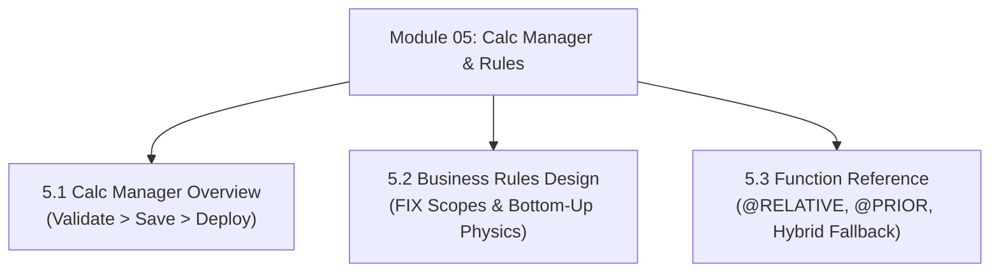

# Module 05: Calculation Manager, Business Rules & Function Reference

## Navigation & Module Overview

This module covers Calculation Manager development modes, rule deployment lifecycles, calculation physics (FIX scoping, Top-Down vs Bottom-Up), multithreading (`@CALCPARALLEL`), and essential calculation functions.

---

<!-- ===================================================================== -->
<!-- 🎯 LIVE INTERACTIVE VISUAL CARD: MODULE 05 CALC MANAGER -->
<!-- ===================================================================== -->

<b>🎯 Live Interactive Architecture Card: Calculation Engine Suite (Click to Collapse / Expand)</b>

 

> [!TIP]
> **Interactive Standalone Dashboard:** Open [`card_kb_04_calc_business_rules.html`](../interactive_cards/card_kb_04_calc_business_rules.html) in your browser for a live interactive business rule builder & FIX scope visualizer!

| Document | Primary Domain | Core Focus | Direct Link |
| :--- | :--- | :--- | :--- |
| **5.1 Calc Manager Overview** | Rule Development Lifecycle | Visual Mode vs Script Mode, Validate vs Save vs Deploy | [01_Calc_Manager_Overview.md](01_Calc_Manager_Overview.md) |
| **5.2 Business Rules Design** | Calculation Physics | FIX Statement Scopes, Top-Down vs Bottom-Up, `@CALCPARALLEL` | [02_Business_Rules_Design.md](02_Business_Rules_Design.md) |
| **5.3 Function Reference** | Function Engineering | `@RELATIVE`, `@PRIOR`, `@XREF` anti-pattern, Hybrid BSO fallback traps | [03_Calculation_Functions_Reference.md](03_Calculation_Functions_Reference.md) |

---

## Module Documents

1. **[5.1 Calculation Manager Overview: Views, Visual Palette & Deployment Lifecycle](01_Calc_Manager_Overview.md)**
   * System View vs. Database View.
   * Visual Canvas vs. Script Editor vs. Groovy Editor.
   * 4-Step Rule Lifecycle (Design, Validate, Save, Deploy).
   * Tough & twisted review questions with consultant model answers.

2. **[5.2 Business Rules Design: Scoping, Execution Modes & Calc Math](02_Business_Rules_Design.md)**
   * FIX statement physics: Filtering sparse blocks vs. evaluating dense cells.
   * Top-Down vs. Bottom-Up execution mechanics.
   * Calculation modes: `SET CALCMODE BLOCK;`, `CELL;`, `HYBRID;`.
   * Parallel multithreading with `@CALCPARALLEL`.
   * Tough & twisted review questions with consultant model answers.

3. **[5.3 Calculation Functions Reference: @ Functions Deep Dive & Performance Gotchas](03_Calculation_Functions_Reference.md)**
   * Function evaluation matrix: `@RELATIVE`, `@DESCENDANTS`, `@ISMBR`, `@PRIOR`.
   * Cross-cube linking: Why `@XREF` is an anti-pattern and how Smart Push replaces it.
   * Functions that break Hybrid BSO execution and force procedural fallback.
   * Tough & twisted review questions with consultant model answers.

---
*Return to [Knowledge Base Master Index](../README.md) or advance to [Module 06: Data Integration and Exchange](../06_Data_Integration_and_Exchange/00_INDEX.md).*
