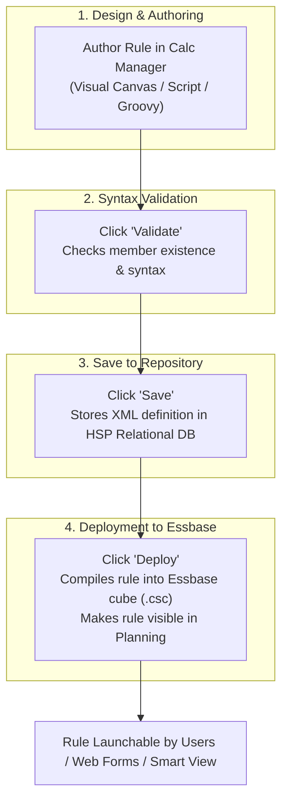

# 5.1 Calculation Manager Overview: Views, Visual Palette & Deployment Lifecycle

## Table of Contents
1. [Core Consultant Mental Model](#1-core-consultant-mental-model)
2. [Calc Manager Views: System View vs. Database View](#2-calc-manager-views-system-view-vs-database-view)
3. [Visual Canvas Mode vs. Script Mode vs. Groovy Mode](#3-visual-canvas-mode-vs-script-mode-vs-groovy-mode)
4. [The 4-Step Rule Lifecycle: Design, Validate, Save, Deploy](#4-the-4-step-rule-lifecycle-design-validate-save-deploy)
5. [Tough & Twisted Review Questions with Consultant Model Answers](#5-tough--twisted-review-questions-with-consultant-model-answers)

---

<!-- ===================================================================== -->
<!-- 🎯 LIVE INTERACTIVE VISUAL CARD: CALC MANAGER LIFECYCLE -->
<!-- ===================================================================== -->

<b>🎯 Live Interactive Architecture Card: Calc Manager Rule Lifecycle (Click to Collapse / Expand)</b>

 

> [!TIP]
> **Interactive Standalone Dashboard:** Open [`card_kb_04_calc_business_rules.html`](../interactive_cards/card_kb_04_calc_business_rules.html) in your browser for a live interactive business rule builder & FIX scope visualizer!

| Development Mode | Underlying Engine | Key Capabilities | Irreversible Caution |
| :--- | :--- | :--- | :--- |
| **Visual Designer** | Drag-and-drop flowchart palette | Formula components, FIX loops, Condition branches | Easy for functional users |
| **Script Editor** | Native Essbase calc script text | Full Essbase calc language, `@` functions, `SET` commands | Converting to Script mode with advanced syntax **cannot be converted back** |
| **Groovy Editor** | JVM Java-based sandbox | Pre-save validation, Micro-FIX, DataGridBuilder, REST | Requires EPM Enterprise Cloud subscription |

---

## 1. Core Consultant Mental Model

When developing business rules in Oracle Cloud EPM, consultants must distinguish between **Saving** a rule and **Deploying** a rule:

* **Saving a Rule:** Writes the rule definition as an XML/JSON object inside the **Planning Relational Repository (HSP database)**. The Essbase calculation engine does NOT know the rule exists yet, and users cannot run it.
* **Deploying a Rule:** Compiles the rule, translates graphical components into native Essbase calculation script format, and registers the rule with the Essbase cube and Planning security engine.
* If a junior consultant modifies a rule and clicks *Save* but forgets to click *Deploy*, **the application will continue running the old version of the rule in production!**

---

## 2. Calc Manager Views: System View vs. Database View

Calculation Manager provides two structural navigation lenses:

| View Name | Hierarchy Displayed | Primary Consultant Use Case |
| :--- | :--- | :--- |
| **System View** | Global tree organized by object type: Rules, Rule Sets, Formulas, Scripts, Templates, Variables | Managing shared components, global substitution variables, and cross-application rule sets. |
| **Database View** | Tree organized by Application -> Cube (Plan Type) | Focused cube development: inspecting only the rules and formulas associated with a specific cube (e.g., `Oep_FS`). |

---

## 3. Visual Canvas Mode vs. Script Mode vs. Groovy Mode

### 1. Visual Canvas Mode
* Uses graphical palette blocks:
  * **Rule:** Container for all logic.
  * **Formula Component:** Assigns values (`Account = Driver * Rate;`).
  * **Script Component:** Embeds raw Essbase calc syntax within a flowchart.
  * **Condition Component:** `IF ... ELSEIF ... ENDIF` branching.
  * **Member Block:** Scopes calculations to specific sparse combinations (`FIX`).

### 2. Script Mode
* Directly exposes Essbase calculation script language.
* Best practice for performance tuning, complex `@LOOP` allocations, and large multidimensional blocks.
* **Gotcha:** If you convert a visual rule to Script mode and introduce advanced scripting constructs, Calculation Manager cannot reverse the script back to graphical flowchart blocks.

### 3. Groovy Mode
* Available for Planning and FreeForm applications.
* Selected by setting the rule type to **Groovy Script**.
* Enables event-driven micro-calculations, REST calls, and pre-save form validation.

---

## 4. The 4-Step Rule Lifecycle: Design, Validate, Save, Deploy

To migrate a calculation safely into production, follow this strict lifecycle:

1. **Design:** Build logic using variables instead of hardcoded strings (e.g., `&CurYear`, `&CurPeriod`).
2. **Validate:** Click the checkmark icon. Calc Manager parses the syntax against the active application outline, verifying that all members, variables, and functions are valid.
3. **Save:** Commits the rule to the relational repository.
4. **Deploy:** Pushes the compiled calculation to Essbase. Can be deployed individually or as a batch via **Deployment View**.

---

## 5. Tough & Twisted Review Questions with Consultant Model Answers

### Question 1: "A developer updates a business rule in Calculation Manager, clicks Save, and sees 'Save Successful'. However, when a planner tests the rule on a web form, the calculation outputs old results. What did the developer forget?"
**Consultant Model Answer:**
> "The developer forgot to **Deploy** the rule. 
> Clicking 'Save' only commits the updated rule XML to the Planning relational database repository (`HSP_*` tables). The Essbase calculation engine and the web application runtime execute the compiled rule registered during deployment. Until the developer clicks **Deploy** (or deploys all rules from the Deployment View), the active Essbase cube continues executing the previously deployed version of the script."

### Question 2: "Can you convert a Groovy business rule into a Visual Canvas flowchart in Calculation Manager?"
**Consultant Model Answer:**
> "No. Visual Canvas mode is exclusively designed for standard Essbase calculation script components (Formula, Script, Condition, FIX blocks). Groovy is a general-purpose, object-oriented programming language executing within a JVM sandbox with access to the EPM Java API. Calc Manager does not support visual diagrammatic representation of Groovy code; Groovy rules can only be edited in text Script mode."

### Question 3: "What is a 'Rule Set' in Calculation Manager, and how does its execution order differ from running individual rules?"
**Consultant Model Answer:**
> "A **Rule Set** is an ordered sequence of multiple business rules grouped together into a single execution unit. 
> * **Execution Order:** Rules inside a Rule Set execute sequentially in the exact top-to-bottom order defined by the administrator.
> * **Performance Benefit:** Rule Sets can be configured to share common runtime prompts (RTPs) across all contained rules, prompting the user once rather than requiring multiple inputs.
> * **Parallel Execution:** Administrators can configure rules within a rule set to execute in parallel across different cubes if there are no data dependencies between them."

---
*Proceed to [5.2 Business Rules Design: Scoping, Execution Modes & Calc Math](02_Business_Rules_Design.md).*
