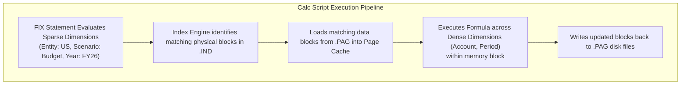
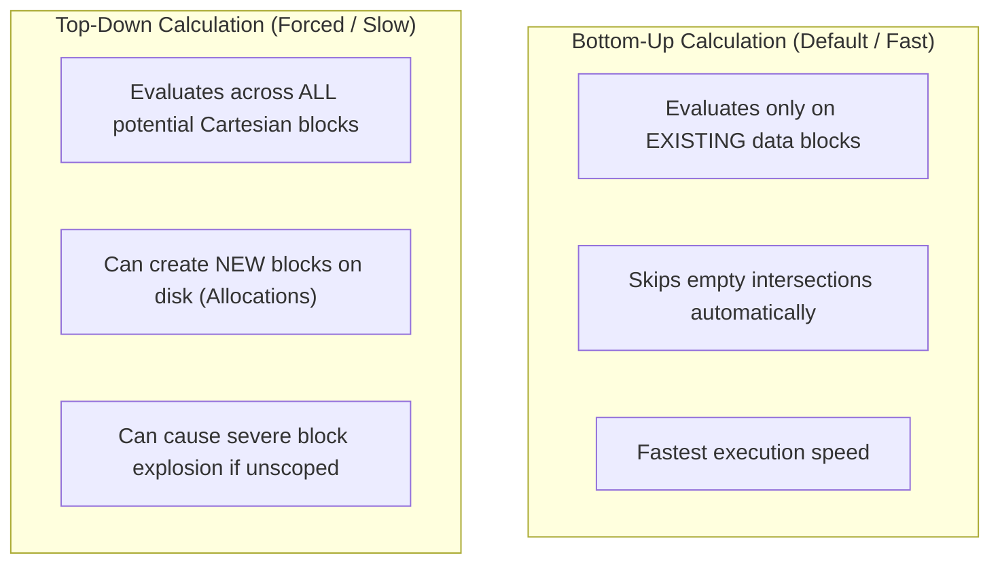

# 5.2 Business Rules Design: Scoping, Execution Modes & Calc Math

## Table of Contents
1. [Core Consultant Mental Model](#1-core-consultant-mental-model)
2. [FIX Statement Physics: How Essbase Evaluates Sparse Blocks](#2-fix-statement-physics-how-essbase-evaluates-sparse-blocks)
3. [Top-Down vs. Bottom-Up Execution Mechanics](#3-top-down-vs-bottom-up-execution-mechanics)
4. [Calculation Modes: BLOCK vs. CELL vs. HYBRID](#4-calculation-modes-block-vs-cell-vs-hybrid)
5. [Parallel Calculation Architecture (`@CALCPARALLEL`)](#5-parallel-calculation-architecture-calcparallel)
6. [Tough & Twisted Review Questions with Consultant Model Answers](#6-tough--twisted-review-questions-with-consultant-model-answers)

---

<!-- ===================================================================== -->
<!-- 🎯 LIVE INTERACTIVE VISUAL CARD: BUSINESS RULE CALCULATION PHYSICS -->
<!-- ===================================================================== -->
<details open>
<summary><b>🎯 Live Interactive Architecture Card: Business Rule Calculation Physics (Click to Collapse / Expand)</b></summary>

<br/>

> [!TIP]
> **Consultant High-Yield Summary:** A FIX statement filters **sparse dimensions only**. Essbase identifies physical blocks on disk matching the sparse Cartesian coordinates, loads matching blocks into the Page Cache, and executes formula logic across dense cells inside each block.

| Architectural Construct | Engine Mechanism | Best Practice Rule | Common Performance Trap |
| :--- | :--- | :--- | :--- |
| **`FIX (...) ... ENDFIX`** | Filters matching sparse blocks on disk | Narrow scope to exact slice being updated | Fixing on dense dimensions does NOT reduce block loads! |
| **Bottom-Up Calc** | Executes only on existing data blocks | Standard default; skips non-existent blocks | Ignores cells if target block does not exist |
| **Top-Down Calc** | Forces block creation or cross-block loops | Required for allocations into new combinations | Creates massive block explosion if unscoped |
| **`SET CALCMODE BLOCK;`**| Calculates entire dense block in one pass | Ultra-fast vectorized math | Falls back to CELL mode if complex cross-dim formulas exist |
| **`SET CALCPARALLEL n;`**| Spawns multiple threads across sparse blocks| Set to 2 to 4 threads in Cloud EPM | Setting threads higher than CPU cores causes thread thrashing |



</details>

---

## 1. Core Consultant Mental Model

When writing or optimizing Essbase business rules, keep the **Physical Block Axiom** in mind:
> **Essbase reads and writes whole data blocks, never single cells.**
> A single physical block contains every cell formed by the intersection of all **Dense dimensions**. 
> Therefore, a `FIX` statement on Sparse dimensions decides **which blocks to open**. The equations inside the block evaluate across **Dense cells**.

If you write a `FIX` on a Dense dimension (e.g., `FIX("Jan", "Salary")`), Essbase still loads the entire block containing all 12 months and all accounts, then simply ignores the non-fixed cells. To reduce disk I/O, you must **fix on Sparse dimensions**.

---

## 2. FIX Statement Physics: How Essbase Evaluates Sparse Blocks

```essbase
/* Optimized Rule: Scopes strictly to sparse leaf entities and budget scenario */
SET UPDATECALC OFF;
SET AGGMISSG ON;

FIX(@RELATIVE("Total_Entity", 0), "Budget", "FY26", "Working")
    /* Dense formula running inside each matching block */
    "Total_Compensation" = "Salary" + "Bonus" + "Benefits";
    "Payroll_Taxes" = "Total_Compensation" * 0.085;
ENDFIX
```

### Critical Rules for Scoping:
1. **Never FIX on Dense Dimensions to Improve I/O:** Fixing on dense dimensions only masks cells inside memory; it does not stop the block from being loaded from disk.
2. **Order of Dimensions in FIX:** Does not affect performance. Essbase evaluates the sparse Cartesian intersection using index B-trees regardless of order.
3. **Nested FIX Statements:** Avoid deeply nested `FIX` blocks. Combine conditions into a single outer `FIX` whenever possible.

---

## 3. Top-Down vs. Bottom-Up Execution Mechanics

When an equation contains complex member formulas, Essbase determines whether to execute in **Bottom-Up** or **Top-Down** mode:



### When Does Essbase Force Top-Down Mode?
* When a formula assigns values to a member outside the current block (Cross-dimensional assignment):
  `"Sales" -> "No_Product" = "Sales" * 1.1;`
* When a formula contains complex range functions or cross-dimensional references:
  `"Bonus" = @MEDIAN(SKIPNONE, @DESCENDANTS("Total_Entity"), "Salary");`
* **Consultant Best Practice:** Force Bottom-Up mode using `@BOTTOMUP` operator when you know target blocks already exist:
  `"Expense_Allocation" = @BOTTOMUP("Headcount" * "Corp_Rate"->"Total_Entity");`

---

## 4. Calculation Modes: BLOCK vs. CELL vs. HYBRID

You can explicitly control how formulas evaluate using the `SET CALCMODE` command:

| Calc Mode | Internal Processing | When to Use |
| :--- | :--- | :--- |
| **`SET CALCMODE BLOCK;`** | Calculates all dense cells in the block simultaneously using vectorized array math. | Standard additive math, driver multiplications, and straightforward linear formulas. |
| **`SET CALCMODE CELL;`** | Evaluates formulas cell-by-cell sequentially. | Required when formulas contain complex conditionals (`IF ... ELSE`), cross-dimensional offsets, or `@PRIOR` functions. |
| **`SET CALCMODE HYBRID;`** | Allows Hybrid BSO engine to calculate dynamic parent rollups in memory using multi-threaded ASO vector math. | **Modern Cloud EPM default standard.** |

---

## 5. Parallel Calculation Architecture (`@CALCPARALLEL`)

In Oracle Cloud EPM, calculations can be accelerated across multiple CPU threads:

```essbase
SET CALCPARALLEL 4;
FIX(@DESCENDANTS("Total_Entity"), "FY26", "Working")
    CALC DIM("Account");
ENDFIX
```

### Thread Sizing Rules:
* In Cloud EPM environments, the underlying virtual compute instances typically provide 2 to 4 virtual CPU cores per pod.
* Setting `CALCPARALLEL 4` allows Essbase to divide the list of sparse blocks across 4 parallel threads.
* **Caution:** Do not set `CALCPARALLEL` higher than 4 in Cloud EPM. Over-allocating threads causes CPU context-switching overhead and thread contention, slowing down calculations rather than speeding them up.

---

## 6. Tough & Twisted Review Questions with Consultant Model Answers

### Question 1: "A developer writes a calc script: `FIX("Actual", "FY25", "Jan", "Salary") ... ENDFIX`. Scenario and Year are Sparse; Period and Account are Dense. Does fixing on 'Jan' and 'Salary' reduce the number of blocks Essbase reads from disk?"
**Consultant Model Answer:**
> "No. Fixing on 'Jan' (Period) and 'Salary' (Account) **does not reduce disk I/O by a single byte**. 
> Because Period and Account are Dense dimensions, they reside inside the physical data block. Essbase must load the entire physical block containing all 12 months and all accounts from disk into the Page Cache. The FIX on Jan and Salary merely instructs Essbase to ignore the other dense cells in memory during formula evaluation. Only fixing on Sparse dimensions (such as Entity, Cost Center, or Scenario) reduces the physical count of blocks loaded from disk."

### Question 2: "What is 'Block Explosion', what causes it during allocation rules, and how do you remediate it?"
**Consultant Model Answer:**
> "**Block Explosion** occurs when a calculation rule triggers Top-Down block creation across an unconstrained sparse Cartesian product, generating hundreds of thousands of new physical data blocks that contain mostly zeros or `#Missing` cells. 
> * **Root Cause:** Occurs when an allocation rule uses cross-dimensional operators without pre-filtering existing blocks (e.g., assigning Corporate Overhead across `@DESCENDANTS("Total_Entity") -> @DESCENDANTS("Total_Product")`).
> * **Remediation:**
>   1. Rewrite the formula to use `@BOTTOMUP` or check `@ISMBR` before assignment.
>   2. Scope the allocation strictly to populated intersections using `@RELATIVE("Entity", 0)`.
>   3. Execute `CLEARBLOCK EMPTY;` to scan the database and purge zero-cell ghost blocks, restoring performance."

### Question 3: "Why does assigning a formula to a Sparse dimension member in a Hybrid BSO cube degrade dynamic rollup performance?"
**Consultant Model Answer:**
> "In Hybrid BSO, upper-level sparse rollups are computed dynamically at query time using the multi-threaded ASO vector engine, bypassing physical disk block reads. 
> However, if a sparse parent member contains a member formula (especially one with procedural logic, cross-dimensional references, or unsupported `@` functions), the Hybrid engine cannot resolve the calculation via fast vector aggregation. It is forced to **fall back to slow procedural BSO mode**, instantiating full block structures in memory block-by-block. Best practice is to keep sparse members as standard rollup operators (`+`, `~`) and place all formula logic in Dense accounts or business rules."

---
*Proceed to [5.3 Calculation Functions Reference: @ Functions Deep Dive](03_Calculation_Functions_Reference.md).*
