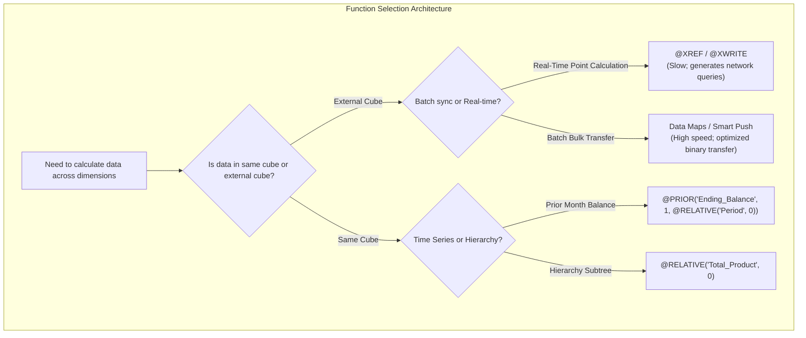

# 5.3 Calculation Functions Reference: @ Functions Deep Dive & Performance Gotchas

## Table of Contents
1. [Core Consultant Mental Model](#1-core-consultant-mental-model)
2. [Master Function Matrix: Purpose, Scope & Performance Impact](#2-master-function-matrix-purpose-scope--performance-impact)
3. [Member Navigation & Range Functions](#3-member-navigation--range-functions)
4. [Cross-Cube Data Movement: `@XREF` vs. `@XWRITE` vs. Data Maps](#4-cross-cube-data-movement-xref-vs-xwrite-vs-data-maps)
5. [Functions That Break Hybrid BSO Execution](#5-functions-that-break-hybrid-bso-execution)
6. [Tough & Twisted Review Questions with Consultant Model Answers](#6-tough--twisted-review-questions-with-consultant-model-answers)

---

<!-- ===================================================================== -->
<!-- 🎯 LIVE INTERACTIVE VISUAL CARD: ESSBASE CALCULATION FUNCTIONS MATRIX -->
<!-- ===================================================================== -->
<details open>
<summary><b>🎯 Live Interactive Architecture Card: Calculation Functions & Performance Traps (Click to Collapse / Expand)</b></summary>

<br/>

> [!TIP]
> **Consultant High-Yield Summary:** In Hybrid BSO applications, certain calculation functions trigger a **catastrophic fallback to slow procedural BSO mode**. Avoid `@CURRMBRRANGE`, `@ANCESTVAL`, and complex cross-dimensional `@MDANCESTVAL` inside dynamic parent formulas. Use standard additive rollups and delegate procedural calculations to business rules.

| Function Group | Functions | Execution Performance | Hybrid BSO Compatibility |
| :--- | :--- | :--- | :--- |
| **Member Selection** | `@ISMBR`, `@ISANCEST`, `@ISDESC`, `@ISLEV` | Fast boolean evaluation | Fully Supported |
| **Hierarchy Navigation**| `@DESCENDANTS`, `@RELATIVE`, `@CHILDREN`, `@SIBLINGS` | Fast outline tree traversal | Fully Supported |
| **Time Series Offset** | `@PRIOR`, `@NEXT`, `@SHIFT`, `@MDSHIFT` | Fast within dense Period dimension | Supported on Dense dimensions |
| **Range Aggregations** | `@SUMRANGE`, `@AVGRANGE`, `@ACCUM` | Moderate; depends on range size | Supported with limitations |
| **Cross-Cube Linking** | `@XREF`, `@XWRITE` | **Extremely Slow (TCP network hops)** | Block-level only; never dynamic |



</details>

---

## 1. Core Consultant Mental Model

When writing member formulas or calc scripts in Oracle Cloud EPM:
* **Function Placement Dictates Speed:** Running `@ISMBR` inside a dense formula executes thousands of times per block. Moving condition checks outside into a `FIX` statement executes once per block, eliminating 90% of formula evaluation overhead.
* **Hybrid BSO Awareness:** Classic BSO allowed any function on dynamic members. In Cloud EPM's Hybrid BSO engine, placing an unsupported function on a Dynamic Calc member disables the vector engine and triggers multi-second query delays for all users querying that parent.

---

## 2. Master Function Matrix: Purpose, Scope & Performance Impact

| Function | Syntax & Purpose | Consultant Best Practice |
| :--- | :--- | :--- |
| **`@RELATIVE`** | `@RELATIVE(member, level)`<br/>Returns members at a specific level (Level 0 = leaf). | Standard best practice for scoping leaf inputs (`@RELATIVE("Total Entity", 0)`). |
| **`@DESCENDANTS`**| `@DESCENDANTS(member)`<br/>Returns all child and descendant nodes. | Avoid on sparse dimensions unless calculating full tree consolidations. |
| **`@CURRMBR`** | `@CURRMBR(dimName)`<br/>Returns the current member being calculated. | Use inside dynamic string generation or condition logging; avoid in dense loops. |
| **`@ISMBR`** | `@ISMBR(mbrList)`<br/>Returns TRUE if current intersection matches member. | Use inside `IF` conditions; keep member list compact. |
| **`@PRIOR`** | `@PRIOR(mbrName, [n], [range])`<br/>Fetches previous period cell value. | Best for opening balance roll-forwards: `"Opening_Cash" = @PRIOR("Closing_Cash");`. |
| **`@XREF`** | `@XREF(locationAlias, [mbrList])`<br/>Reads cell from remote Essbase cube. | High network overhead. Replace with **Smart Push** or **Data Maps** in Cloud EPM. |
| **`@XWRITE`** | `@XWRITE(mbrName, locationAlias, [mbrList])`<br/>Pushes cell into remote cube. | Replaced by Smart Push in modern application design. |

---

## 3. Member Navigation & Range Functions

### 1. Rolling Periods Forward with `@PRIOR`:
```essbase
/* Roll-forward formula on Ending_Inventory */
"Ending_Inventory" = 
    @PRIOR("Ending_Inventory", 1, @RELATIVE("Period", 0)) 
    + "Inventory_Additions" 
    - "Inventory_Depletion";
```
* **Performance Note:** When using `@PRIOR`, always pass `@RELATIVE("Period", 0)` as the range parameter. If omitted, Essbase evaluates across quarterly summary members, corrupting period boundary math.

### 2. Year-to-Date Accumulation with `@SUMRANGE`:
```essbase
/* YTD Calculation on Account */
"Sales_YTD" = @SUMRANGE("Sales", @CURRMBRRANGE("Period", LEV, 0, , 0));
```

---

## 4. Cross-Cube Data Movement: `@XREF` vs. `@XWRITE` vs. Data Maps

Review panels frequently ask how to move data between cubes (e.g., from `Workforce` cube to `Financials` cube):

| Solution | Technology | Performance & Architecture | Recommended? |
| :--- | :--- | :--- | :---: |
| **`@XREF`** | Pull cell via TCP socket | Cell-by-cell lookup. High latency. Locks cubes. | ❌ Avoid |
| **`@XWRITE`** | Push cell via TCP socket | Procedural push. Can cause deadlock if cubes write reciprocally. | ❌ Avoid |
| **Data Maps** | Planning Server Pipeline | High-speed bulk ETL between cubes. Scheduled batch. | ✅ Recommended |
| **Smart Push** | On-Save Integration | Pushes only form context / edited cells instantaneously. | 🌟 Best Practice |

---

## 5. Functions That Break Hybrid BSO Execution

In Hybrid BSO cubes, upper-level members calculate dynamically via the ASO vector engine. The following functions force Essbase to **abandon the vector engine and fall back to slow BSO procedural mode**:

1. **`@CURRMBRRANGE` inside a dynamic parent formula.**
2. **`@MDANCESTVAL` or complex multi-dimensional ancestor lookups.**
3. **Cross-dimensional formulas that reference dynamic calc members from other dimensions.**
4. **Member formulas that assign values to other members (`A = B + C; D = E;`).**

**The Solution:** If an account requires complex procedural arithmetic, model the member as **Stored** and calculate it via an explicit business rule, keeping all dynamic parent rollups as standard arithmetic operators (`+`, `~`).

---

## 6. Tough & Twisted Review Questions with Consultant Model Answers

### Question 1: "Why is using `@XREF` considered an anti-pattern in modern Oracle Cloud EPM applications, and what should be used instead?"
**Consultant Model Answer:**
> "`@XREF` is an anti-pattern because it executes cell-by-cell queries over internal TCP connections between Essbase cubes. When evaluated across thousands of blocks, `@XREF` generates massive network latency, monopolizes cube connection threads, and can trigger application timeouts. 
> In Oracle Cloud EPM, cross-cube data sharing should be architected using:
> 1. **Smart Push (Run on Save):** For instantaneous synchronization of form inputs from BSO to ASO or between plan types.
> 2. **Data Maps:** For scheduled, high-volume batch synchronization across entire slices. Both methods leverage optimized memory buffers rather than slow socket queries."

### Question 2: "When using `@PRIOR("Closing_Balance")` to calculate January opening balance in a multi-year model, what happens across the fiscal year boundary from December to January?"
**Consultant Model Answer:**
> "By default, `@PRIOR("Closing_Balance", 1, @RELATIVE("Period", 0))` operates strictly within the active Period dimension range. When January calculates, it has no prior sibling period in that year, so `@PRIOR` evaluates to `#Missing`. 
> To correctly handle the fiscal year boundary from December of FY24 to January of FY25, you must either:
> 1. Use the multi-dimensional shift function: `@MDSHIFT("Closing_Balance", -1, "Year", , -11, "Period", )`.
> 2. Write an explicit condition: 
>    `IF(@ISMBR("Jan")) "Opening_Balance" = "Closing_Balance"->@PRIOR("Year", 1)->"Dec"; ELSE "Opening_Balance" = @PRIOR("Closing_Balance"); ENDIF;`"

### Question 3: "A senior architect notices that querying a dynamic parent member in Smart View takes 18 seconds. Querying leaf cells takes 0.2 seconds. What is the most likely root cause in a Hybrid BSO cube?"
**Consultant Model Answer:**
> "The parent member (or one of its ancestors/descendants) has a member formula containing a calculation function that is **incompatible with the Hybrid BSO dynamic vector engine** (e.g., `@CURRMBRRANGE`, procedural loops, or complex cross-dimensional assignments). 
> When the user queries the parent, the Hybrid engine cannot calculate the node dynamically in memory and is forced to fall back to the slow procedural BSO calculation engine, constructing temporary blocks in memory. Removing the formula from the dynamic parent and calculating the logic via an on-save business rule or simplifying the formula to standard addition restores sub-second query performance."

---
*Proceed to [Module 06: Data Integration and Exchange](../06_Data_Integration_and_Exchange/00_INDEX.md).*
