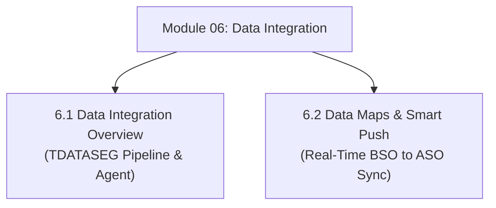

# Module 06: Data Integration, Smart Push & Cross-Cube Architecture

## Navigation & Module Overview

This module covers enterprise data loading, TDATASEG staging, dimension mapping rules, the EPM Integration Agent, Data Maps, and real-time Smart Push synchronization.

---

<!-- ===================================================================== -->
<!-- 🎯 LIVE INTERACTIVE VISUAL CARD: MODULE 06 DATA INTEGRATION -->
<!-- ===================================================================== -->

<b>🎯 Live Interactive Architecture Card: Data Integration & Movement Suite (Click to Collapse / Expand)</b>

 

> [!TIP]
> **Interactive Standalone Dashboard:** Open [`card_kb_05_data_integration_maps.html`](../interactive_cards/card_kb_05_data_integration_maps.html) in your browser for a live interactive Data Integration & Smart Push simulator!

| Document | Primary Domain | Core Focus | Direct Link |
| :--- | :--- | :--- | :--- |
| **6.1 Data Integration Overview** | Enterprise ETL Pipeline | 4-Stage Pipeline (Import, Validate, Export, Check), Mapping Precedence, EPM Integration Agent | [01_Data_Integration_Overview.md](01_Data_Integration_Overview.md) |
| **6.2 Data Maps & Smart Push** | Cross-Cube Synchronization | Declarative Data Maps, Form Context Smart Push, ASO Slice Compaction & Merges | [02_Data_Maps_and_Smart_Push.md](02_Data_Maps_and_Smart_Push.md) |

---

## Module Documents

1. **[6.1 Data Integration Architecture: Pipeline, Mappings & EPM Integration Agent](01_Data_Integration_Overview.md)**
   * 4-Stage ETL Pipeline: Import -> Validate -> Export -> Check.
   * Mapping rule precedence (Explicit > Between > In > Multi-Dim > Like).
   * EPM Integration Agent: Secure hybrid extraction over outbound Port 443.
   * Drill-Through architecture from summary cells to source ERP transactions.
   * Tough & twisted review questions with consultant model answers.

2. **[6.2 Data Maps, Smart Push & Cross-Cube Architecture](02_Data_Maps_and_Smart_Push.md)**
   * Data Maps (Scheduled batch) vs. Smart Push (Real-time form save event).
   * Dual-Cube architecture (Hybrid BSO input + ASO reporting).
   * ASO slice accumulation problem and `Merge Slices (Drop Zero Cells)` maintenance.
   * Tough & twisted review questions with consultant model answers.

---
*Return to [Knowledge Base Master Index](../README.md) or advance to [Module 07: Essbase Architecture & Storage Engines](../07_Essbase_Architecture/00_INDEX.md).*
