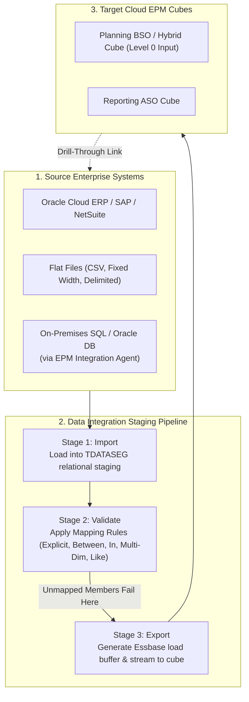
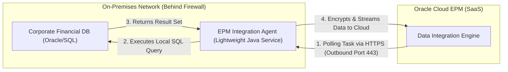

# 6.1 Data Integration Architecture: Pipeline, Mappings & EPM Integration Agent

## Table of Contents
1. [Core Consultant Mental Model](#1-core-consultant-mental-model)
2. [The 4-Stage Data Integration Pipeline](#2-the-4-stage-data-integration-pipeline)
3. [Mapping Rules Architecture & Precedence Engine](#3-mapping-rules-architecture--precedence-engine)
4. [EPM Integration Agent: Hybrid Cloud Extraction](#4-epm-integration-agent-hybrid-cloud-extraction)
5. [Drill-Through Architecture: From Summary Cell to Source GL](#5-drill-through-architecture-from-summary-cell-to-source-gl)
6. [Tough & Twisted Review Questions with Consultant Model Answers](#6-tough--twisted-review-questions-with-consultant-model-answers)

---

<!-- ===================================================================== -->
<!-- 🎯 LIVE INTERACTIVE VISUAL CARD: DATA INTEGRATION PIPELINE -->
<!-- ===================================================================== -->

<b>🎯 Live Interactive Architecture Card: Data Integration Pipeline & Agent (Click to Collapse / Expand)</b>

 

> [!TIP]
> **Interactive Standalone Dashboard:** Open [`card_kb_05_data_integration_maps.html`](../interactive_cards/card_kb_05_data_integration_maps.html) in your browser for a live interactive Data Integration & Smart Push simulator!

| Pipeline Stage | Mechanical Action | Fish Status Color | Fatal Error Condition |
| :--- | :--- | :--- | :--- |
| **1. Import** | Parses flat file or executes SQL via Agent into TDATASEG staging table | 🟡 Yellow Fish | File delimiter mismatch, invalid date format |
| **2. Validate** | Evaluates staging rows against mapping rules | 🟠 Orange Fish | **Unmapped member error:** source member has no mapping |
| **3. Export** | Converts mapped rows into Essbase data load buffer | 🟢 Green Fish | Dimension member does not exist in target outline |
| **4. Check** | Runs target data validation / balance audit rules | 🏁 Checkered Flag | Variance exceeds predefined audit threshold |

---

## 1. Core Consultant Mental Model

In Oracle Cloud EPM, **Data Integration** (the unified evolution of Data Management / FDMEE) is the mission-critical ETL bridge between external financial systems and Essbase multidimensional cubes.

* **Never Load Raw Files Directly into Essbase Outlines:** Loading raw files directly into Essbase bypasses mapping audit trails, eliminates drill-through capabilities, and risks data corruption if source chart of accounts change.
* **TDATASEG Staging Architecture:** Every imported record passes through the relational `TDATASEG` staging table where source values (`ACCOUNT`, `ENTITY`, `AMOUNT`) are mapped, transformed, and validated before touching an Essbase block.

---

## 2. The 4-Stage Data Integration Pipeline

The execution pipeline follows a strict 4-phase sequence, represented visually by the "Fish" status icons:

1. **Import (Stage 1):**
   * Reads data from source file, ERP adapter, or EPM Integration Agent query.
   * Loads raw records into `TDATASEG_T` staging table.
2. **Validate (Stage 2):**
   * Applies dimension mapping rules. Every source account, department, and entity must resolve to a valid target member.
   * **The #1 Production Issue:** If even one member fails to map, the entire batch validation fails, and the status remains Orange.
3. **Export (Stage 3):**
   * Assembles mapped records into Essbase load buffers.
   * Commits the buffer directly to Essbase leaf blocks. Options include:
     * *Store Data (Merge / Overwrite)*
     * *Replace Data (Clear existing target slice before loading)*
     * *Accumulate (Add incoming amounts to existing cells)*
4. **Check (Stage 4):**
   * Optional audit rules verify that total debits equal credits or that totals match source control totals.

---

## 3. Mapping Rules Architecture & Precedence Engine

When source chart of accounts differ from EPM target dimensions, mapping rules translate values:

| Mapping Rule Type | Precedence Order | Mechanics | Example |
| :--- | :---: | :--- | :--- |
| **1. Explicit** | **Highest (1)** | 1-to-1 direct exact match | `Source: 4100` -> `Target: Acc_Revenue` |
| **2. Between** | **2** | Numeric range mapping | `Source: 5000 to 5999` -> `Target: Acc_Opex` |
| **3. In** | **3** | Comma-delimited list match | `Source: 6100, 6150, 6200` -> `Target: Acc_Travel` |
| **4. Multi-Dimension** | **4** | Evaluates multiple source fields | `If Account=4100 AND Dept=Sales` -> `Target: Rev_Direct` |
| **5. Like (*)** | **Lowest (5)** | Wildcard mask transformation | `Source: CC_*` -> `Target: CostCenter_*` |

### Precedence Rule:
> **Explicit trumps Between; Between trumps In; In trumps Multi-Dimension; Multi-Dimension trumps Like.**
> If an Account matches both an Explicit rule and a Like rule, the Explicit rule wins.

---

## 4. EPM Integration Agent: Hybrid Cloud Extraction

Many enterprise clients host their transactional General Ledger on on-premises relational databases (Oracle DB, SQL Server, SAP HANA) behind corporate firewalls:

### Key Security Advantage:
* The EPM Integration Agent initiates **outbound HTTPS connections over port 443**.
* **Zero inbound firewall ports** need to be opened into the customer's on-premises network.

---

## 5. Drill-Through Architecture: From Summary Cell to Source GL

One of EPM's greatest executive capabilities is **Drill-Through**:
* An executive viewing a \$2,500,000 Travel Expense cell in Smart View or a Web Form can right-click and select **Drill Through**.
* **Landing Page Drill-Through:** Opens a web grid showing the exact rows imported into the `TDATASEG` staging table (all regional vouchers totaling \$2.5M).
* **Direct URL Drill-Through:** Passes parameterized transaction IDs back to Oracle Fusion ERP or SAP, launching the ERP screen showing the original scanned vendor invoice.

---

## 6. Tough & Twisted Review Questions with Consultant Model Answers

### Question 1: "During a nightly automated batch data load, the Data Integration job fails at the 'Validate' step with an Orange Fish icon. What is the root cause and how do you resolve it?"
**Consultant Model Answer:**
> "A failure at the Validate step indicates an **Unmapped Member error**. 
> The source system introduced a new account, department, or entity in the General Ledger that does not match any existing Explicit, In, Between, Multi-Dimension, or Like mapping rule in Data Integration. 
> To resolve:
> 1. Open Data Integration / Data Management and navigate to the **Process Details** log.
> 2. Open the Workbench and filter for rows with unmapped target members.
> 3. Add an appropriate mapping rule (or update the Wildcard rule) for the missing member.
> 4. Re-run the Validate step to verify all rows turn green, then proceed with the Export to Essbase."

### Question 2: "What is the difference between 'Replace' and 'Merge' export modes when loading data into an Essbase cube via Data Integration?"
**Consultant Model Answer:**
> "* **Merge (Store Data):** Overwrites only the specific cell intersections present in the data load file. Any existing cells in the Essbase cube that are NOT in the incoming file remain untouched.
> * **Replace:** **Physically clears the entire target slice** (e.g., clearing all accounts for that Scenario, Year, and Period) before loading the incoming data. Any cell that previously held a value but is omitted from the new file becomes `#Missing`.
> Using 'Replace' is standard when reloading monthly actuals to eliminate obsolete adjustments, but using it with an improperly scoped slice can accidentally wipe out manual adjustments."

### Question 3: "A client wants to extract 5 million journal lines directly from on-premises SQL Server into Cloud EPM. Why is the EPM Integration Agent preferred over manual file export/upload?"
**Consultant Model Answer:**
> "The EPM Integration Agent is superior because:
> 1. **Security & Compliance:** It operates via outbound HTTPS (Port 443), requiring no holes in corporate firewalls and avoiding unencrypted intermediate CSV files stored on local disks.
> 2. **Automation & Query Offloading:** It runs custom parameterized SQL queries directly against the source database, filtering and aggregating data at the database level before streaming results to the cloud.
> 3. **Native Pipeline Orchestration:** It is triggered directly via EPM Automate (`epm-automate rundatarule`) or REST API, fitting seamlessly into enterprise scheduler workflows."

---
*Proceed to [6.2 Data Maps, Smart Push & Cross-Cube Architecture](02_Data_Maps_and_Smart_Push.md).*
