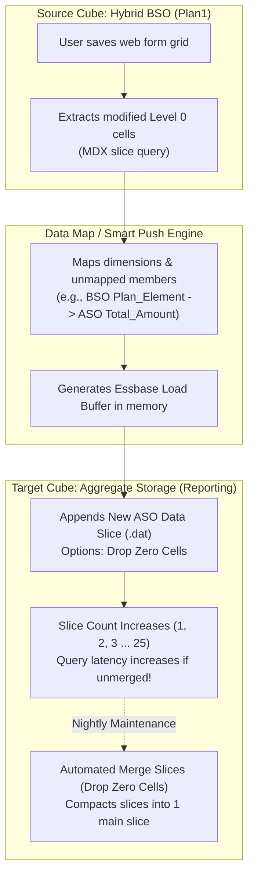
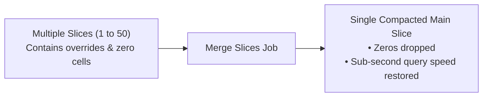

# 6.2 Data Maps, Smart Push & Cross-Cube Architecture

## Table of Contents
1. [Core Consultant Mental Model](#1-core-consultant-mental-model)
2. [Data Maps vs. Smart Push: Mechanical Architecture](#2-data-maps-vs-smart-push-mechanical-architecture)
3. [The BSO-to-ASO Push Pipeline](#3-the-bso-to-aso-push-pipeline)
4. [ASO Slice Fragmentation & Compaction Management](#4-aso-slice-fragmentation--compaction-management)
5. [Tough & Twisted Review Questions with Consultant Model Answers](#5-tough--twisted-review-questions-with-consultant-model-answers)

---

<!-- ===================================================================== -->
<!-- 🎯 LIVE INTERACTIVE VISUAL CARD: SMART PUSH & DATA MAPS PIPELINE -->
<!-- ===================================================================== -->

<b>🎯 Live Interactive Architecture Card: Data Maps & Smart Push Architecture (Click to Collapse / Expand)</b>

 

> [!TIP]
> **Consultant High-Yield Summary:** **Data Maps** are designed for scheduled batch synchronization across entire plan slices; **Smart Push** is designed for real-time form save events. In an ASO target, every push creates a new **incremental data slice**. If not merged regularly via `Merge Slices`, ASO query performance degrades dramatically.

| Architectural Dimension | Data Maps (Batch Sync) | Smart Push (Form Event) | Legacy `@XWRITE` |
| :--- | :--- | :--- | :--- |
| **Execution Trigger** | Admin job, EPM Automate, Scheduled pipeline | Form Save, Groovy event, Right-click action | Inside calc script during rule run |
| **Data Scope** | Broad dimensional slice (e.g., All Entities, All Periods) | **Contextual:** Scoped strictly to active form POV / edited cells | Cell-by-cell coordinate evaluation |
| **Target Storage Impact** | Appends large ASO slice or BSO blocks | Appends tiny micro-slice to target ASO | Overwrites blocks via TCP socket |
| **Execution Speed** | 10 to 60 seconds (bulk ETL) | **0.2 to 0.8 seconds (real-time)** | Slow; locks cubes during transaction |

---

## 1. Core Consultant Mental Model

Enterprise planning solutions frequently employ a **Dual-Cube Architecture**:
1. **Input / Calculation Cube (Hybrid BSO):** Planners enter detailed forecasts, run Groovy business rules, and execute driver allocations across dense accounts and periods.
2. **Reporting Cube (ASO):** Thousands of executive users run complex, high-cardinality ad-hoc reports in Smart View across 20+ dimensions.

**The Golden Law:**
> Never run heavy reporting on the calculation cube, and never run procedural allocations on the reporting cube.
> **Smart Push** is the real-time bridge that keeps the reporting cube synchronized the instant a planner clicks Save.

---

## 2. Data Maps vs. Smart Push: Mechanical Architecture

* **Data Maps:** A declarative metadata mapping defined in the Planning web interface. It specifies which dimensions in Cube A map to dimensions in Cube B, handling member exclusions, default member selections, and rollups.
* **Smart Push:** The runtime invocation engine of a Data Map. Smart Push is attached directly to a **Data Form** with the option **"Run After Save"**. 
* When the planner saves the form, Smart Push dynamically filters the Data Map's source scope to the **exact POV and row members on that specific form**, avoiding the overhead of a full database extract.

---

## 3. The BSO-to-ASO Push Pipeline

When Smart Push executes, it follows an optimized memory pipeline:
1. **Source Slice Extraction:** The Planning server issues an in-memory MDX query to the BSO cube, extracting only modified Level 0 leaf cells.
2. **Transformation:** Source dimension members are mapped to target members based on Data Map definitions. Any dimensions missing in the source are populated using target default members.
3. **Load Buffer Creation:** The data stream is loaded into an Essbase **Write Load Buffer** (`EssWriteLoadBuffer`) in memory.
4. **ASO Commit:** The buffer commits to the ASO cube as an **Incremental Data Slice**, making the new numbers immediately queryable in executive reports.

---

## 4. ASO Slice Fragmentation & Compaction Management

### The ASO Micro-Slice Problem:
Every time Smart Push runs, the ASO cube creates a new physical **data slice** (a small delta file on disk):
* If 100 planners save forms 20 times a day, the ASO cube accumulates **2,000 data slices**.
* When an executive queries the ASO cube, Essbase must read and aggregate numbers across all 2,000 slices in real time.
* **Result:** Ad-hoc query response times degrade from 0.2 seconds to 15 seconds!

### The Solution: Slice Merging Operations
To maintain peak performance, administrators must automate **Slice Merging** via EPM Automate:

1. **Incremental Merge (Merge All Slices):** Merges all accumulated small slices into a single secondary slice. Fast; can run during business hours.
2. **Full Merge (Merge All Slices into Main Slice with Drop Zero Cells):** Compacts all slices into the primary baseline slice and physically purges zero-value cells (`Drop Zero Cells`). Run nightly during maintenance windows.

---

## 5. Tough & Twisted Review Questions with Consultant Model Answers

### Question 1: "A client configures Smart Push on an Expense form. Planners report that saving the form takes 18 seconds, but the business rule calculation only took 0.5 seconds. What is causing the delay?"
**Consultant Model Answer:**
> "The delay is caused by an **unconstrained Data Map attached to Smart Push**. 
> If the Data Map definition does not have 'Use Form Context' enabled, Smart Push ignores the active form POV and attempts to extract and push the entire multi-year, multi-entity slice from BSO to ASO every time a single cell is saved. 
> To resolve:
> 1. In the Form Designer, ensure **'Use Form Context'** is checked for the attached Smart Push.
> 2. Alternatively, use a Groovy business rule to dynamically override the Smart Push dimensional slice, passing strictly `operation.grid.dataCellIterator({it.edited})`. This drops the push time from 18 seconds to under 0.4 seconds."

### Question 2: "What is the physical architectural consequence of running Smart Push 5,000 times a week without performing an ASO slice merge?"
**Consultant Model Answer:**
> "Every Smart Push execution writes an independent **incremental data slice** to the ASO database. Accumulating 5,000 slices causes severe **slice fragmentation**. 
> When an executive runs an ad-hoc query or opens an ASO dashboard, Essbase must resolve the cell coordinates across all 5,000 slice layers to calculate the net value, causing high disk I/O, heavy memory cache utilization, and severe query latency. 
> To remediate, the administrator must schedule an automated EPM Automate job:
> `epm-automate mergeslices AppName AsoCubeName dropzeros` during the nightly batch window."

### Question 3: "Can Smart Push move data from an ASO cube back into a BSO cube?"
**Consultant Model Answer:**
> "Yes. Data Maps and Smart Push support bidirectional data movement: BSO to ASO, ASO to BSO, BSO to BSO, and ASO to ASO. 
> However, when pushing from ASO to BSO, data must be pushed **strictly to Level 0 leaf members** in the target BSO cube. If the target BSO member is a dynamic parent or a stored parent without a spreading rule, the push will fail with a data validation error."

---
*Proceed to [Module 07: Essbase Architecture & Storage Engines](../07_Essbase_Architecture/00_INDEX.md).*
