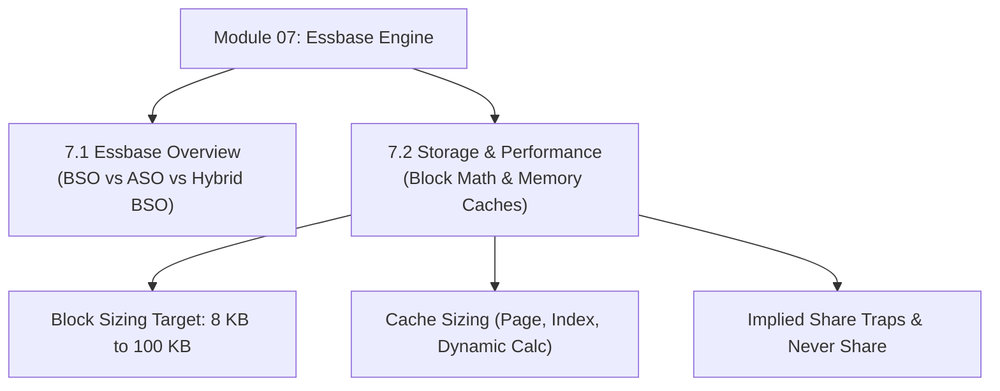

# Module 07: Essbase Architecture, Storage Engines & Block Physics

## Navigation & Module Overview

This module covers the core Essbase analytical database engine, BSO vs ASO vs Hybrid storage engines, physical block mathematics, memory cache hierarchy, and Implied Share mechanics.

---

<!-- ===================================================================== -->
<!-- 🎯 LIVE INTERACTIVE VISUAL CARD: MODULE 07 ESSBASE ARCHITECTURE -->
<!-- ===================================================================== -->

<b>🎯 Live Interactive Architecture Card: Essbase Architecture Suite (Click to Collapse / Expand)</b>

 

> [!TIP]
> **Interactive Standalone Dashboard:** Open [`card_kb_06_essbase_deep_dive.html`](../interactive_cards/card_kb_06_essbase_deep_dive.html) in your browser for a live interactive Essbase storage engine & memory cache explorer!

| Document | Primary Domain | Core Focus | Direct Link |
| :--- | :--- | :--- | :--- |
| **7.1 Essbase Overview** | Storage Engines | BSO vs ASO vs Modern Hybrid BSO, Physical Block Array vs Columnar Tuple | [01_Essbase_Overview.md](01_Essbase_Overview.md) |
| **7.2 Storage & Performance** | Block Sizing & Caches | Block Sizing Formula ($D_1 \times D_2 \times \dots \times 8$), Memory Caches, Implied Shares | [02_Essbase_Storage_and_Performance.md](02_Essbase_Storage_and_Performance.md) |

---

## Module Documents

1. **[7.1 Essbase Architecture: BSO, ASO & Modern Hybrid Storage Engines](01_Essbase_Overview.md)**
   * BSO (Block Storage) vs. ASO (Aggregate Storage) vs. Modern Hybrid BSO.
   * Physical storage atoms: Multidimensional array (`.pag`) vs. Compressed tuple (`.dat`).
   * Hybrid BSO dual-kernel execution internals and fallback risks.
   * Tough & twisted review questions with consultant model answers.

2. **[7.2 Essbase Storage, Memory Caches & Block Math Physics](02_Essbase_Storage_and_Performance.md)**
   * The Block Sizing Formula: Dense Cartesian cells $\times 8$ bytes (8 KB - 100 KB target).
   * Three Essbase files: Blueprint (`.otl`), Index (`.ind`), Page (`.pag`).
   * Memory cache hierarchy: Page Cache, Index Cache, Dynamic Calc Cache.
   * Implied Share mechanics, 1-child parent traps, and `Never Share` configuration.
   * Tough & twisted review questions with consultant model answers.

---
*Return to [Knowledge Base Master Index](../README.md) or advance to [Module 08: Dimensions and Metadata Engineering](../08_Dimensions_and_Metadata/00_INDEX.md).*
