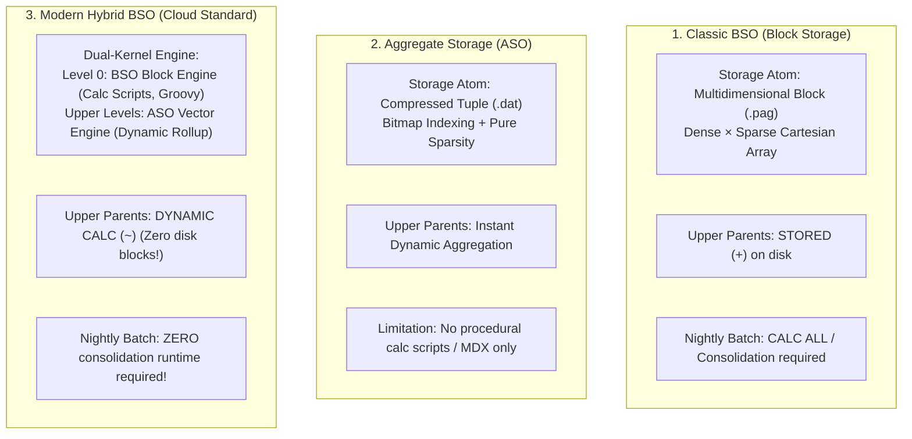
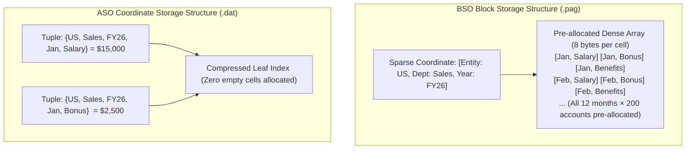

# 7.1 Essbase Architecture: BSO, ASO & Modern Hybrid Storage Engines

## Table of Contents
1. [Core Consultant Mental Model](#1-core-consultant-mental-model)
2. [Storage Engine Anatomy: BSO vs. ASO vs. Hybrid BSO](#2-storage-engine-anatomy-bso-vs-aso-vs-hybrid-bso)
3. [Physical Storage Mechanics: Block Arrays vs. Coordinate Tuples](#3-physical-storage-mechanics-block-arrays-vs-coordinate-tuples)
4. [Hybrid BSO Dual-Kernel Execution Internals](#4-hybrid-bso-dual-kernel-execution-internals)
5. [Tough & Twisted Review Questions with Consultant Model Answers](#5-tough--twisted-review-questions-with-consultant-model-answers)

---

<!-- ===================================================================== -->
<!-- 🎯 LIVE INTERACTIVE VISUAL CARD: ESSBASE STORAGE ENGINES COMPARISON -->
<!-- ===================================================================== -->
<details open>
<summary><b>🎯 Live Interactive Architecture Card: BSO vs. ASO vs. Hybrid BSO Matrix (Click to Collapse / Expand)</b></summary>

<br/>

> [!TIP]
> **Interactive Standalone Dashboard:** Open [`card_kb_06_essbase_deep_dive.html`](../interactive_cards/card_kb_06_essbase_deep_dive.html) in your browser for a live interactive Essbase storage engine & memory cache explorer!

| Architectural Dimension | Classic BSO (Block Storage) | Aggregate Storage (ASO) | Hybrid BSO (Modern Cloud EPM) |
| :--- | :--- | :--- | :--- |
| **Physical Storage Atom** | Dense Cartesian Array (`.pag`) | Compressed Columnar Coordinate Tuple (`.dat`) | **Dual Kernel:** Level 0 BSO Block + ASO Dynamic Vectors |
| **Dimensional Density** | Strict Dense / Sparse configuration | Pure sparsity; no dense/sparse concept | Dense / Sparse at Level 0; Pure Dynamic Upper Rollup |
| **Calculation Engine** | Procedural Calc Scripts (`@` functions) | Declarative MDX formulas only | Procedural at Level 0; Multi-threaded vector rollups |
| **Upper Parent Storage** | Stored (`+`) physical disk blocks | Stored or Dynamic hierarchies | **Dynamic Calc (`~`)** (Zero disk blocks!) |
| **Concurrency & Write-Back** | Exclusive Block Locks during writes | Non-blocking append-only data slices | Non-blocking upper queries; Level 0 block locks |
| **Dimensional Scalability** | Max 10-14 dimensions (Block explosion) | Scales to 20+ dimensions, millions of members | Scales to 15-18 dimensions comfortably |



</details>

---

## 1. Core Consultant Mental Model

When entering an Oracle Cloud EPM technical interview or conversion review, you must never provide high-level answers like *"BSO is for planning and ASO is for reporting."* 

**The Technical Architect Definition:**
> **BSO (Block Storage Option)** is an in-place array storage engine optimized for complex procedural calculations, iterative allocations, and multi-dimensional write-back across dense matrices.
> **ASO (Aggregate Storage Option)** is a compressed, columnar coordinate storage engine optimized for high-concurrency read queries, sub-second rollups across massive sparse dimensionality, and dynamic slice aggregation.
> **Hybrid BSO** is Oracle's dual-kernel standard that combines the best of both worlds: BSO procedural write-back at Level 0 leaf cells, combined with ASO multi-threaded dynamic vector aggregation at upper summary levels.

---

## 2. Storage Engine Anatomy: BSO vs. ASO vs. Hybrid BSO

### 1. Classic BSO (Block Storage)
* **How It Works:** Essbase divides dimensions into **Dense** and **Sparse**.
* Every unique combination of sparse members that contains data generates a physical multidimensional data block.
* All dense cells inside that block are pre-allocated in memory and stored sequentially on disk (`.pag`).
* **The Fatal Flaw:** Beyond 12 to 14 dimensions, calculating and storing upper-level parent blocks triggers **Block Explosion**, causing database size to balloon into hundreds of gigabytes and extending nightly batch windows.

### 2. Aggregate Storage (ASO)
* **How It Works:** ASO eliminates the dense/sparse distinction entirely.
* Data is stored strictly as compressed coordinate tuples: `[Account_ID, Entity_ID, Period_ID, Value]`.
* Zero empty cells are ever allocated or stored.
* Upper-level aggregations are calculated dynamically in sub-seconds using multi-threaded vector math and bitmap indexing.
* **The Fatal Flaw:** ASO cannot execute procedural calculation scripts (no `@LOOP`, no `@PRIOR`, no cross-cube `@XWRITE`). Allocations require complex MDX expressions.

### 3. Modern Hybrid BSO (The Cloud Standard)
* **The Breakthrough:** Hybrid BSO runs two calculation engines simultaneously inside the same cube kernel:
  1. **Level 0 Blocks:** Handled by the **BSO Engine**. Supports full procedural Calculation Manager rules, Groovy scripts, and cell-level write-backs.
  2. **Upper Summary Levels:** Handled by the **ASO Vector Engine**. All upper parent members are configured as **Dynamic Calc (`~`)**.
* **Impact on Production:** Eliminates nightly batch rollups entirely. When a user enters data at Level 0, parent entities and total accounts aggregate in memory instantaneously upon query!

---

## 3. Physical Storage Mechanics: Block Arrays vs. Coordinate Tuples



---

## 4. Hybrid BSO Dual-Kernel Execution Internals

When a user submits a query to a Hybrid BSO cube (via Smart View or Web Form), the Hybrid Coordinator evaluates the execution plan:

1. **Vector Execution (Fast Path):** If the requested upper-level members have simple consolidation operators (`+`, `-`, `~`) and standard mathematical formulas, the coordinator delegates evaluation to the ASO vector engine. Rollups return in **under 100 milliseconds**.
2. **Procedural Fallback (Slow Path):** If a dynamic parent contains complex procedural logic, range functions (`@CURRMBRRANGE`), or cross-dimensional assignments, the coordinator **falls back to the procedural BSO engine**. It creates temporary Cartesian blocks in memory block-by-block, causing multi-second delays.

### The Hybrid Optimization Directive:
To ensure business rules leverage Hybrid speed during calculation scripts, administrators include the compiler directive:
```essbase
SET HYBRIDBSOINCALCSCRIPT FULL;
```
This forces the Essbase calculation compiler to use the fast dynamic vector engine for intermediate rollups within business rules.

---

## 5. Tough & Twisted Review Questions with Consultant Model Answers

### Question 1: "Why does converting a Classic BSO application to Hybrid BSO reduce database disk footprint by 70% to 90%?"
**Consultant Model Answer:**
> "In Classic BSO, every upper-level parent member (Total Entity, Total Product, All Quarters) is configured as 'Stored' (`+`). To report on summary numbers, batch calculations had to calculate and physically write blocks to disk for every summary sparse combination, where upper blocks typically represented 70% to 90% of total database volume. 
> In Hybrid BSO, all upper-level parent members are converted to **Dynamic Calc (`~`)**. Essbase **never writes upper-level blocks to disk**; only Level 0 leaf blocks are stored. At query time, upper totals are computed dynamically in memory by the ASO vector engine, eliminating 70% to 90% of the physical `.pag` files on disk."

### Question 2: "What is the physical difference between an ASO data slice and a BSO data block?"
**Consultant Model Answer:**
> "* **BSO Data Block:** A fixed-format, multidimensional array containing all combinations of Dense dimensions for a single Sparse intersection. All cells inside the block occupy 8 bytes of physical storage, regardless of whether they contain numbers or `#Missing`.
> * **ASO Data Slice:** A compressed, columnar table of sparse coordinate tuples stored in `.dat` files. Only cells with non-zero, non-missing values are recorded alongside bitmap coordinate pointers. Slices are append-only; updates create new micro-slices that must be compacted via slice merges."

### Question 3: "A senior reviewer asks: Can a user write back directly to an ASO reporting cube in Smart View without spreading?"
**Consultant Model Answer:**
> "No. ASO cubes do not support direct in-place write-back to stored parent members because upper levels do not exist as stored physical blocks. Write-back into an ASO cube is permitted **only at Level 0 leaf intersections**, or through explicitly configured **Allocation / Grid Spreading** operations where the client supplies a spreading pattern down to leaf cells. For interactive planning and recursive write-backs, Hybrid BSO is the recommended architectural standard."

---
*Proceed to [7.2 Essbase Storage, Memory Caches & Block Math](02_Essbase_Storage_and_Performance.md).*
