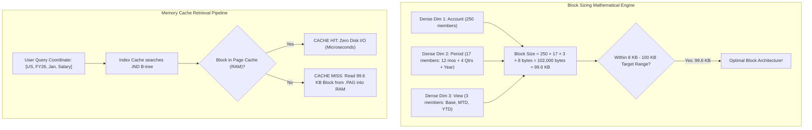

# 7.2 Essbase Storage, Memory Caches & Block Math Physics

## Table of Contents
1. [Core Consultant Mental Model](#1-core-consultant-mental-model)
2. [The Block Sizing Formula & The 8 KB - 100 KB Target Range](#2-the-block-sizing-formula--the-8-kb---100-kb-target-range)
3. [The Three Essbase Files: Outline (`.otl`), Index (`.ind`), Page (`.pag`)](#3-the-three-essbase-files-outline-otl-index-ind-page-pag)
4. [Memory Cache Hierarchy: Page, Index & Dynamic Calc Caches](#4-memory-cache-hierarchy-page-index--dynamic-calc-caches)
5. [Implied Share Mechanics & Configuration Traps](#5-implied-share-mechanics--configuration-traps)
6. [Tough & Twisted Review Questions with Consultant Model Answers](#6-tough--twisted-review-questions-with-consultant-model-answers)

---

<!-- ===================================================================== -->
<!-- 🎯 LIVE INTERACTIVE VISUAL CARD: BLOCK SIZING & MEMORY CACHES -->
<!-- ===================================================================== -->
<details open>
<summary><b>🎯 Live Interactive Architecture Card: Block Sizing & Cache Architecture (Click to Collapse / Expand)</b></summary>

<br/>

> [!TIP]
> **Interactive Standalone Dashboard:** Open [`card_kb_06_essbase_deep_dive.html`](../interactive_cards/card_kb_06_essbase_deep_dive.html) in your browser for a live interactive Essbase storage engine & memory cache explorer!

| Architecture Component | Physical Role | Mathematical / Sizing Rule | Optimal Target |
| :--- | :--- | :--- | :--- |
| **Data Block** | Multidimensional array of dense cells | $\prod (\text{Dense Member Counts}) \times 8 \text{ bytes}$ | **8 KB to 100 KB** (Max 200 KB) |
| **Page Cache** | Holds uncompressed data blocks in RAM | Read/Write buffer between memory and `.pag` | Sized to hold active working set |
| **Index Cache** | Holds B-tree index pages in RAM | Resolves sparse coordinates to `.pag` disk offsets | Sized to fit entire `.ind` index in memory |
| **Implied Share** | Automatic memory pointer sharing | Occurs when parent has only 1 child or 1 consolidates | Parent and child share the same memory cell |



</details>

---

## 1. Core Consultant Mental Model

When a senior reviewer hands you an Essbase outline and asks: *"Is this cube well-designed?"*, the first calculation you must perform on paper is the **Physical Block Size**.

If the block size is **under 4 KB**, the database suffers from massive index overhead: Essbase spends more CPU cycles searching B-tree index pointers than reading data.
If the block size is **over 500 KB**, the database suffers from memory bloat and I/O thrashing: loading a single cell into memory requires dragging half a megabyte of disk space into RAM.

The universal sweet spot for modern 64-bit Essbase is **8 KB to 100 KB** (up to 200 KB in high-density cubes).

---

## 2. The Block Sizing Formula & The 8 KB - 100 KB Target Range

$$\text{Block Size (Bytes)} = (\text{Dense}_1 \times \text{Dense}_2 \times \dots \times \text{Dense}_n) \times 8 \text{ bytes}$$

*(Where 8 bytes is the standard IEEE 754 double-precision floating-point size of a single Essbase numeric cell).*

### Real-World Example:
* **Account (Dense):** 200 stored members
* **Period (Dense):** 17 stored members (12 Months, Q1-Q4, Full Year)
* **HSP_Rates (Dense):** 4 members
* **Scenario (Dense):** 3 members

$$\text{Block Size} = 200 \times 17 \times 4 \times 3 \times 8 \text{ bytes} = 40,800 \times 8 = 326,400 \text{ bytes} \approx 318.75 \text{ KB}$$

**Architectural Evaluation:** 318.75 KB is too large!
* **Remediation:** Flip `Scenario` to **Sparse**.
* **New Calculation:** $200 \times 17 \times 4 \times 8 \text{ bytes} = 108,800 \text{ bytes} \approx 106.25 \text{ KB}$ (Near-perfect optimal range!).

---

## 3. The Three Essbase Files: Outline (`.otl`), Index (`.ind`), Page (`.pag`)

| File Extension | File Name & Role | Internal Structure |
| :--- | :--- | :--- |
| **`.otl` (Outline)** | Application blueprint | Stores dimensional tree hierarchies, member properties, formulas, and aliases. |
| **`.ind` (Index)** | Table of contents | B-tree index mapping sparse member ID combinations to physical offsets inside `.pag`. |
| **`.pag` (Page)** | Actual data storage | Stores physical data blocks containing dense cell arrays. Split into 2 GB volume segments (`ess00001.pag`). |


---

## 4. Memory Cache Hierarchy: Page, Index & Dynamic Calc Caches

1. **Page Cache:**
   * Holds uncompressed data blocks in memory.
   * When an equation modifies a cell, it updates the block in the Page Cache. Blocks are written back to `.pag` during checkpoints or commits.
2. **Index Cache:**
   * Holds index pages from the `.ind` file in RAM.
   * **Rule of Thumb:** Size the Index Cache large enough to hold the **entire index file in memory** (`Index Cache Size >= .IND file size`). This ensures Essbase never performs disk I/O to locate a block!
3. **Dynamic Calc Cache:**
   * Allocates dedicated RAM for intermediate calculation results during dynamic parent rollups and MDX evaluations.

---

## 5. Implied Share Mechanics & Configuration Traps

### What Is an Implied Share?
Essbase automatically marks a parent member as an **Implied Share** under two specific conditions:
1. **The parent has only ONE child member.**
2. **The parent has multiple children, but only ONE child consolidates (all other children are marked as non-consolidating `~`).**

```mermaid
graph TD
    Parent["Parent: Total_Marketing (Stored +)"]
    Child1["Child: Advertising (Consolidates +)"]
    Child2["Child: Internal_Promo (Does not consolidate ~)"]
    
    Parent --> Child1
    Parent --> Child2
    
    Child1 -.->|"Implied Share Triggered!"| Parent
    note right of Child1: Advertising and Total_Marketing share the SAME physical cell!
```

### The Consultant Gotcha:
* Because parent and child share the exact same physical cell memory pointer, **writing to the parent overwrites the child**, and writing to the child overwrites the parent!
* If a planner enters data into both on a web form, the second write silently overwrites the first!
* **Remediation:** If parent and child must store independent data, set the parent property to **Never Share (`UNSHARE`)** or configure the parent as Dynamic Calc.

---

## 6. Tough & Twisted Review Questions with Consultant Model Answers

### Question 1: "An Essbase cube has 4 Dense dimensions with member counts of 300, 16, 4, and 5. Calculate the exact block size in bytes and KB, and evaluate whether this block size is optimal."
**Consultant Model Answer:**
> "We apply the standard Essbase block sizing formula:
> $$\text{Block Size (Bytes)} = (300 \times 16 \times 4 \times 5) \times 8 \text{ bytes}$$
> $$\text{Dense Cells} = 300 \times 16 \times 4 \times 5 = 96,000 \text{ cells}$$
> $$\text{Block Size (Bytes)} = 96,000 \times 8 = 768,000 \text{ bytes}$$
> $$\text{Block Size (KB)} = \frac{768,000}{1024} = 750 \text{ KB}$$
> **Architectural Evaluation:** 750 KB is **excessively large** (well above the 100 KB - 200 KB threshold). This cube will suffer from high memory consumption, slow I/O transfers, and cache thrashing. 
> To optimize, change the dimension with 4 or 5 members (e.g., Scenario or View) from Dense to Sparse, which slashes the block size down to 150 KB or 187.5 KB."

### Question 2: "What is the physical architectural consequence of setting the Essbase Index Cache smaller than the physical `.ind` file on disk?"
**Consultant Model Answer:**
> "If the Index Cache is smaller than the physical `.ind` file, Essbase cannot hold the entire B-tree index in RAM. 
> When users query or submit data to different sparse coordinates, Essbase suffers from **Index Cache Thrashing**: it must repeatedly evict index pages from memory and read new index pages from the physical disk drive. Because disk I/O is thousands of times slower than RAM, queries and calculation rules experience severe latency. 
> Best practice in Cloud EPM is ensuring the Index Cache is large enough to contain the entire `.ind` file."

### Question 3: "A form user inputs \$5,000 into 'Parent_Dept' and \$2,000 into its only child 'Sub_Dept'. Upon saving, both cells display \$2,000. Why did the parent lose its \$5,000 value?"
**Consultant Model Answer:**
> "This is a classic **Implied Share** collision. 
> Because 'Parent_Dept' has only one child ('Sub_Dept'), Essbase automatically optimizes storage by creating an Implied Share: the parent does not allocate an independent physical cell; instead, it shares the exact same memory pointer as its single child. 
> When the form submitted both values, the child value of \$2,000 wrote to the shared pointer last, overwriting the parent's \$5,000. 
> To resolve this, the administrator must explicitly set the parent member property to **Never Share** in the dimension outline and execute a database refresh."

---
*Proceed to [Module 08: Dimensions & Metadata Engineering](../08_Dimensions_and_Metadata/00_INDEX.md).*
