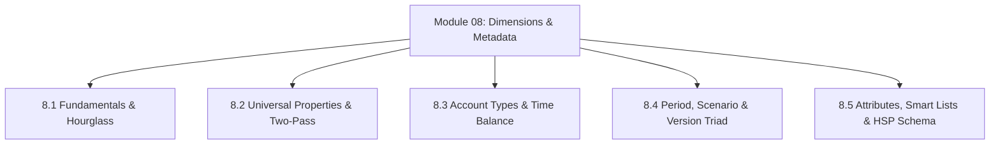

# Module 08: Dimensions, Metadata Engineering & Attribute Modeling

## Navigation & Module Overview

This module covers multidimensional outline design, standard vs custom dimensions, the Hourglass optimization model, universal member properties, Two-Pass calculation, Account/Period/Scenario/Version architectures, attributes, and the relational `HSP_*` schema.

---

<!-- ===================================================================== -->
<!-- 🎯 LIVE INTERACTIVE VISUAL CARD: MODULE 08 DIMENSIONS -->
<!-- ===================================================================== -->

<b>🎯 Live Interactive Architecture Card: Dimensions & Metadata Engineering Suite (Click to Collapse / Expand)</b>

 

> [!TIP]
> **Consultant High-Yield Summary:** Master the Hourglass ordering rule (Dense largest-to-smallest, then Sparse smallest-to-largest), Two-Pass calculation on ratios, Time Balance mechanics, and Attribute Dimensions.

| Document | Primary Domain | Core Focus | Direct Link |
| :--- | :--- | :--- | :--- |
| **8.1 Dimension Fundamentals** | Outline Structure | Standard Dimensions, Density, The Hourglass Dimension Ordering Model | [01_Dimension_Fundamentals.md](01_Dimension_Fundamentals.md) |
| **8.2 Universal Member Properties** | Member Properties | Data Storage (`Store`, `Dynamic Calc`), Consolidation Operators, Two-Pass Calculation | [02_Universal_Member_Properties.md](02_Universal_Member_Properties.md) |
| **8.3 Account Dimension** | Financial Modeling | Account Types (Revenue, Expense, Asset), Time Balance (Flow vs Balance), Variance Reporting | [03_Account_Dimension.md](03_Account_Dimension.md) |
| **8.4 Period, Scenario & Version** | Planning Context Triad | Base vs Summary Periods, Dynamic Time Series (DTS), Scenario Open Windows, Sandboxing | [04_Period_Scenario_Version.md](04_Period_Scenario_Version.md) |
| **8.5 Advanced Topics** | Advanced Metadata | Attribute Dimensions (Zero-block rollups), Smart Lists as Pseudo-Dimensions, `HSP_*` Schema | [05_Advanced_Topics.md](05_Advanced_Topics.md) |

---

## Module Documents

1. **[8.1 Dimension Fundamentals: Standard Dimensions, Sparsity & The Hourglass Model](01_Dimension_Fundamentals.md)**
   * Standard system dimensions vs. Custom operational dimensions.
   * The Hourglass Model for outline dimension ordering.
   * Dense vs. Sparse assignment matrix and physical restructuring impact.
   * Tough & twisted review questions with consultant model answers.

2. **[8.2 Universal Member Properties & Consolidation Operators](02_Universal_Member_Properties.md)**
   * Data Storage: `Store`, `Dynamic Calc`, `Never Share`, `Shared Member`, `Label Only`.
   * Consolidation operators: `+`, `-`, `*`, `/`, `%`, `~`, `^`.
   * Two-Pass Calculation physics and margin ratio consolidation traps.
   * Tough & twisted review questions with consultant model answers.

3. **[8.3 Account Dimension Architecture: Types, Time Balance & Variance](03_Account_Dimension.md)**
   * Account Types: Revenue, Expense, Asset, Liability, Equity, Saved Assumption.
   * Time Balance: Flow vs. Balance (First, Last, Average) with Skip settings.
   * Variance Reporting: Expense vs. Non-Expense math.
   * Tough & twisted review questions with consultant model answers.

4. **[8.4 Period, Scenario & Version: The Planning Context Triad](04_Period_Scenario_Version.md)**
   * Intra-year calendars and Dynamic Time Series (DTS: `Y-T-D`, `Q-T-D`).
   * Scenario open/closed planning horizons and Exchange Rate table assignment.
   * Version workflow: Bottom-Up vs. Target vs. Private Sandboxing.
   * Substitution variables and rolling forecast automation.
   * Tough & twisted review questions with consultant model answers.

5. **[8.5 Advanced Metadata Topics: Attributes, Smart Lists & HSP Relational Schema](05_Advanced_Topics.md)**
   * Attribute Dimensions: Cross-dimensional querying with zero physical block allocation.
   * Smart Lists as pseudo-dimensions: Storing integer IDs to eliminate block explosion.
   * Planning Relational Repository (`HSP_OBJECT`, `HSP_MEMBER`, `HSP_ACCOUNT`, `HSP_ALIAS`).
   * Tough & twisted review questions with consultant model answers.

---
*Return to [Knowledge Base Master Index](../README.md) or advance to [Module 09: EPBCS Out-of-the-Box Business Processes](../09_EPBCS_Modules/00_INDEX.md).*
