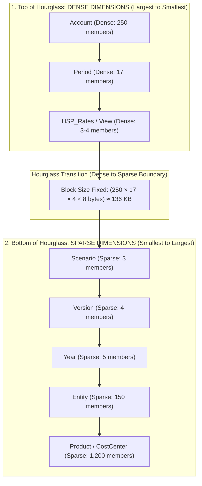

# 8.1 Dimension Fundamentals: Standard Dimensions, Sparsity & The Hourglass Model

## Table of Contents
1. [Core Consultant Mental Model](#1-core-consultant-mental-model)
2. [Standard (System) vs. Custom Dimensions](#2-standard-system-vs-custom-dimensions)
3. [The Hourglass Dimension Ordering Model](#3-the-hourglass-dimension-ordering-model)
4. [Dense vs. Sparse Assignment Matrix](#4-dense-vs-sparse-assignment-matrix)
5. [Tough & Twisted Review Questions with Consultant Model Answers](#5-tough--twisted-review-questions-with-consultant-model-answers)

---

<!-- ===================================================================== -->
<!-- 🎯 LIVE INTERACTIVE VISUAL CARD: DIMENSION FUNDAMENTALS & HOURGLASS -->
<!-- ===================================================================== -->

<b>🎯 Live Interactive Architecture Card: Dimension Density & The Hourglass Model (Click to Collapse / Expand)</b>

 

> [!TIP]
> **Consultant High-Yield Summary:** The order of dimensions in the Essbase outline determines calculation and query performance. Follow the classic **Hourglass Model**: Dense dimensions ordered from largest member count to smallest, followed by Sparse dimensions ordered from smallest member count to largest.

| Dimension Type | Standard Members | Typical Density | Architectural Role |
| :--- | :--- | :--- | :--- |
| **Account** | Revenue, Opex, Net Income | **Dense** | Contains financial logic, time balance, and mathematical formulas |
| **Period** | Jan, Feb, Q1, YearTotal | **Dense** | Represents time calendar intervals; dense array indexing |
| **Entity** | Legal entities, Cost Centers | **Sparse** | Defines organizational reporting tree; defines physical block count |
| **Scenario** | Actual, Budget, Forecast | **Sparse** | Defines independent versions of reality; separates historical actuals |
| **Version** | Working, Final, What-If | **Sparse** | Governs workflow state (Bottom-Up vs Target) |
| **Year** | FY24, FY25, FY26 | **Sparse** | Fiscal calendar years |

---

## 1. Core Consultant Mental Model

In a multidimensional database, a **dimension** is an analytical axis. 
* **Every coordinate cell in Essbase requires exactly one member from every single dimension.**
* If an application has 10 dimensions, you cannot store a cell with only 9 coordinates. This is why custom dimensions include a dummy member (e.g., `No_Product`, `No_CostCenter`) for transactions that do not apply to that dimension.
* **The Hourglass Axiom:** In BSO and Hybrid BSO cubes, dimension ordering is not aesthetic. The order of dimensions inside the outline determines how Essbase navigates B-trees and structures index pages in RAM.

---

## 2. Standard (System) vs. Custom Dimensions

When building a Planning or EPBCS application, Essbase seeds mandatory **Standard Dimensions**:

1. **Account:** Stores line items, KPIs, and balances. Drives Account Type, Time Balance, and Variance Reporting.
2. **Period:** Stores time intervals within a fiscal year (Months, Quarters, YearTotal).
3. **Year:** Stores fiscal calendar years.
4. **Scenario:** Distinguishes Actual, Plan, Forecast, and Variance scenarios. Controls start and end periods.
5. **Version:** Controls workflow and security. Types include `Bottom-Up` (editable by planners) and `Target` (top-down targets).
6. **Entity:** Represents legal corporations, business units, or departments. Drives the Approval Unit Hierarchy.
7. **Custom Dimensions:** Up to 15-20 additional dimensions (e.g., `Product`, `CostCenter`, `Channel`, `Project`) for granular operational planning.

---

## 3. The Hourglass Dimension Ordering Model

To maximize cache hits and optimize calculations, organize the outline in an **Hourglass pattern**:

### Top of Hourglass (Dense Dimensions):
* **Order from Largest Member Count to Smallest:**
  1. `Account` (~250 members)
  2. `Period` (~17 members)
  3. `HSP_Rates` / `View` (~3 to 4 members)
* **Reason:** Ordering dense dimensions from largest to smallest minimizes internal memory fragmentation within the data block array.

### Bottom of Hourglass (Sparse Dimensions):
* **Order from Smallest Member Count to Largest:**
  1. `Scenario` (3 members)
  2. `Version` (4 members)
  3. `Year` (5 members)
  4. `Entity` (100 members)
  5. `Product` (1,000 members)
* **Reason:** Ordering sparse dimensions from smallest to largest builds an optimal B-tree index hierarchy, minimizing pointer traversal depth when searching the `.ind` index.

---

## 4. Dense vs. Sparse Assignment Matrix

| Dimension | Standard Recommendation | When to Change |
| :--- | :--- | :--- |
| **Account** | **Always DENSE** | Almost never make Sparse (would destroy block math and formula performance). |
| **Period** | **Always DENSE** | Almost never make Sparse (Time Series functions require Dense Period). |
| **Entity** | **Always SPARSE** | Never make Dense (making Entity dense creates massive empty blocks and crashes RAM). |
| **Scenario** | **SPARSE** | Can be made Dense ONLY in very small cubes with < 8 dimensions. |
| **Version** | **SPARSE** | Keep Sparse to prevent block explosion across sandbox versions. |
| **Custom Dims** | **SPARSE** | Product, Customer, and Project should strictly remain Sparse. |

---

## 5. Tough & Twisted Review Questions with Consultant Model Answers

### Question 1: "A fresher changes the 'Entity' dimension from Sparse to Dense in an existing production cube with 200 entities. What happens physically to the cube upon database refresh?"
**Consultant Model Answer:**
> "Changing Entity from Sparse to Dense causes an immediate **Dense Restructure (Full Restructure)** with catastrophic storage implications:
> 1. **Block Size Detonation:** The physical block size multiplies by 200 (the count of entity members). A 50 KB block suddenly becomes a 10 MB block.
> 2. **Massive Empty Cell Storage:** Because every block now contains all 200 entities, Essbase pre-allocates storage for entities that have zero business in those accounts/departments, resulting in massive file bloat.
> 3. **Disk I/O Latency:** Reading a single cell now requires loading 10 MB into memory instead of 50 KB, exhausting the Page Cache, slowing calculations by 50x, and potentially crashing the Essbase process with an out-of-memory error."

### Question 2: "Why do custom dimensions like 'Product' and 'Project' always contain a 'No_Product' or 'No_Project' member?"
**Consultant Model Answer:**
> "Essbase is a strict multidimensional coordinate system. Every single data cell stored on disk must possess an exact coordinate pointer for **every dimension in the outline**. 
> When entering general corporate overhead expenses (such as Corporate Headquarters Rent or Legal Fees), these expenses do not correlate to any specific physical Product or Project. Because the Product dimension cannot be left blank or omitted, the application uses **'No_Product'** (Level 0 leaf member) to complete the multidimensional coordinate tuple."

### Question 3: "Explain the architectural rationale behind placing the largest Dense dimension at the top of the outline and the smallest Sparse dimension immediately after the dense/sparse boundary."
**Consultant Model Answer:**
> "This follows the **Essbase Hourglass Optimization Principle**:
> * **Dense Dimensions (Largest to Smallest):** Essbase builds the internal block matrix using nested arrays. Placing the dimension with the highest member count (Account) first maximizes contiguous memory allocation and vector processing efficiency.
> * **Sparse Dimensions (Smallest to Largest):** Essbase constructs its sparse index B-trees based on outline order. Placing low-cardinality dimensions (Scenario, Version) at the top of the sparse list creates a compact primary index branching structure, allowing Essbase index searches to discard entire non-existent sparse branches with minimal CPU tree traversals."

---
*Proceed to [8.2 Universal Member Properties & Consolidation Operators](02_Universal_Member_Properties.md).*
