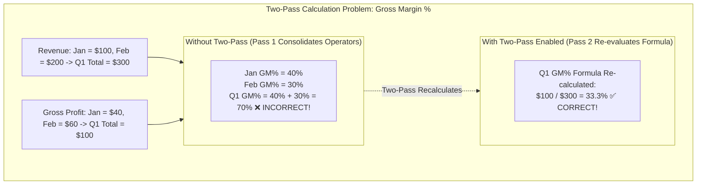
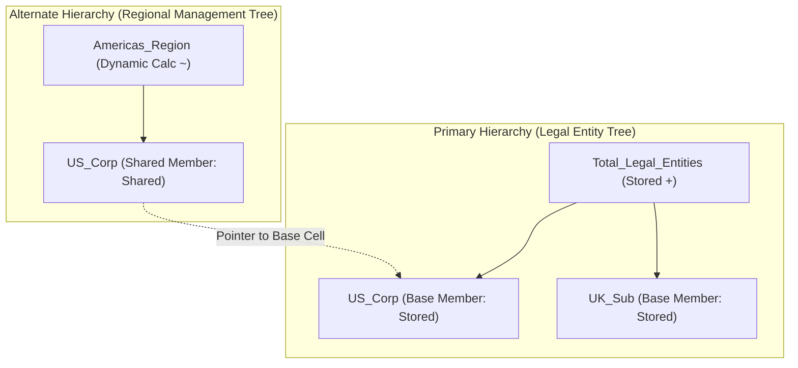

# 8.2 Universal Member Properties & Consolidation Operators

## Table of Contents
1. [Core Consultant Mental Model](#1-core-consultant-mental-model)
2. [Data Storage Properties Deep Dive](#2-data-storage-properties-deep-dive)
3. [Consolidation Operators Matrix (`+`, `-`, `*`, `/`, `%`, `~`, `^`)](#3-consolidation-operators-matrix)
4. [Two-Pass Calculation Physics & Margin Ratio Traps](#4-two-pass-calculation-physics--margin-ratio-traps)
5. [Shared Members & Storage Mechanics](#5-shared-members--storage-mechanics)
6. [Tough & Twisted Review Questions with Consultant Model Answers](#6-tough--twisted-review-questions-with-consultant-model-answers)

---

<!-- ===================================================================== -->
<!-- 🎯 LIVE INTERACTIVE VISUAL CARD: MEMBER PROPERTIES & TWO-PASS CALC -->
<!-- ===================================================================== -->

<b>🎯 Live Interactive Architecture Card: Member Properties & Consolidation Operators (Click to Collapse / Expand)</b>

 

> [!TIP]
> **Consultant High-Yield Summary:** Master the **Two-Pass Calculation** property. Ratios and percentage accounts (such as `Gross Margin %` = `Gross Margin / Revenue`) must be marked as **Dynamic Calc + Two-Pass**. Without Two-Pass, Essbase incorrectly sums child percentages up the hierarchy instead of recalculating the formula at parent intersections!

| Storage Property | Storage Impact | Calculation Behavior | When to Use |
| :--- | :--- | :--- | :--- |
| **Store** | Occupies physical 8-byte cell in `.pag` | Value persists until overwritten by calc or input | Level 0 leaf inputs in BSO |
| **Dynamic Calc** | **Zero disk space** (Calculated in RAM) | Evaluated on the fly at query time | All upper parents in Hybrid BSO; ratios |
| **Dynamic Calc and Store** | Calculates dynamically, then writes to disk | Legacy BSO feature; rarely used in Cloud | Deprecated in modern Hybrid BSO |
| **Never Share** | Independent physical cell allocated | Disables automated Implied Share pointer | Parent with 1 child that must store data |
| **Shared Member** | Pointer to base member cell | Shares value with primary member | Alternate hierarchies (e.g., Geographic vs Legal) |
| **Label Only** | Zero disk space; cannot hold data | Visual navigational grouping parent | Summary headers that contain no numbers |

---

## 1. Core Consultant Mental Model

In Essbase, member properties govern **where numbers physically live, how they aggregate, and how formulas evaluate**.
* An incorrect storage property can break an entire financial model: marking a ratio account as `Store` causes parent entities to display nonsensical sums of percentages (e.g., adding 40% margin + 30% margin to get 70% margin).
* In **Hybrid BSO**, configuring upper parent members as `Store` instead of `Dynamic Calc` defeats the dual-kernel architecture and wastes gigabytes of disk storage.

---

## 2. Data Storage Properties Deep Dive

1. **Store:**
   * Allocates physical 8-byte storage in the `.pag` data block.
   * Standard for all Level 0 leaf members where planners input operational data.
2. **Dynamic Calc:**
   * Consumes zero physical disk storage.
   * Computed dynamically in memory upon query using member formulas or hierarchical rollup operators.
   * Standard for all upper-level parent members in **Hybrid BSO**.
3. **Never Share:**
   * Prevents Essbase from creating an automated **Implied Share**.
   * Mandatory when a parent member has only one child, but the client requires the parent to hold independent planning targets.
4. **Label Only:**
   * Acts as a pure navigational title in forms and reports.
   * Cannot hold numbers, cannot be written to, and has no consolidation operator.
5. **Shared Member:**
   * A secondary occurrence of a base member inside an alternate hierarchy.
   * Does not create a duplicate physical cell; acts as an outline alias pointing back to the base member's data cell.

---

## 3. Consolidation Operators Matrix (`+`, `-`, `*`, `/`, `%`, `~`, `^`)

The consolidation operator dictates how a child rolls up into its immediate parent:

| Operator | Symbol | Action | Typical Financial Use Case |
| :--- | :---: | :--- | :--- |
| **Addition** | `+` | Adds child value to parent | Standard rollup (Revenue + Opex) |
| **Subtraction** | `-` | Subtracts child value from parent | Returns / Discounts reducing Gross Revenue |
| **Multiplication**| `*` | Multiplies child into parent | Statistical drivers and index factors |
| **Division** | `/` | Divides parent by child | Ratio indicators |
| **Percent** | `%` | Computes percentage ratio | Allocation percentages |
| **Ignore / Do Not Consolidate** | `~` | Excludes child from parent rollup | Memo accounts, Headcount drivers, Prior Year reference |
| **Never Consolidate**| `^` | Prevents consolidation across all dimensions | Specialized technical calculation controls |

---

## 4. Two-Pass Calculation Physics & Margin Ratio Traps

When Essbase consolidates a database during a calculation script, it executes **Pass 1 (Dimension Rollup)**:
* It traverses the outline bottom-up, applying consolidation operators (`+`, `-`).
* If `Gross Margin %` has children, Essbase sums the children's percentage values together!

### The Two-Pass Solution:
* When a member has the **Two-Pass Calculation** property enabled:
  1. Essbase completes the standard consolidation of all base dimensions in Pass 1.
  2. Essbase initiates **Pass 2**: it re-evaluates the formula for Two-Pass members at all summary intersections, dividing the consolidated Gross Profit by the consolidated Revenue.
* **Axiom:** Two-Pass is supported strictly on **Account dimension members** configured as **Dynamic Calc** or members with explicit formulas.

---

## 5. Shared Members & Storage Mechanics

### Shared Member Rules:
1. The **Base Member** must precede the Shared Member in outline order.
2. The Base Member must be **Stored** (cannot share a Dynamic Calc member).
3. The Shared Member shares the exact same member name, alias, and physical data block pointer.

---

## 6. Tough & Twisted Review Questions with Consultant Model Answers

### Question 1: "An Account member 'Operating_Margin_Pct' has formula `[Operating_Income] / [Revenue]`. In Smart View, leaf entities show correct margins (15%, 20%), but 'Total_Entity' shows 35%. What property was omitted?"
**Consultant Model Answer:**
> "The **Two-Pass Calculation** property was omitted. 
> During hierarchical consolidation, Essbase applies standard additive consolidation operators (`+`) across the Entity tree. Without Two-Pass, Essbase summed the leaf margins: $15\% + 20\% = 35\%$. 
> To resolve this, the administrator must enable the **Two-Pass Calculation** checkbox on 'Operating_Margin_Pct' (which must be configured as Dynamic Calc). In Pass 2, Essbase recalculates the formula at the 'Total_Entity' coordinate, dividing Total Operating Income by Total Revenue to produce the correct blended margin."

### Question 2: "What occurs if an administrator marks a parent member as 'Dynamic Calc' and assigns child members with consolidation operator `~` (Ignore)?"
**Consultant Model Answer:**
> "The parent member will evaluate to `#Missing` (or zero) unless the parent has an explicit member formula. 
> The `~` operator instructs Essbase to completely ignore the child during rollup calculations. If all children under a Dynamic Calc parent are set to `~`, the dynamic vector rollup engine adds zero values into the parent coordinate, resulting in `#Missing`."

### Question 3: "A developer attempts to create a Shared Member inside an alternate hierarchy, but the database refresh fails with error: 'Base member must precede shared member'. How do you fix this?"
**Consultant Model Answer:**
> "In Essbase outline architecture, the **primary base member must physically reside higher in the outline file than any of its shared occurrences**. 
> Essbase reads the outline from top to bottom; it cannot instantiate a shared memory pointer to a member that has not yet been registered. 
> To fix:
> 1. Locate both occurrences in the Dimension Editor.
> 2. Move the hierarchy containing the Base Member above the alternate hierarchy containing the Shared Member.
> 3. Verify the base member is configured as Stored, then execute a Refresh Database."

---
*Proceed to [8.3 Account Dimension Architecture: Types, Time Balance & Variance](03_Account_Dimension.md).*
