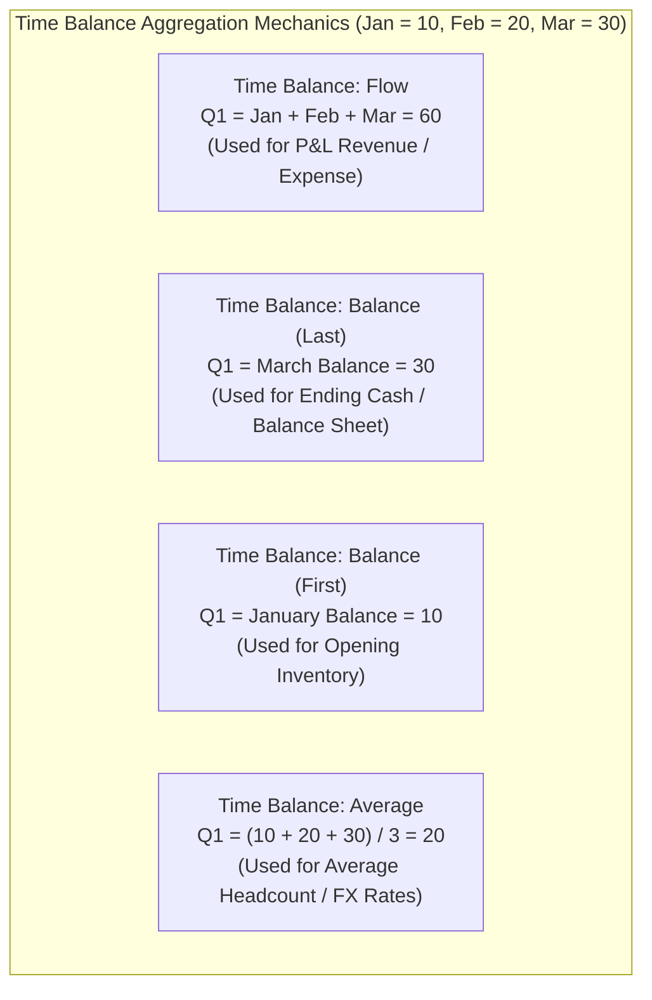

# 8.3 Account Dimension Architecture: Types, Time Balance & Variance

## Table of Contents
1. [Core Consultant Mental Model](#1-core-consultant-mental-model)
2. [Account Types Matrix & Financial Sign Rules](#2-account-types-matrix--financial-sign-rules)
3. [Time Balance Mechanics: Flow vs. Balance (First, Last, Average)](#3-time-balance-mechanics-flow-vs-balance-first-last-average)
4. [Variance Reporting: Expense vs. Non-Expense](#4-variance-reporting-expense-vs-non-expense)
5. [Data Types: Currency, Non-Currency, Smart List & Text](#5-data-types-currency-non-currency-smart-list--text)
6. [Tough & Twisted Review Questions with Consultant Model Answers](#6-tough--twisted-review-questions-with-consultant-model-answers)

---

<!-- ===================================================================== -->
<!-- 🎯 LIVE INTERACTIVE VISUAL CARD: ACCOUNT DIMENSION ARCHITECTURE -->
<!-- ===================================================================== -->

<b>🎯 Live Interactive Architecture Card: Account Dimension Mechanics (Click to Collapse / Expand)</b>

 

> [!TIP]
> **Consultant High-Yield Summary:** The Account dimension is the mathematical core of Oracle Cloud EPM. Three properties drive calculation and reporting behavior: **Account Type** (governs consolidation sign), **Time Balance** (governs time aggregation: Flow vs Balance), and **Variance Reporting** (governs variance sign: Budget vs Actual).

| Account Type | Standard Financial Statement | Time Balance Default | Variance Reporting |
| :--- | :--- | :--- | :--- |
| **Revenue** | Income Statement (P&L) | `Flow` (Sum across months) | `Non-Expense` (Actual - Budget) |
| **Expense** | Income Statement (P&L) | `Flow` (Sum across months) | `Expense` (Budget - Actual) |
| **Asset** | Balance Sheet | `Balance` (`Last`) | `Non-Expense` (Actual - Budget) |
| **Liability** | Balance Sheet | `Balance` (`Last`) | `Expense` / `Non-Expense` |
| **Equity** | Balance Sheet | `Balance` (`Last`) | `Non-Expense` |
| **Saved Assumption**| Driver / Rate / Headcount tables | `None` / `Flow` / `Average` | `Non-Expense` |

---

## 1. Core Consultant Mental Model

In Essbase, the **Account Dimension** is the only dimension that possesses native financial intelligence. 
* Unlike custom dimensions, Account properties instruct the Essbase kernel how to interpret debit/credit signs, how to roll up through time periods, and how to compute budget variances.
* If a junior consultant sets an Asset account to `Flow`, quarterly cash balances will be inflated by summing all three months.
* If an Expense account is configured as `Non-Expense`, budget variance reports will flag spending *under* budget as negative/unfavorable.

---

## 2. Account Types Matrix & Financial Sign Rules

| Account Type | Normal Financial Balance | Consolidation Behavior | Typical Member Examples |
| :--- | :--- | :--- | :--- |
| **Revenue** | Credit | Adds positively into Gross Margin / Operating Income | Product Sales, Service Revenue, Intercompany Sales |
| **Expense** | Debit | Subtracts from Gross Margin or adds to Total Opex | Salaries, Travel, Rent, Depreciation, Advertising |
| **Asset** | Debit | Adds positively into Total Assets | Cash, Accounts Receivable, Inventory, Fixed Assets |
| **Liability** | Credit | Adds positively into Total Liabilities | Accounts Payable, Short-Term Debt, Accrued Expenses |
| **Equity** | Credit | Adds into Total Shareholders' Equity | Common Stock, Retained Earnings, Additional Paid-in Capital |
| **Saved Assumption** | Neutral | Configurable consolidation | Tax Rates, Inflation %, Headcount, Days Sales Outstanding |

---

## 3. Time Balance Mechanics: Flow vs. Balance (First, Last, Average)

The **Time Balance** property defines how an account consolidates across the **Period (Time)** dimension:

### 1. `Flow` (Default for P&L)
* Sums child periods into parent periods:
  $$\text{Q1 Total} = \text{Jan} + \text{Feb} + \text{Mar}$$
* Used for revenues, expenses, cash flows, and volume shipments.

### 2. `Balance` with `Last` (Default for Balance Sheet)
* Takes the balance of the **last open child period**:
  $$\text{Q1 Ending Balance} = \text{Mar Balance}$$
* If March is `#Missing`, skip settings govern behavior:
  * **`Skip: None`:** Q1 returns `#Missing`.
  * **`Skip: Missing`:** Q1 falls back to February balance.

### 3. `Balance` with `First`
* Takes the balance of the **first open child period**:
  $$\text{Q1 Opening Balance} = \text{Jan Balance}$$

### 4. `Average`
* Calculates the mathematical average across open periods:
  $$\text{Q1 Average} = \frac{\text{Jan} + \text{Feb} + \text{Mar}}{3}$$
* Standard for Average Headcount, Average Inventory, and Effective Tax Rates.

---

## 4. Variance Reporting: Expense vs. Non-Expense

When comparing **Actual vs. Budget** scenarios:

* **`Non-Expense` (Revenue Accounts):**
  $$\text{Variance} = \text{Actual} - \text{Budget}$$
  *(If Actual Revenue is \$120 and Budget was \$100, Variance is +\$20 Favorable).*
* **`Expense` (Expense Accounts):**
  $$\text{Variance} = \text{Budget} - \text{Actual}$$
  *(If Budget Opex was \$100 and Actual Spending was \$85, Variance is +\$15 Favorable because spending was below budget).*

---

## 5. Data Types: Currency, Non-Currency, Smart List & Text

| Data Type | Description | Internal Essbase Storage |
| :--- | :--- | :--- |
| **Currency** | Monetary financial amounts | 8-byte floating point |
| **Non-Currency** | Quantities, units, hours, index numbers | 8-byte floating point |
| **Percentage** | Decimal ratios (0.15 for 15%) | 8-byte floating point |
| **Smart List** | Drop-down selections (e.g., "Full-Time", "Contractor") | Stores positive integer ID pointing to HSP table |
| **Date** | Calendar dates (YYYYMMDD) | Stores 8-byte integer: `20261105` |
| **Text** | Free-form alpha-numeric text comments | Stored in relational repository table |

---

## 6. Tough & Twisted Review Questions with Consultant Model Answers

### Question 1: "A balance sheet account 'Cash' is configured with `Time Balance: Balance (Last)`. If January has \$10,000, February has \$15,000, and March is `#Missing`, what does Q1 display under `Skip: None` vs. `Skip: Missing`?"
**Consultant Model Answer:**
> "* Under **`Skip: None`**: Essbase evaluates strictly the last physical child period (March). Because March is `#Missing`, Q1 returns **`#Missing`**.
> * Under **`Skip: Missing`**: Essbase skips any missing trailing periods and retrieves the last child period containing valid numeric data (February). Therefore, Q1 displays **\$15,000**.
> In financial planning applications where future forecast months may not be populated yet, `Skip: Missing` is the standard best practice."

### Question 2: "Why must Smart List accounts and Date accounts be configured as 'Saved Assumption' rather than 'Revenue' or 'Expense'?"
**Consultant Model Answer:**
> "Smart List accounts store numeric integer IDs (e.g., ID 1 = 'Engineering', ID 2 = 'Sales'), and Date accounts store integer date representations (e.g., `20261105`). 
> If configured as `Expense` or `Revenue`, Essbase attempts to apply currency formatting, applies variance reporting logic, and consolidates the IDs up the hierarchy, resulting in nonsensical sums of Smart List IDs. Setting the Account Type to **Saved Assumption** treats the value as neutral driver data, preventing currency symbol application and disabling unwanted consolidation rollups."

### Question 3: "A financial analyst notices that 'Gross Margin' (Revenue minus COGS) is calculated via member formula `[Revenue] - [COGS]`, but parent entities display incorrect values in variance reports. How should the account properties be configured?"
**Consultant Model Answer:**
> "To calculate correctly:
> 1. Set 'Gross Margin' Data Storage to **Dynamic Calc**.
> 2. Enable **Two-Pass Calculation** so the formula re-evaluates at parent entities rather than summing child margins.
> 3. Set Account Type to **Revenue** (or Non-Expense) and Variance Reporting to **Non-Expense**. This ensures that when consolidated Actual Gross Margin exceeds Budget, the variance displays as a positive favorable number."

---
*Proceed to [8.4 Period, Scenario & Version Dimensions Architecture](04_Period_Scenario_Version.md).*
