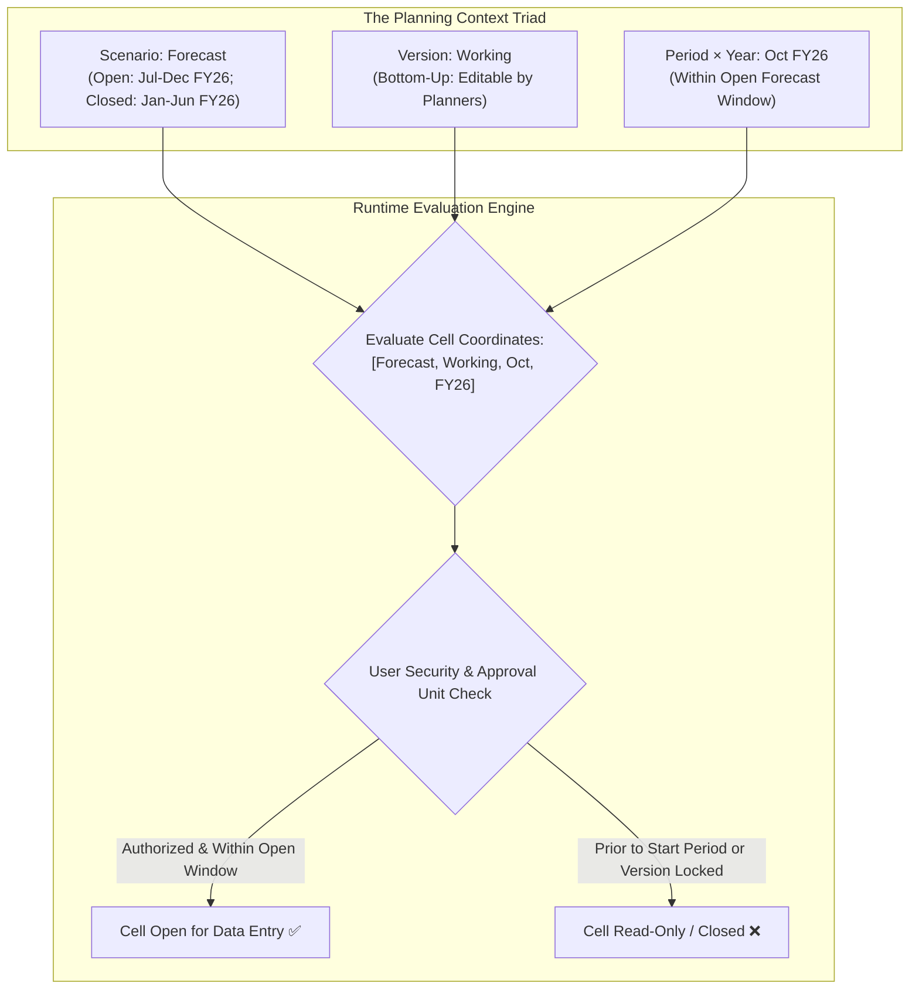

# 8.4 Period, Scenario & Version: The Planning Context Triad

## Table of Contents
1. [Core Consultant Mental Model](#1-core-consultant-mental-model)
2. [Period & Year Architecture: Calendars, Quarters & Dynamic Time Series (DTS)](#2-period--year-architecture-calendars-quarters--dynamic-time-series-dts)
3. [Scenario Dimension: Time Horizons & Exchange Rate Tables](#3-scenario-dimension-time-horizons--exchange-rate-tables)
4. [Version Dimension: Bottom-Up vs. Target vs. Sandboxing](#4-version-dimension-bottom-up-vs-target-vs-sandboxing)
5. [Substitution Variables & Rolling Forecast Automation](#5-substitution-variables--rolling-forecast-automation)
6. [Tough & Twisted Review Questions with Consultant Model Answers](#6-tough--twisted-review-questions-with-consultant-model-answers)

---

<!-- ===================================================================== -->
<!-- 🎯 LIVE INTERACTIVE VISUAL CARD: PLANNING CONTEXT TRIAD -->
<!-- ===================================================================== -->
<details open>
<summary><b>🎯 Live Interactive Architecture Card: Period, Scenario & Version Triad (Click to Collapse / Expand)</b></summary>

<br/>

> [!TIP]
> **Consultant High-Yield Summary:** The combination of **Scenario, Version, and Period/Year** establishes the operational context of every planning cell. Scenario defines *what reality* is being modeled (Actual vs Forecast) and which periods are open for data entry; Version defines *who owns the slice* (Bottom-Up vs Target); Period/Year establishes *the time horizon*.

| Dimension | Primary Role | Density | Key Configuration Properties |
| :--- | :--- | :--- | :--- |
| **Period** | Intra-year calendar intervals | **Dense** | Base periods (Jan-Dec), Quarters (Q1-Q4), Dynamic Time Series (DTS) |
| **Year** | Multi-year fiscal horizon | **Sparse** | FY23, FY24, FY25, FY26 (Past actuals + active budget + rolling forecast) |
| **Scenario** | Business version of reality | **Sparse** | Start/End Period, Start/End Year, Exchange Rate Table assignment |
| **Version** | Workflow ownership & sandboxing | **Sparse** | **Bottom-Up** (Leaf input) vs. **Target** (Top-down) vs. **Sandboxing** |



</details>

---

## 1. Core Consultant Mental Model

In Oracle Cloud EPM Planning, security permissions alone do not dictate whether a cell is editable.
* Even if a user has `WRITE` access to an Entity and an Account, they cannot type numbers into closed actuals.
* **The Scenario Dimension controls the Time Horizon boundary.**
* The **Version Dimension controls the Workflow and Sandboxing model.**
* When combined with **Substitution Variables** (e.g., `&CurMonth`, `&CurYear`), the triad automates rolling forecast boundaries without manual form redesign.

---

## 2. Period & Year Architecture: Calendars, Quarters & Dynamic Time Series (DTS)

### 1. Base vs. Summary Periods
* **Base Periods (Level 0):** Standard monthly intervals (Jan, Feb, Mar ... Dec) or 4-4-5 / 5-4-4 retail calendars.
* **Summary Periods:** Quarters (Q1, Q2, Q3, Q4) and `YearTotal`. Configured as Dynamic Calc (`~`) or Stored (`+`).

### 2. Dynamic Time Series (DTS)
Instead of creating dozens of manual YTD accounts in the outline, Essbase provides native **Dynamic Time Series (DTS)** members enabled directly on the Period dimension:
* **`Y-T-D` (Year-to-Date):** Calculates cumulative sum from January up to the queried month.
* **`Q-T-D` (Quarter-to-Date):** Calculates cumulative sum from the start of the quarter up to the queried month.
* **`M-T-D` (Month-to-Date):** Evaluates daily numbers within the month.

---

## 3. Scenario Dimension: Time Horizons & Exchange Rate Tables

Each member in the Scenario dimension defines its own operational lifecycle rules:

| Configuration Property | Purpose | Example |
| :--- | :--- | :--- |
| **Start Year & Period** | Defines the first calendar month open for data entry | `Start Year: FY26`, `Start Period: Jul` |
| **End Year & Period** | Defines the last calendar month open for data entry | `End Year: FY27`, `End Period: Dec` |
| **Exchange Rate Table** | Associates currency conversion rates with the scenario | Actuals use `Monthly_Average`; Budget uses `Constant_Plan_Rate` |
| **Data Storage** | Typically `Store` at Level 0 | Aggregates dynamically across parent scenarios |

* **The Actuals Closed-Period Trap:** Any period preceding the `Start Period` is automatically rendered **read-only** on web forms for that Scenario, preventing accidental overwriting of historical actuals.

---

## 4. Version Dimension: Bottom-Up vs. Target vs. Sandboxing

### 1. Bottom-Up Version (Default)
* Enables standard leaf-level operational budgeting.
* Planners enter numbers into Level 0 entities.
* Fully integrated with the **Approval Unit Hierarchy (AUH)**: entities can be promoted, approved, or rejected independently.

### 2. Target Version
* Used for top-down corporate target setting.
* Executives enter target numbers directly at parent entities (e.g., *Total Corporation Revenue Target = \$500M*).
* Targets are pushed down to operational budgets via spreading rules.

### 3. Sandboxing (What-If Analysis)
* Allows individual planners to create **private sandbox versions** (e.g., `Working_WhatIf`).
* Planners test driver assumptions without affecting the official `Working` version.
* Once finalized, planners click **Publish Sandbox**, which merges their private changes into the official shared version.

---

## 5. Substitution Variables & Rolling Forecast Automation

Hardcoding dates in business rules and forms is a critical anti-pattern. Consultants use **Substitution Variables**:

| Variable Name | Sample Value | Role in Forms and Calc Scripts |
| :--- | :--- | :--- |
| `&CurYear` | `FY26` | Anchors current planning year across all forms and rules. |
| `&CurPeriod` | `Oct` | Dynamic column selector; updates monthly via batch script. |
| `&OEP_CurYr` | `FY26` | Out-of-the-box EPBCS variable used in module calculation rules. |
| `&ForecastStart`| `Jul` | Sets the boundary where Actuals end and Forecast begins. |

```essbase
/* Dynamic Rule using Substitution Variables */
FIX(&CurYear, "Forecast", &CurPeriod)
    "Salary" = "Headcount" * "Avg_Rate";
ENDFIX
```

---

## 6. Tough & Twisted Review Questions with Consultant Model Answers

### Question 1: "A planner opens a Forecast web form in October. Why are cells from January to September read-only, while October to December cells are open for editing?"
**Consultant Model Answer:**
> "This behavior is governed by the **Scenario dimension configuration** for 'Forecast'. 
> In the Scenario definition, the administrator configured the **Start Period as 'October'** and **Start Year as 'FY26'**. Cloud EPM automatically enforces read-only cell locking on any period prior to the Start Period (January through September), protecting historical Actual months that were copied into the Forecast scenario from being overwritten by planners."

### Question 2: "What is the physical storage difference between an official 'Working' version and a private user 'Sandbox' version in Essbase?"
**Consultant Model Answer:**
> "* **Official Working Version:** Stored as standard physical blocks or coordinate tuples accessible to all authorized users and reflected in consolidated parent totals.
> * **Sandbox Version:** Implemented via **sparse version slicing**. Essbase tracks delta changes made by the sandbox user in private virtual memory blocks. Other users querying the cube do not see the sandbox changes, and parent rollups reflect official data until the user explicitly executes **Publish Sandbox**, which copies the delta coordinates into the official Working version."

### Question 3: "Why is Dynamic Time Series (`Y-T-D`) preferred over creating custom 'YTD_Account' members in the Account dimension?"
**Consultant Model Answer:**
> "Using Dynamic Time Series is architecturally superior because:
> 1. **Zero Outline Bloat:** Creating manual YTD accounts doubles the size of the Account dimension, expanding dense block size or sparse index pointers. DTS calculates YTD in memory on the fly without adding a single member to the outline.
> 2. **Zero Maintenance:** Manual YTD accounts require writing and maintaining complex `@SUMRANGE` formulas and executing batch calculations to populate them. DTS computes automatically for all accounts and all periods.
> 3. **Native Smart View Support:** Smart View recognizes DTS members natively in ad-hoc grids (e.g., selecting `Jan.Y-T-D` or `Aug.Y-T-D`)."

---
*Proceed to [8.5 Advanced Metadata Topics: Attributes, Smart Lists & HSP Tables](05_Advanced_Topics.md).*
