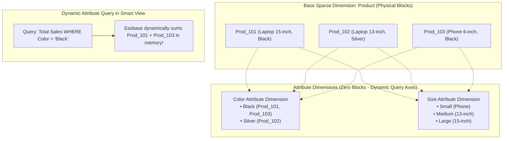

# 8.5 Advanced Metadata Topics: Attributes, Smart Lists & HSP Relational Schema

## Table of Contents
1. [Core Consultant Mental Model](#1-core-consultant-mental-model)
2. [Attribute Dimensions: Cross-Dimensional Filtering without Block Expansion](#2-attribute-dimensions-cross-dimensional-filtering-without-block-expansion)
3. [Smart Lists as Pseudo-Dimensions](#3-smart-lists-as-pseudo-dimensions)
4. [The Planning Relational Repository (`HSP_*` Schema)](#4-the-planning-relational-repository-hsp_-schema)
5. [Tough & Twisted Review Questions with Consultant Model Answers](#5-tough--twisted-review-questions-with-consultant-model-answers)

---

<!-- ===================================================================== -->
<!-- 🎯 LIVE INTERACTIVE VISUAL CARD: ATTRIBUTES & HSP RELATIONAL SCHEMA -->
<!-- ===================================================================== -->
<details open>
<summary><b>🎯 Live Interactive Architecture Card: Attributes & Relational HSP Schema (Click to Collapse / Expand)</b></summary>

<br/>

> [!TIP]
> **Consultant High-Yield Summary:** Do NOT create a full physical dimension if an **Attribute Dimension** or a **Smart List** solves the business requirement. Adding physical sparse dimensions detonates the Cartesian block space; Attribute Dimensions provide dynamic aggregation filtering with **zero block explosion**.

| Metadata Mechanism | Storage Footprint | Calculation Behavior | When to Use |
| :--- | :--- | :--- | :--- |
| **Physical Dimension** | Creates Cartesian index entries & blocks | Participates in full Essbase block array | Core organizational axes (Entity, CostCenter, Account) |
| **Attribute Dimension** | **Zero physical data blocks** | Dynamically aggregates base members at query time | Secondary traits (Product Size, SKU Color, Entity Country) |
| **Smart List** | Stores positive integer ID in single cell | Non-aggregating; referenced by Calc Manager/Groovy | Drop-down choices (Job Grades, Project Status, Ratings) |
| **HSP Relational Tables** | Oracle Autonomous RDBMS tables | Defines metadata properties, aliases, and security | Core repository compiled into Essbase via Cube Refresh |



</details>

---

## 1. Core Consultant Mental Model

When a client requests tracking 25 different characteristics (e.g., *Product Color, Package Size, Voltage, Warehouse Region, Tax Tier*), a novice consultant creates 25 physical dimensions. 
* **The Result:** The Essbase sparse Cartesian product explodes by $10^{15}$, the database crashes, and calculations freeze indefinitely.
* **The Architect Rule:**
  1. Use **Physical Dimensions** strictly for primary analytical axes that require independent budgets and write-back.
  2. Use **Attribute Dimensions** for secondary rollups and ad-hoc slicing.
  3. Use **Smart Lists** for categorical dropdown tags.

---

## 2. Attribute Dimensions: Cross-Dimensional Filtering without Block Expansion

### What Is an Attribute Dimension?
An **Attribute Dimension** is a special type of dimension linked to a base sparse dimension (most commonly `Product` or `Entity`):
* **Data Types Supported:** Text, Numeric, Date, Boolean.
* **Storage Footprint:** **Zero physical blocks.** Essbase does not allocate data blocks for attribute intersections.
* **Query Mechanics:** When a user queries `Color: Black` in Smart View, Essbase identifies all base products associated with the attribute 'Black' and aggregates them dynamically in memory.
* **Limitation:** Attributes can be associated **strictly with Sparse dimensions**, and only with **Level 0 leaf members**.

---

## 3. Smart Lists as Pseudo-Dimensions

Instead of creating dimensions for categorical labels, use **Smart Lists**:
* Planners select values from a drop-down list on web forms (e.g., `Employee Status`: *Full-Time*, *Part-Time*, *Contractor*).
* **Physical Storage Mechanics:**
  * Essbase stores a single **positive integer ID** (e.g., `1`, `2`, `3`) inside the standard 8-byte numeric cell.
  * The Planning web interface queries the relational repository to display the text label (*"Full-Time"*) to the user.
* **Calc Manager Integration:** Business rules evaluate Smart Lists using the `@HSPMBR` function or integer comparisons:
  ```essbase
  IF("Employee_Status" == [[SmartList.Employee_Status.Full_Time]])
      "Benefits" = "Salary" * 0.20;
  ENDIF
  ```

---

## 4. The Planning Relational Repository (`HSP_*` Schema)

Junior consultants often forget that Cloud EPM is built on a **relational RDBMS** synchronized with the Essbase analytical engine:

| Relational Table | Core Contents & Metadata Stored |
| :--- | :--- |
| **`HSP_OBJECT`** | Every artifact in the application (members, forms, rules, folders) has a unique `OBJECT_ID`. |
| **`HSP_MEMBER`** | Maps member names, parent IDs, dimension IDs, and member order. |
| **`HSP_ACCOUNT`** | Stores Account Type, Time Balance, Variance Reporting, and Data Type properties. |
| **`HSP_ALIAS`** | Stores multi-language alias tables and member aliases. |
| **`HSP_ACCESS_CONTROL`** | Stores security group assignments and artifact permissions. |

* **Why Direct SQL Is Impossible:** In OCI Gen 2 Cloud EPM, Oracle shields the relational schema inside an encrypted managed boundary. Administrators manage metadata via LCM snapshots, Dimension Editor, or REST APIs.

---

## 5. Tough & Twisted Review Questions with Consultant Model Answers

### Question 1: "A client wants to add 5 new dimensions for reporting: 'Product Color', 'Voltage', 'Manufacturing Plant', 'Warranty Tier', and 'Package Type'. How do you evaluate whether to make them Physical Dimensions or Attribute Dimensions?"
**Consultant Model Answer:**
> "I evaluate based on three architectural criteria:
> 1. **Do users need to enter and save budget data directly at these intersections?** If planners need to input budgets by 'Voltage' regardless of Product, it requires a physical dimension. If it is only used to slice and aggregate existing Product actuals/budgets, use an **Attribute Dimension**.
> 2. **Are the characteristics 1-to-1 attributes of an existing sparse dimension?** Each base product has one specific Color, Voltage, and Package Type. These are perfect candidates for Attribute Dimensions.
> 3. **Block Explosion Risk:** Adding 5 physical sparse dimensions would detonate block count and degrade performance. Implementing them as Attribute Dimensions adds **zero physical blocks**, preserves cube sizing, and provides instant Smart View ad-hoc aggregation."

### Question 2: "Can you assign an Attribute Dimension to a Dense dimension like Account or Period?"
**Consultant Model Answer:**
> "No. Essbase architecture strictly forbids associating Attribute Dimensions with Dense dimensions. Attribute Dimensions can be associated **strictly with Sparse dimensions** (e.g., Product, Entity, Customer), and can be assigned **only to Level 0 leaf members**. Dense dimensions reside inside the internal Cartesian block array and cannot support external attribute B-tree indexing."

### Question 3: "A business rule checks: `IF("Project_Status" == "Active")`. The rule fails to compile in Calculation Manager. Why did it fail and how do you write it correctly?"
**Consultant Model Answer:**
> "Calculation Manager rules evaluate against the Essbase engine, which only understands numbers and member names; it does not understand string literals like `\"Active\"`. 
> Because 'Project_Status' is a Smart List account, Essbase stores an integer ID on disk. 
> To write the condition correctly in Calc Manager:
> 1. Use the Smart List reference syntax: 
>    `IF("Project_Status" == [[SmartList.Project_Status.Active]])`
> 2. Alternatively, if the integer ID of 'Active' is 1:
>    `IF("Project_Status" == 1)`
> Both formats allow Essbase to execute valid numerical comparisons."

---
*Proceed to [Module 09: EPBCS Out-of-the-Box Business Processes](../09_EPBCS_Modules/00_INDEX.md).*
