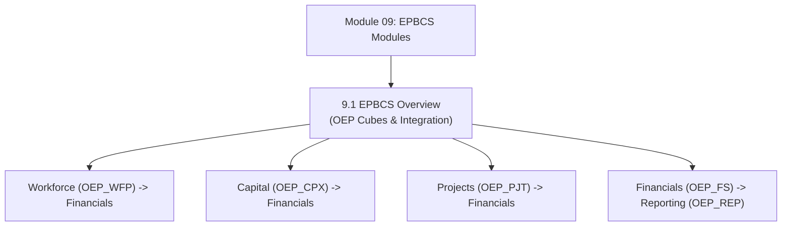

# Module 09: EPBCS Out-of-the-Box Modules & Business Processes

## Navigation & Module Overview

This module covers pre-built EPBCS applications, the 5 core business processes (Financials, Workforce, Capital, Projects, Strategic Modeling), cross-module data flow pipelines, and FreeForm Planning.

---

<!-- ===================================================================== -->
<!-- 🎯 LIVE INTERACTIVE VISUAL CARD: MODULE 09 EPBCS MODULES -->
<!-- ===================================================================== -->

<b>🎯 Live Interactive Architecture Card: EPBCS Modules Suite (Click to Collapse / Expand)</b>

 

> [!TIP]
> **Consultant High-Yield Summary:** Master the cube naming convention (`OEP_FS`, `OEP_WFP`, `OEP_CPX`, `OEP_PJT`, `OEP_REP`), the pre-seeded Data Map flow, and the distinction between Custom, Modular, and FreeForm applications.

| Document | Primary Domain | Core Focus | Direct Link |
| :--- | :--- | :--- | :--- |
| **9.1 EPBCS Overview** | Pre-Built Business Processes | Financials, Workforce, Capital, Projects, Data Maps, Custom vs FreeForm | [01_EPBCS_Overview.md](01_EPBCS_Overview.md) |

---

## Module Documents

1. **[9.1 EPBCS Pre-Built Business Processes: Financials, Workforce, Capital & Projects](01_EPBCS_Overview.md)**
   * Custom Planning vs. Modular EPBCS vs. FreeForm Planning.
   * The 5 Core Modules: Financials (`OEP_FS`), Workforce (`OEP_WFP`), Capital (`OEP_CPX`), Projects (`OEP_PJT`), Strategic Modeling.
   * Cross-module data integration architecture (Data Maps & Smart Push).
   * Preservation rules for pre-seeded `OEP_*` metadata.
   * Tough & twisted review questions with consultant model answers.

---
*Return to [Knowledge Base Master Index](../README.md) or advance to [Module 10: Smart View Architecture](../10_Smart_View/00_INDEX.md).*
