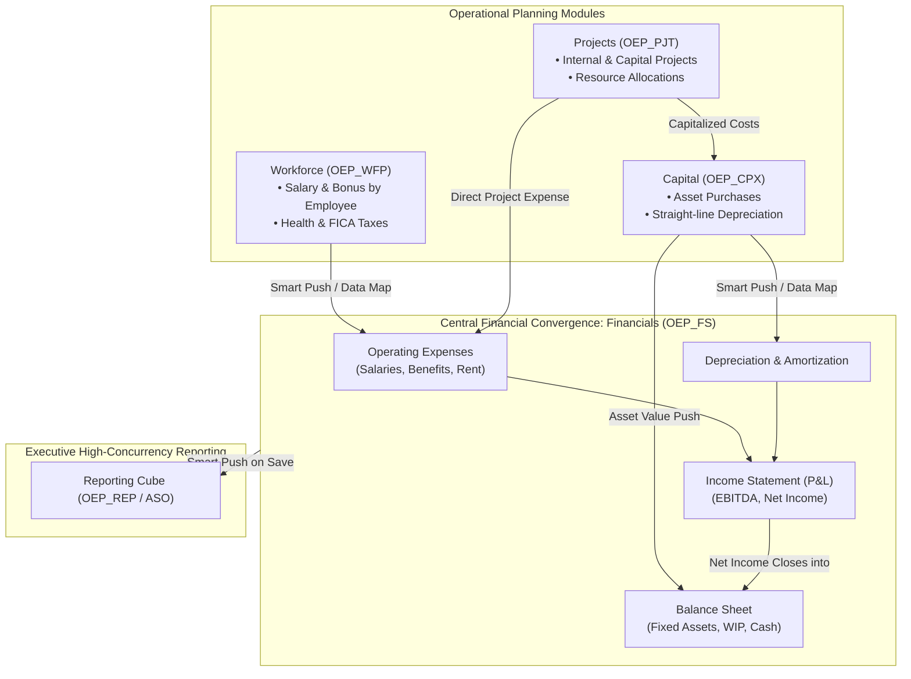

# 9.1 EPBCS Pre-Built Business Processes: Financials, Workforce, Capital & Projects

## Table of Contents
1. [Core Consultant Mental Model](#1-core-consultant-mental-model)
2. [Custom Planning vs. Pre-Built Modules vs. FreeForm](#2-custom-planning-vs-pre-built-modules-vs-freeform)
3. [The 5 Core EPBCS Business Processes](#3-the-5-core-epbcs-business-processes)
4. [Cross-Module Integration Architecture (Data Maps & Smart Push)](#4-cross-module-integration-architecture-data-maps--smart-push)
5. [Tough & Twisted Review Questions with Consultant Model Answers](#5-tough--twisted-review-questions-with-consultant-model-answers)

---

<!-- ===================================================================== -->
<!-- 🎯 LIVE INTERACTIVE VISUAL CARD: EPBCS PRE-BUILT MODULES -->
<!-- ===================================================================== -->

<b>🎯 Live Interactive Architecture Card: EPBCS Business Processes & Data Pipeline (Click to Collapse / Expand)</b>

 

> [!TIP]
> **Consultant High-Yield Summary:** In an EPBCS application, out-of-the-box modules (**Financials, Workforce, Capital, Projects**) are powered by dedicated Essbase cubes prefixed with `OEP_`. Pre-seeded Data Maps automatically roll detailed operational expenses (payroll, asset depreciation, project costs) into the main `OEP_FS` financial cube.

| Module | Cube Name | Primary Focus | Integration Target |
| :--- | :--- | :--- | :--- |
| **Financials** | `OEP_FS` (BSO) / `OEP_REP` (ASO) | P&L, Balance Sheet, Cash Flow, Drivers | Central convergence hub |
| **Workforce** | `OEP_WFP` | Employee / Job compensation, benefits, payroll tax | Pushes to `OEP_FS` under Labor Expense |
| **Capital** | `OEP_CPX` | New asset investments, depreciation schedules | Pushes D&A to P&L; Net Book Value to Balance Sheet |
| **Projects** | `OEP_PJT` | Contract, Capital, and Internal projects | Pushes capitalized costs to Capital & Financials |
| **Strategic Modeling** | Dedicated Engine | Multi-year corporate finance, M&A simulations | Periodic balance transfer to Financials |

---

## 1. Core Consultant Mental Model

When a client selects **Oracle Enterprise Planning (EPBCS)**, they are purchasing pre-built best practices:
* **Configurable, Not Hardcoded:** When enabling a module (e.g., *Financials*), administrators choose specific features via the **Configure** screen (e.g., choosing *Expense Planning -> Driver Based*, *Balance Sheet -> Cash Flow Direct / Indirect*).
* **Pre-Seeded Metadata Architecture:** Enabling a feature automatically creates standardized dimensions (`Plan Element`, `Property`), accounts, forms, dashboards, and calculation rules.
* **The Rule of Customization:** Never rename or delete pre-seeded out-of-the-box members (`OEP_*`). Doing so corrupts the pre-built calculation rules and causes monthly Oracle cloud patches to fail!

---

## 2. Custom Planning vs. Pre-Built Modules vs. FreeForm

| Dimension | Custom Planning | EPBCS Pre-Built Modules | FreeForm Planning |
| :--- | :--- | :--- | :--- |
| **Out-of-the-Box Content** | None (100% custom designed) | Complete pre-built cubes, forms, and rules | None (Pure Essbase architecture) |
| **Mandatory Dimensions** | Account, Period, Year, Scenario, Version, Entity | Same, plus module-specific dimensions (`Plan Element`) | **Zero mandatory dimensions** (Can omit Entity/Version) |
| **Implementation Speed** | 3 to 6 months | **6 to 12 weeks** | 2 to 4 weeks |
| **Best Architectural Fit** | Specialized niche business models | Standard corporate FP&A, HR, and Capex | Pure standalone Essbase migration from on-prem |

---

## 3. The 5 Core EPBCS Business Processes

### 1. Financials (`OEP_FS` / `OEP_REP`)
* Central financial engine integrating Revenue, Expense, Balance Sheet, and Cash Flow.
* Provides driver-based modeling (Units $\times$ Price, DSO, DPO).
* Aggregates financial totals and syncs to `OEP_REP` for Smart View reporting.

### 2. Workforce (`OEP_WFP`)
* Calculates salary, merit increases, bonus incentives, health benefits, and statutory taxes (FICA, Medicare, Pension).
* **Granularity Options:** Employee-only, Job-only, or Employee-and-Job.
* Pushes summarized compensation to Financials without exposing individual employee salaries to general planners.

### 3. Capital (`OEP_CPX`)
* Manages the lifecycle of new and existing capital assets (Buildings, Equipment, IT hardware).
* Automates depreciation calculations based on asset class useful lives.
* Calculates repairs, maintenance, and insurance expenses.

### 4. Projects (`OEP_PJT`)
* Tracks financial performance across four project types:
  * *Capital Projects:* Capitalizes costs and pushes asset value to the Capital module.
  * *Contract Projects:* Tracks customer billing, revenue recognition, and project margins.
  * *Internal Projects:* Tracks internal R&D or corporate marketing campaigns.

### 5. Strategic Modeling
* 50-year long-term strategic forecasting with integrated balance sheet, debt financing, and tax calculations.
* Features native Monte Carlo risk analysis and M&A consolidation modeling.

---

## 4. Cross-Module Integration Architecture (Data Maps & Smart Push)

Data passes between modules seamlessly using out-of-the-box **Data Maps**:

1. **Workforce to Financials:**
   * Data Map: `Compensation Data to Financials`.
   * Maps detailed employee expenses into summary accounts: `Salaries -> 5110_Salaries`, `Benefits -> 5120_Benefits`.
2. **Capital to Financials:**
   * Data Map: `Capital Data to Financials`.
   * Pushes monthly depreciation expenses into P&L account `6100_Depreciation` and updates Balance Sheet fixed assets.
3. **Financials to Reporting:**
   * Smart Push: `Financials to Reporting`.
   * Synchronizes BSO cube `OEP_FS` to high-speed ASO cube `OEP_REP` upon form save.

---

## 5. Tough & Twisted Review Questions with Consultant Model Answers

### Question 1: "A client enables the Workforce module. Why should general financial planners NOT be given access to the `OEP_WFP` cube?"
**Consultant Model Answer:**
> "The `OEP_WFP` cube stores granular, highly sensitive payroll data: individual employee names, base salaries, merit increases, bonus payouts, and personal tax rates. 
> To enforce strict confidentiality and data governance:
> 1. Provision access to `OEP_WFP` strictly to Human Resources and dedicated Compensation Planners.
> 2. General department planners work strictly inside `OEP_FS` (Financials), which only receives aggregated summary compensation expense lines (e.g., Total Department 100 Salaries = \$500k) pushed via Data Maps, preventing unauthorized visibility into individual salaries."

### Question 2: "Can you delete an out-of-the-box dimension member prefixed with `OEP_` or `HSP_` in an EPBCS application?"
**Consultant Model Answer:**
> "No. Deleting or modifying out-of-the-box members prefixed with `OEP_` is strictly forbidden. 
> These members are hardcoded references inside pre-built Calculation Manager rules, Groovy validation scripts, data maps, and web forms. Deleting an `OEP_` member breaks the dependency chain, causes calculation scripts to fail compilation during database refreshes, and can corrupt future monthly Oracle cloud application updates. 
> If a client does not use a pre-seeded member, the best practice is to mark the member as inactive or remove it from form layouts."

### Question 3: "What is the architectural difference between an EPBCS Custom Application and an EPBCS FreeForm Application?"
**Consultant Model Answer:**
> "* **Custom Application:** Created under the Planning framework with mandatory standard dimensions (Account, Period, Year, Scenario, Version, Entity) and underlying relational `HSP_*` metadata schema constraints.
> * **FreeForm Application:** Created directly from an Essbase outline without standard Planning dimensions. An application can have 10 custom dimensions without an Entity or Version dimension, supports pure Essbase BSO/ASO outline design, and operates without Planning metadata restrictions, making it ideal for direct migrations from on-premises Essbase."

---
*Proceed to [Module 10: Smart View Architecture & Ad-Hoc Analytics](../10_Smart_View/00_INDEX.md).*
