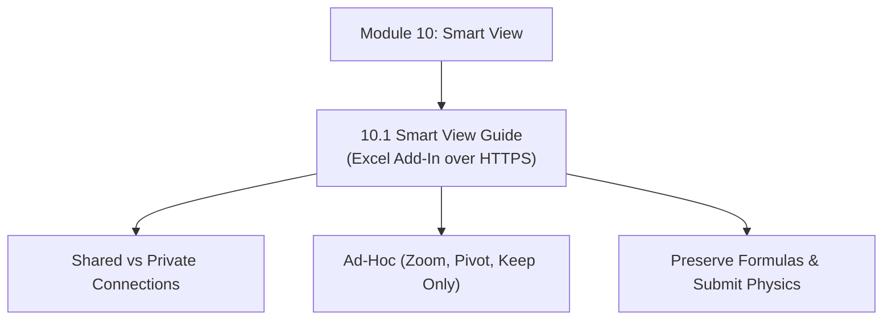

# Module 10: Smart View Architecture & Ad-Hoc Analytics

## Navigation & Module Overview

This module covers Oracle Smart View for Office, Shared vs. Private connection architecture, ad-hoc analysis mechanics (Zoom, Pivot, Keep Only), formatting options, and Excel formula preservation.

---

<!-- ===================================================================== -->
<!-- 🎯 LIVE INTERACTIVE VISUAL CARD: MODULE 10 SMART VIEW -->
<!-- ===================================================================== -->

<b>🎯 Live Interactive Architecture Card: Smart View Suite (Click to Collapse / Expand)</b>

 

> [!TIP]
> **Consultant High-Yield Summary:** Master connection URLs (`/workspace/SmartViewProviders`), Planning vs Essbase provider behaviors, and the critical "Preserve Formulas and Comments" ad-hoc option.

| Document | Primary Domain | Core Focus | Direct Link |
| :--- | :--- | :--- | :--- |
| **10.1 Smart View Guide** | Client Analytics | Shared vs Private Providers, Ad-Hoc Mechanics, Formula Preservation, Submit Traps | [01_Smart_View_Complete_Guide.md](01_Smart_View_Complete_Guide.md) |

---

## Module Documents

1. **[10.1 Smart View Architecture: Providers, Ad-Hoc Analytics & Formula Preservation](01_Smart_View_Complete_Guide.md)**
   * Shared Connection XML catalog vs. Direct Private Connection URLs.
   * Planning Provider vs. Essbase Provider architectural differences.
   * Ad-Hoc operational gestures: Zoom In (Next, All, Bottom), Pivot, Keep/Remove Only.
   * Data and Formatting Options: Suppress Missing Rows, Distinct Member Names.
   * Formula preservation engine and troubleshooting submit failures.
   * Tough & twisted review questions with consultant model answers.

---
*Return to [Knowledge Base Master Index](../README.md) or advance to [Module 11: Smart Lists Architecture](../11_Smart_Lists/00_INDEX.md).*
