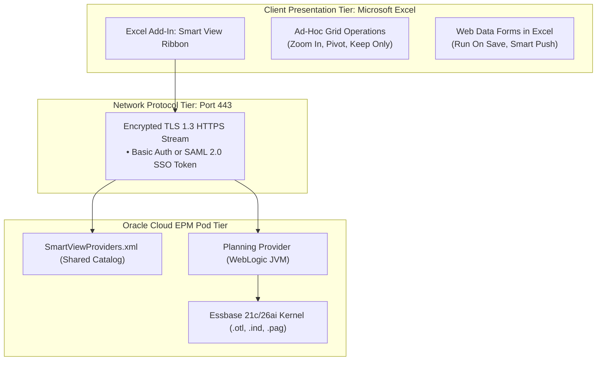

# 10.1 Smart View Architecture: Providers, Ad-Hoc Analytics & Formula Preservation

## Table of Contents
1. [Core Consultant Mental Model](#1-core-consultant-mental-model)
2. [Connection Architecture: Shared vs. Private Connections](#2-connection-architecture-shared-vs-private-connections)
3. [Ad-Hoc Analysis Mechanics: Zoom, Pivot & Keep Only](#3-ad-hoc-analysis-mechanics-zoom-pivot--keep-only)
4. [Smart View Options & Formatting Engine](#4-smart-view-options--formatting-engine)
5. [Excel Formula Preservation & Submit Pitfalls](#5-excel-formula-preservation--submit-pitfalls)
6. [Tough & Twisted Review Questions with Consultant Model Answers](#6-tough--twisted-review-questions-with-consultant-model-answers)

---

<!-- ===================================================================== -->
<!-- 🎯 LIVE INTERACTIVE VISUAL CARD: SMART VIEW ARCHITECTURE -->
<!-- ===================================================================== -->

<b>🎯 Live Interactive Architecture Card: Smart View & Ad-Hoc Grid Mechanics (Click to Collapse / Expand)</b>

 

> [!TIP]
> **Consultant High-Yield Summary:** Smart View connects Excel to Cloud EPM via HTTPS REST/XMLA over port 443. The #1 cause of lost work in Smart View is entering custom Excel formulas on an ad-hoc grid without enabling **"Preserve Formulas and Comments in Ad Hoc"**, causing the next Refresh to wipe out all local calculations!

| Connection Mode | URL / Provider Architecture | Key Feature / Limitation |
| :--- | :--- | :--- |
| **Shared Connection** | `https://<epm_url>/workspace/SmartViewProviders` | Centrally managed XML catalog of all instances and cubes |
| **Private Connection** | Direct cube URL (`.../HyperionPlanning/SmartView`) | Fast 1-click connect; bookmarks specific ad-hoc sheets |
| **Planning Provider** | Connects to Planning business logic | Enforces valid intersections, task lists, and web form formatting |
| **Essbase Provider** | Direct connection to Essbase kernel | Pure free-form ad-hoc multidimensional slicing |

---

## 1. Core Consultant Mental Model

To 90% of enterprise finance users, **Smart View IS the planning system**. 
* They do not care about WebLogic clusters or OCI data centers; they care why an ad-hoc refresh takes 20 seconds or why typing an `=SUM()` formula disappeared when they hit Refresh.
* **The Consultant Imperative:** You must master every tab in the **Smart View Options** dialog:
  * *Member Options:* Member Name and Alias, Ancestor on Top/Bottom.
  * *Data Options:* Suppress Missing Rows, Suppress Invalid Combinations.
  * *Formatting Options:* Use Excel Formatting vs. Use Smart View Cell Styles.

---

## 2. Connection Architecture: Shared vs. Private Connections

### 1. Shared Connection
* Configured using a single central URL:
  `https://<instance_id>.epm.<data_center>.oraclecloud.com/workspace/SmartViewProviders`
* Queries an XML service catalog returning all available business processes: Planning, Financial Consolidation and Close, Tax Reporting, Profitability, and Narrative Reporting.
* Ideal for end users who need access to all enterprise cubes without memorizing server paths.

### 2. Private Connection
* Configured using the direct application URL:
  `https://<instance_id>.epm.<data_center>.oraclecloud.com/HyperionPlanning/SmartView`
* Direct shortcut to a specific cube or form.
* Essential for creating standardized, distributable Excel financial workbooks and VBA automations.

---

## 3. Ad-Hoc Analysis Mechanics: Zoom, Pivot & Keep Only

Smart View enables multidimensional navigation via standard gestures:

* **Zoom In:** Expands a parent member to view descendants:
  * *Next Level:* Expands immediate children only.
  * *All Levels:* Expands full hierarchy down to leaf members.
  * *Bottom Level:* Expands directly to Level 0 leaf members, skipping intermediate parents.
* **Zoom Out:** Collapses child members back into the parent summary node.
* **Keep Only:** Retains only selected members, deleting all other rows/columns.
* **Remove Only:** Deletes selected rows/columns from the sheet.
* **Pivot:** Drags a dimension from Rows to Columns (or Page/POV) to rotate the multidimensional viewing angle.

---

## 4. Smart View Options & Formatting Engine

| Setting Tab | Recommended Setting | Architectural Reason |
| :--- | :--- | :--- |
| **Data Options -> Suppress Missing** | **Checked** | Prevents retrieving thousands of `#Missing` cells; reduces query payload by 95%. |
| **Data Options -> Suppress Invalid** | **Checked** | Hides rows/columns filtered out by Valid Intersection rules. |
| **Formatting -> Use Excel Formatting** | **Checked (Standard)** | Preserves user-defined font sizes, colors, and borders during refresh. |
| **Formatting -> Move Formatting on Operations** | **Checked** | Keeps conditional formatting intact when zooming in or out. |
| **Member Options -> Member Name Display** | **Member Name and Alias** | Displays unique member key alongside business description. |

---

## 5. Excel Formula Preservation & Submit Pitfalls

### The Formula Overwrite Crisis:
If a user writes `=SUM(C5:C15)` in cell `C16` and clicks **Refresh**, Smart View re-queries the cube. If cell `C16` corresponds to an Essbase coordinate, Essbase retrieves its stored value and **completely overwrites the user's Excel formula**!

### The Solution:
1. In Smart View Options, navigate to **Member Options**.
2. Check **"Preserve Formulas and Comments in Ad Hoc Operations"**.
3. Enable **"Formula Retention"**.
Now, Smart View tracks Excel formula cells in local worksheet metadata, recalculating them locally and submitting values without deleting the formula logic.

---

## 6. Tough & Twisted Review Questions with Consultant Model Answers

### Question 1: "A finance manager complains that when they submit data in Smart View, the numbers do not commit to the database. They click Submit Data, the sheet flashes, but reopening the form shows old values. What is the root cause?"
**Consultant Model Answer:**
> "This issue occurs when:
> 1. **Data Was Entered on Dynamic Calc Parent Cells:** If the user typed numbers into parent summary members or dynamic ratio accounts, Smart View cannot write to dynamic cells; the submit completes without error, but no blocks are updated.
> 2. **Active Cell in Edit Mode:** If the user remained in cell edit mode (cursor blinking in the formula bar) when clicking Submit, Excel did not commit the value to the grid.
> 3. **The Sheet Is Not Connected to an Active Provider:** If the session timed out, Smart View appears active but silently fails to authenticate. Clicking 'Refresh' first confirms active connection status."

### Question 2: "What is the difference between connecting to a Planning application via the 'Planning Provider' versus the 'Essbase Provider' in Smart View?"
**Consultant Model Answer:**
> "* **Planning Provider:** Communicates through the Planning WebLogic application tier. It enforces Planning security, Valid Intersections, cell-level security, form formatting, task lists, and triggers on-save business rules and Smart Push.
> * **Essbase Provider:** Connects directly to the underlying Essbase analytic kernel. It allows raw multidimensional ad-hoc slicing, bypasses web form layouts, and evaluates pure Essbase outline hierarchies. However, it does not enforce web form design locks or automatically trigger form-level Smart Push."

### Question 3: "A user opens an ad-hoc grid in Smart View and zooms in on 'Total Expenses'. The operation hangs for 45 seconds before returning a timeout error. How do you resolve this?"
**Consultant Model Answer:**
> "The timeout occurs because 'Total Expenses' contains hundreds of accounts, and the user zoomed in with **'All Levels'** on an unsuppressed grid without a restrictive POV. Essbase attempted to calculate and return an explosive Cartesian grid. 
> To resolve:
> 1. In Smart View Options -> Data Options, enable **'Suppress Missing Rows'** and **'Suppress Zero Rows'**.
> 2. Change Zoom In behavior from 'All Levels' to **'Next Level'** or **'Bottom Level'**.
> 3. Ensure high-cardinality dimensions (Entity, CostCenter, Scenario) are restricted on the POV bar rather than left on rows."

---
*Proceed to [Module 11: Smart Lists Complete Architecture](../11_Smart_Lists/00_INDEX.md).*
