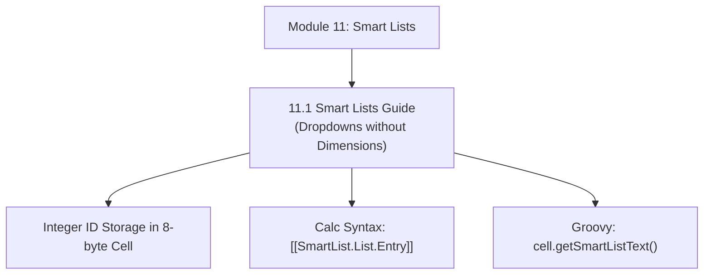

# Module 11: Smart Lists Architecture & Dropdown Modeling

## Navigation & Module Overview

This module covers Smart Lists as pseudo-dimensions, physical integer ID storage mechanics, relational schema mappings, Calculation Manager syntax, and Groovy text extraction.

---

<!-- ===================================================================== -->
<!-- 🎯 LIVE INTERACTIVE VISUAL CARD: MODULE 11 SMART LISTS -->
<!-- ===================================================================== -->

<b>🎯 Live Interactive Architecture Card: Smart Lists Suite (Click to Collapse / Expand)</b>

 

> [!TIP]
> **Consultant High-Yield Summary:** Master the storage mechanics of Smart Lists (storing integer IDs in 8-byte cells), the Calc Manager syntax (`[[SmartList.List.Entry]]`), and the architectural trade-offs vs Attribute Dimensions.

| Document | Primary Domain | Core Focus | Direct Link |
| :--- | :--- | :--- | :--- |
| **11.1 Smart Lists Complete Guide** | Dropdown Modeling | Integer Storage, Smart List vs Dimension, Calc Syntax, Groovy `getSmartListText` | [01_Smart_Lists_Complete_Guide.md](01_Smart_Lists_Complete_Guide.md) |

---

## Module Documents

1. **[11.1 Smart Lists Complete Architecture: Physics, Calculation & Dropdown Modeling](01_Smart_Lists_Complete_Guide.md)**
   * Smart List vs. Physical Dimension vs. Attribute Dimension decision tree.
   * Internal storage physics: Positive integer IDs in Essbase 8-byte cells.
   * Calculation Manager syntax: `[[SmartList.Name.Entry]]`.
   * Groovy scripting integration: `cell.getSmartListText()` vs `cell.data`.
   * Tough & twisted review questions with consultant model answers.

---
*Return to [Knowledge Base Master Index](../README.md) or advance to [Module 12: EPM Automate CLI](../12_EPM_Automate/00_INDEX.md).*
