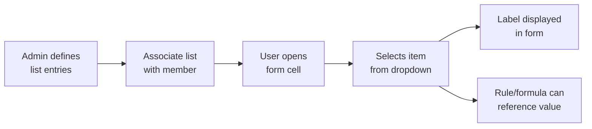

# Smart Lists — Complete Guide

> **Folder:** 11_Smart_Lists | **Audience:** Beginner → Architect
>
> **Provenance:** Merged from ChatGPT `Smart_Lists/` (5 files); Claude (Smart List content within metadata modules); Gemini `Smart_Lists/` (5 files)

---

## Core Idea

A **Smart List** is a configured drop-down list that lets users choose a value in Planning form cells instead of typing a number. The user sees a readable label; behind the scenes, the entry has a unique numeric ID and a programmatic name.

**Plain language:** Instead of typing "1" for "Prior Year Method" and "2" for "Average Method," the user picks from a drop-down like choosing from a menu.

---

## When to Use a Smart List vs a Dimension

| Use a Smart List When... | Use a Dimension When... |
|---|---|
| You need a small governed set of choices | Values must participate as independent members |
| The value drives a formula or rule switch | You need slicing, security, hierarchy, or aggregation |
| Users need a friendly label in data entry | Values need their own data storage and rollup |
| Examples: Forecast Method, Status, Rating | Examples: Department, Product, Region |

> A Smart List is NOT a replacement for a dimension.

---

## How Smart Lists Work



---

## Entry Properties

| Property | What It Is | Design Note |
|---|---|---|
| **ID** | Unique numeric entry identifier | Can be customized; plan changes carefully when data/integrations depend on IDs |
| **Name** | Unique programmatic name | Formula expressions reference this; keep stable and meaningful |
| **Label** | Text displayed to users | Optimize for clarity; label changes and ID changes are different operations |

---

## Evaluation Order — Critical Setup

For a Smart List to display correctly in forms, the **dimension** to which the Smart List-type member belongs must be **first in the evaluation order** for that cube.

> The correct dimension is NOT always Account. Check the relevant cube and member configuration.

---

## Illustrative Example

A hypothetical account member called **Forecast Method** could have Smart List entries:

| ID | Name | Label |
|----|------|-------|
| 1 | PriorYear | Prior Year |
| 2 | ThreeYearAvg | Three-Year Average |
| 3 | Manual | Manual Entry |

A user selects "Three-Year Average" in a form. A business rule then reads the Smart List value to decide which calculation formula to apply.

> **Label:** This example is illustrative, not a project configuration.

---

## Configuration Steps

1. Confirm the cell needs a controlled choice (Smart List) vs. a new dimension member
2. Create the Smart List and define unique IDs, meaningful names, and clear labels
3. Associate it with the intended Account or other member; set data type to "Smart List"
4. Configure the evaluation order in the relevant cube
5. Set missing-value display behavior
6. Preview entries, then test with users at different access levels
7. Test save, retrieval, rule/formula use, Smart View behavior, and cross-cube data maps
8. Before changing IDs or deleting entries, identify dependencies and test impacts

---

## Integration with Calc Manager

Business rules can reference Smart List values to drive conditional logic:

```
/* Hypothetical: Different calc based on Forecast Method Smart List */
IF ("Forecast_Method" == "PriorYear")
  "Revenue" = "Revenue"->prior(Year);
ELSEIF ("Forecast_Method" == "ThreeYearAvg")
  "Revenue" = (@PRIOR("Revenue", 1, Year) + @PRIOR("Revenue", 2, Year) + @PRIOR("Revenue", 3, Year)) / 3;
ENDIF
```

---

## Troubleshooting

| Symptom | What to Check |
|---|---|
| Cell shows a number instead of dropdown | Member data type/list association, form configuration, evaluation order |
| Item missing from dropdown | List entries, member association, access-based filtering |
| Blank value displays unexpectedly | Smart List missing-label options, form missing-value display setting |
| Rule gives unexpected result | Verify entry name used in formula, check correct cube |
| Cross-cube values render differently | Check target metadata/list mapping; IDs don't always transfer safely |

---

## 🧠 Self-Check Questions

1. **What is a Smart List and how does it differ from a dimension?**
2. **What are the three entry properties (ID, Name, Label)?**
3. **Why does evaluation order matter for Smart Lists?**
4. **When should you use a dimension instead of a Smart List?**

> **Teach-back prompt:** Explain a Smart List to a new planner, then describe how you would validate its display and use in a business rule.

---

## Oracle Sources

- [Administering Smart Lists](https://docs.oracle.com/en/cloud/saas/planning-budgeting-cloud/pfusa/sm_lists.html)
- [Smart List Properties](https://docs.oracle.com/en/cloud/saas/planning-budgeting-cloud/pfusa/adding_or_changing_smart_list_properties.html)
- [Smart List Entries](https://docs.oracle.com/en/cloud/saas/planning-budgeting-cloud/pfusa/adding_or_changing_smart_list_entries.html)

