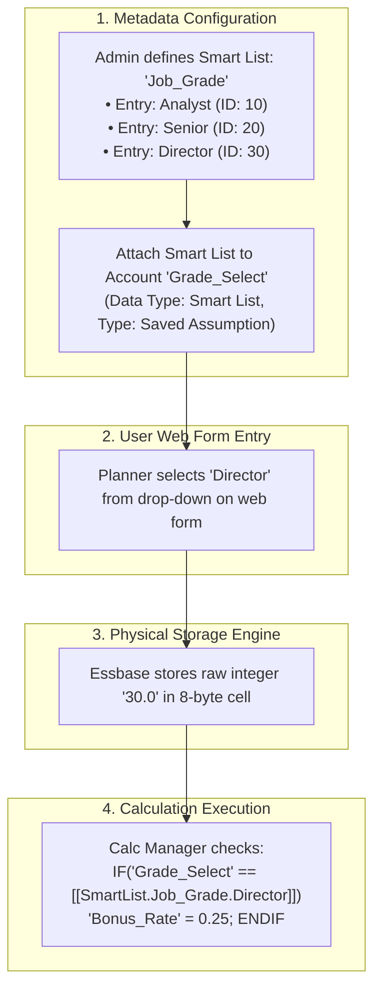
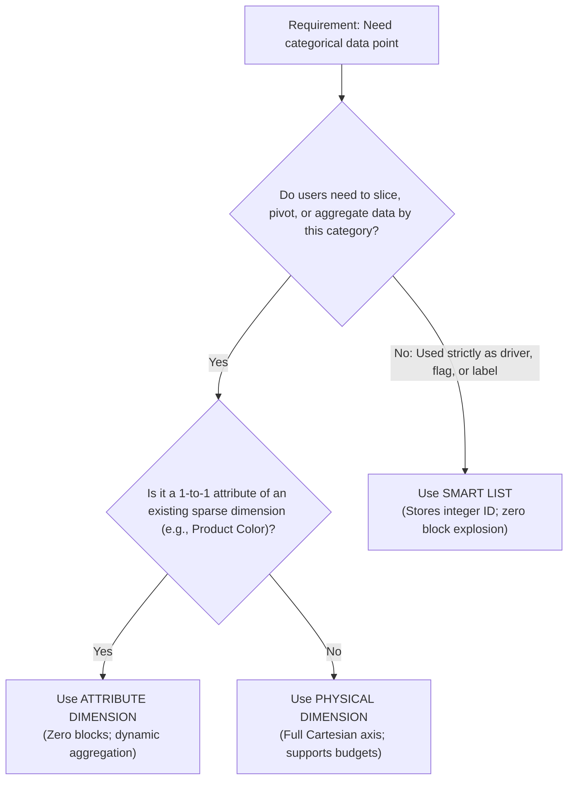

# 11.1 Smart Lists Complete Architecture: Physics, Calculation & Dropdown Modeling

## Table of Contents
1. [Core Consultant Mental Model](#1-core-consultant-mental-model)
2. [Smart List vs. Dimension vs. Attribute: Architectural Decision Tree](#2-smart-list-vs-dimension-vs-attribute-architectural-decision-tree)
3. [Physical Storage Mechanics: Integer IDs in 8-Byte Cells](#3-physical-storage-mechanics-integer-ids-in-8-byte-cells)
4. [Calculation Manager & Business Rule Syntax](#4-calculation-manager--business-rule-syntax)
5. [Groovy Scripting with Smart Lists (`getSmartListText`)](#5-groovy-scripting-with-smart-lists-getsmartlisttext)
6. [Tough & Twisted Review Questions with Consultant Model Answers](#6-tough--twisted-review-questions-with-consultant-model-answers)

---

<!-- ===================================================================== -->
<!-- 🎯 LIVE INTERACTIVE VISUAL CARD: SMART LISTS STORAGE PHYSICS -->
<!-- ===================================================================== -->
<details open>
<summary><b>🎯 Live Interactive Architecture Card: Smart Lists & Dropdown Physics (Click to Collapse / Expand)</b></summary>

<br/>

> [!TIP]
> **Consultant High-Yield Summary:** Smart Lists allow dropdown selections on web forms without creating physical dimensions. Inside Essbase, a Smart List cell stores a **positive integer ID** (e.g., `1`, `2`, `3`) inside the standard 8-byte floating point block cell, while the Planning web tier resolves the integer ID into the human-readable text label.

| Characteristic | Physical Dimension | Attribute Dimension | Smart List |
| :--- | :--- | :--- | :--- |
| **Storage Atom** | Physical Cartesian Blocks | **Zero blocks** (Dynamic pointer) | **Single numeric cell** storing integer ID |
| **Data Slicing** | Full row/col/page slicing | Slicing in Smart View / Reports | Cannot be used as grid axis / slicer |
| **Consolidation** | Rolls up hierarchies (`+`, `-`) | Dynamically aggregates base members | **Non-aggregating** (Account Type = Saved Assumption) |
| **Performance Impact** | Can cause block explosion | Zero block impact | Zero block impact |



</details>

---

## 1. Core Consultant Mental Model

When a business requirement asks for a categorical classification (e.g., *Project Phase, Approval Status, Employee Pay Grade, Asset Depreciation Method*), junior consultants reflexively create a new sparse dimension.
* **The Fatal Mistake:** Adding a dimension expands the sparse Cartesian space, increases index B-tree size, and slows down calculation scripts.
* **The Best Practice:** If the values are simply categorical drivers used by business rules or visual filters, create a **Smart List**. A Smart List stores an integer ID within an existing cell, consuming **zero additional blocks on disk**.

---

## 2. Smart List vs. Dimension vs. Attribute: Architectural Decision Tree



---

## 3. Physical Storage Mechanics: Integer IDs in 8-Byte Cells

A Smart List entry consists of three components:
1. **Label:** The text shown to users in dropdown menus (*"Full-Time Employee"*).
2. **Name:** The internal programmatic identifier (*"Full_Time"*).
3. **ID:** A unique positive integer (*"1"*).

### Internal Storage Architecture:
* In Essbase, data blocks only store numbers. When a planner selects *"Full-Time Employee"*, the web application writes `1.0` into the Essbase block cell.
* In the **Planning Relational Repository (RDBMS)**, the tables `HSP_ENUMERATION` and `HSP_ENUMERATION_ENTRY` maintain the mapping between the integer `1` and the label *"Full-Time Employee"*.
* When a form opens, the Planning server queries Essbase for the number `1`, matches it in the relational table, and displays the dropdown label.

---

## 4. Calculation Manager & Business Rule Syntax

To reference Smart List entries in Calculation Manager rules:

### Standard Syntax:
```essbase
/* Syntax: [[SmartList.SmartListName.EntryName]] */
FIX("FY26", "Working", @RELATIVE("Total_Entity", 0))
    "Merit_Rate" (
        IF("Performance_Rating" == [[SmartList.Perf_Rating.Exceeds]])
            "Merit_Rate" = 0.08;
        ELSEIF("Performance_Rating" == [[SmartList.Perf_Rating.Meets]])
            "Merit_Rate" = 0.04;
        ELSE
            "Merit_Rate" = 0.00;
        ENDIF
    )
ENDFIX
```

### Calculation Rule Best Practices:
* Never hardcode numeric IDs (e.g., `IF("Rating" == 1)`). If an administrator changes the Smart List order or reassigns IDs, the hardcoded rule evaluates incorrectly. Always use the programmatic identifier `[[SmartList.Name.Entry]]`.

---

## 5. Groovy Scripting with Smart Lists (`getSmartListText`)

Groovy provides specialized methods on the `DataCell` object to interact with Smart Lists:

```groovy
/* Groovy Rule: Inspecting Smart List value on active grid */
operation.grid.dataCellIterator().each { DataCell cell ->
    if (cell.getMemberName("Account") == "Employee_Status") {
        // Retrieve the human-readable text label
        String statusText = cell.getSmartListText()
        
        // Retrieve the underlying numeric integer ID
        Double statusId = cell.data
        
        if (statusText == "Terminated" && cell.hasComment() == false) {
            throwVetoException("Terminated employees require a separation note.")
        }
    }
}
```

---

## 6. Tough & Twisted Review Questions with Consultant Model Answers

### Question 1: "In Smart View ad-hoc mode, a user retrieves a Smart List account and sees the number '4' instead of the label 'High Priority'. Why did Smart View fail to display the text label?"
**Consultant Model Answer:**
> "This occurs when the user connects to Smart View via the **Essbase Provider** rather than the **Planning Provider**:
> * **Essbase Provider:** Queries the raw Essbase database directly. Because Essbase only stores the raw integer ID (`4.0`), it displays the numeric value.
> * **Planning Provider:** Queries through the Planning application tier, which intercepts the integer `4.0`, resolves it against the relational `HSP_ENUMERATION_ENTRY` table, and renders the text string 'High Priority' in the Excel grid.
> Connecting via the Planning Provider resolves the issue."

### Question 2: "Can you use a Smart List member as a Row or Column axis header to aggregate data on a data form?"
**Consultant Model Answer:**
> "No. A Smart List is **not a dimension**; it is an attribute property stored inside a single account data cell. 
> Because Smart List entries do not exist in the Essbase outline as dimension members, they cannot be placed on Rows, Columns, Page, or POV axes to slice data. If the business requirement demands viewing all rows grouped and summed by 'Project Phase', Project Phase must be architected as an **Attribute Dimension** or a **Physical Dimension**, not a Smart List."

### Question 3: "An administrator deletes an unused entry from a Smart List in the Planning web interface. When opening an existing data form, the cell displays '#NumericError' or raw integers. What happened?"
**Consultant Model Answer:**
> "Deleting the Smart List entry removed its definition and ID from the relational `HSP_ENUMERATION_ENTRY` table. However, existing Essbase data blocks still contain the deleted integer ID on disk. 
> When the form opened, the Planning server retrieved the integer from Essbase but found no matching label in the relational metadata, displaying an error or raw integer. Best practice is to **never delete Smart List entries that have historical data**; instead, mark the entry as inactive or hide it from data entry forms."

---
*Proceed to [Module 12: EPM Automate Architecture & Scripting](../12_EPM_Automate/00_INDEX.md).*
