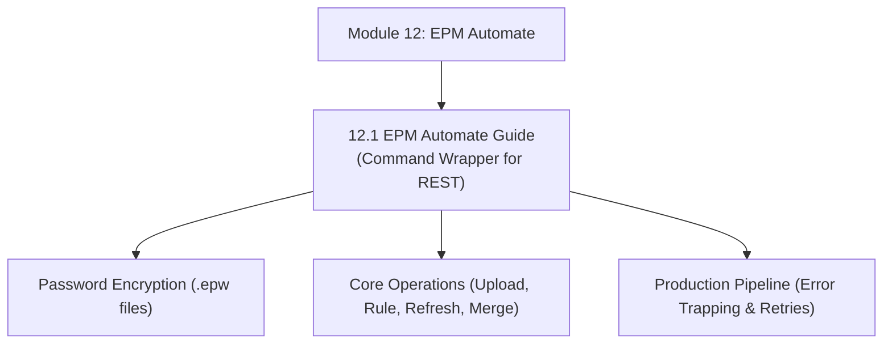

# Module 12: EPM Automate CLI & Enterprise Batch Orchestration

## Navigation & Module Overview

This module covers the EPM Automate command-line interface (CLI), client-to-REST translation architecture, credential encryption (`.epw`), master command syntax, and production batch scripting pipelines.

---

<!-- ===================================================================== -->
<!-- 🎯 LIVE INTERACTIVE VISUAL CARD: MODULE 12 EPM AUTOMATE -->
<!-- ===================================================================== -->

<b>🎯 Live Interactive Architecture Card: EPM Automate CLI Suite (Click to Collapse / Expand)</b>

 

> [!TIP]
> **Interactive Standalone Dashboard:** Open [`card_kb_07_epm_automate_terminal.html`](../interactive_cards/card_kb_07_epm_automate_terminal.html) in your browser for a live interactive EPM Automate command runner & script simulator!

| Document | Primary Domain | Core Focus | Direct Link |
| :--- | :--- | :--- | :--- |
| **12.1 EPM Automate Guide** | Batch Orchestration | CLI Architecture, Password Encryption, Core Commands, Production PowerShell Pipeline | [01_EPM_Automate_Complete_Guide.md](01_EPM_Automate_Complete_Guide.md) |

---

## Module Documents

1. **[12.1 EPM Automate CLI: Architecture, Scripting & Enterprise Orchestration](01_EPM_Automate_Complete_Guide.md)**
   * CLI-to-REST translation engine over HTTPS port 443.
   * Authentication architecture: Encrypted `.epw` files vs. OAuth 2.0.
   * Master command matrix: Lifecycle, Cube operations, ETL, and File transfers.
   * Robust production batch scripting architecture with exit code verification.
   * Tough & twisted review questions with consultant model answers.

---
*Return to [Knowledge Base Master Index](../README.md) or advance to [Module 13: Action Menus Architecture](../13_Action_Menus/00_INDEX.md).*
