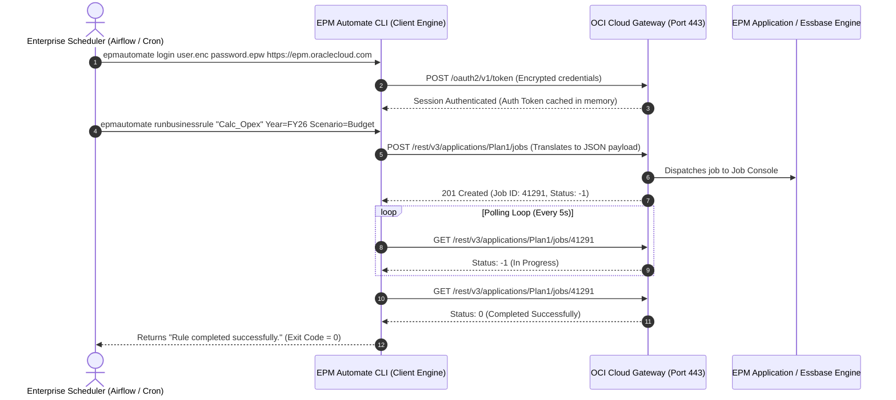

# 12.1 EPM Automate CLI: Architecture, Scripting & Enterprise Orchestration

## Table of Contents
1. [Core Consultant Mental Model](#1-core-consultant-mental-model)
2. [CLI-to-REST Translation Architecture](#2-cli-to-rest-translation-architecture)
3. [Authentication: Encrypted Password Files vs. OAuth 2.0](#3-authentication-encrypted-password-files-vs-oauth-20)
4. [Master Command Taxonomy & Syntax Matrix](#4-master-command-taxonomy--syntax-matrix)
5. [Production Batch Scripting Architecture (PowerShell & Bash)](#5-production-batch-scripting-architecture-powershell--bash)
6. [Tough & Twisted Review Questions with Consultant Model Answers](#6-tough--twisted-review-questions-with-consultant-model-answers)

---

<!-- ===================================================================== -->
<!-- 🎯 LIVE INTERACTIVE VISUAL CARD: EPM AUTOMATE ORCHESTRATION -->
<!-- ===================================================================== -->
<details open>
<summary><b>🎯 Live Interactive Architecture Card: EPM Automate Command Architecture (Click to Collapse / Expand)</b></summary>

<br/>

> [!TIP]
> **Interactive Standalone Dashboard:** Open [`card_kb_07_epm_automate_terminal.html`](../interactive_cards/card_kb_07_epm_automate_terminal.html) in your browser for a live interactive EPM Automate command runner & script simulator!

| Operational Category | Key CLI Commands | Underlying REST Endpoint | Exit Codes |
| :--- | :--- | :--- | :--- |
| **Authentication** | `login`, `logout`, `encrypt` | `/oauth2/v1/token` or Basic Auth | `0` = Success, `1` = Auth Failed |
| **Data & Calculation** | `runbusinessrule`, `rundatarule`, `mergeslices` | `/HyperionPlanning/rest/v3/applications/{app}/jobs` | `0` = Success, `1` = Job Failed |
| **File Management** | `uploadfile`, `downloadfile`, `deletefile` | `/interop/rest/11.1.2.3.600/applicationsnapshots` | `0` = Transferred |
| **Lifecycle & Cube** | `refreshcube`, `exportsnapshot`, `importsnapshot` | `/interop/rest/11.1.2.3.600/migration` | `0` = Refreshed |



</details>

---

## 1. Core Consultant Mental Model

**EPM Automate is not a separate server product; it is an intelligent HTTP client wrapper.**
* Behind every CLI command (`runbusinessrule`, `uploadfile`, `refreshcube`), EPM Automate constructs a secure **HTTPS JSON payload**, submits it over port 443, and handles the asynchronous polling logic automatically.
* When writing shell or PowerShell scripts, consultants must always evaluate the **process exit code** (`$LASTEXITCODE` in PowerShell, `%ERRORLEVEL%` in Windows CMD, `$?` in Linux Bash).
* Never assume a script succeeded without verifying that the CLI returned exit code `0`.

---

## 2. CLI-to-REST Translation Architecture

When you type:
```bash
epmautomate runbusinessrule "Rollup_Entity" Year=FY26 Scenario=Budget
```
EPM Automate executes the following underlying steps:
1. Reads cached authentication session token from local client storage.
2. Constructs HTTP request:
   `POST https://<epm_url>/HyperionPlanning/rest/v3/applications/<app>/jobs`
   Payload:
   ```json
   {
       "jobType": "Rules",
       "jobName": "Rollup_Entity",
       "parameters": {
           "Year": "FY26",
           "Scenario": "Budget"
       }
   }
   ```
3. Receives `jobId` and initiates an automatic HTTP polling loop.
4. When the job finishes with status `0`, EPM Automate prints `The business rule completed successfully.` and terminates with process exit code `0`.

---

## 3. Authentication: Encrypted Password Files vs. OAuth 2.0

Hardcoding plaintext passwords inside automation scripts is a critical security vulnerability:

### 1. Encrypted Password File (`.epw`)
* Generate an encrypted password file on the client machine:
  ```bash
  epmautomate encrypt MySecretPassword123 MyKey C:\Automation\epm_password.epw
  ```
* Log in using the key and encrypted file:
  ```bash
  epmautomate login service_account@company.com C:\Automation\epm_password.epw https://epm-test.oraclecloud.com MyKey
  ```
* **Security Note:** The `.epw` file is tied to the machine and user account that generated it. Copying the file to another server without the key will fail to decrypt.

### 2. OAuth 2.0 Tokens (Modern Enterprise Standard)
* Leverages OCI IAM Confidential Application credentials for token-based authentication without local password storage.

---

## 4. Master Command Taxonomy & Syntax Matrix

| Category | Command | Syntax & Example | Description |
| :--- | :--- | :--- | :--- |
| **Lifecycle** | `exportsnapshot` | `epmautomate exportsnapshot "Nightly_Backup"` | Generates full application LCM zip snapshot |
| **Lifecycle** | `importsnapshot` | `epmautomate importsnapshot "Nightly_Backup"` | Restores application from existing snapshot |
| **Lifecycle** | `recreate` | `epmautomate recreate` | Resets environment to factory default blank state |
| **Cube Ops** | `refreshcube` | `epmautomate refreshcube` | Compiles relational metadata into Essbase outline |
| **Cube Ops** | `mergeslices` | `epmautomate mergeslices Plan1 OEP_REP dropzeros`| Merges ASO incremental slices and drops zeros |
| **Data ETL** | `rundatarule` | `epmautomate rundatarule Import_GL_Actuals Jan FY26 REPLACE` | Triggers Data Integration import and export |
| **Rules** | `runbusinessrule` | `epmautomate runbusinessrule "Calc_Opex" Scenario=Plan` | Executes Calculation Manager business rule |
| **Files** | `uploadfile` | `epmautomate uploadfile "C:\Data\gl.csv"` | Streams local file to Cloud staging inbox |
| **Files** | `downloadfile` | `epmautomate downloadfile "Artifact Snapshot"` | Downloads cloud backup to local disk volume |

---

## 5. Production Batch Scripting Architecture (PowerShell & Bash)

### Robust Production PowerShell Pipeline Template:
```powershell
# EPM Automate Robust Production Pipeline
$ErrorActionPreference = "Stop"
$epmUrl = "https://epm-prod.oraclecloud.com"
$user = "epm_automation@company.com"
$pwdFile = "C:\EPM_Scripts\pass.epw"
$key = "ProdSecretKey"

function Execute-EpmCommand ($command) {
    Write-Host "[EXEC] epmautomate $command"
    $output = Invoke-Expression "epmautomate $command"
    if ($LASTEXITCODE -ne 0) {
        Write-Error "[FATAL] Command failed with exit code $LASTEXITCODE. Output: $output"
        epmautomate logout
        exit $LASTEXITCODE
    }
    Write-Host "[SUCCESS] $output"
}

# 1. Login
Execute-EpmCommand "login $user $pwdFile $epmUrl $key"

# 2. Upload GL Data File
Execute-EpmCommand "uploadfile C:\Inbound\GL_Actuals_Oct26.csv"

# 3. Run Data Integration Rule
Execute-EpmCommand "rundatarule Load_Actuals Oct FY26 MERGE"

# 4. Refresh Essbase Outlines
Execute-EpmCommand "refreshcube"

# 5. Merge ASO Slices & Purge Zeros
Execute-EpmCommand "mergeslices Plan1 OEP_REP dropzeros"

# 6. Logout
Execute-EpmCommand "logout"
Write-Host "Nightly EPM Batch Pipeline Completed Successfully!"
```

---

## 6. Tough & Twisted Review Questions with Consultant Model Answers

### Question 1: "An EPM Automate script runs `epmautomate uploadfile` followed by `epmautomate rundatarule`. The data rule fails with 'File not found in Inbox'. What happened?"
**Consultant Model Answer:**
> "By default, `epmautomate uploadfile filename.csv` uploads the file to the root of the Cloud EPM staging repository. 
> However, Data Integration / Data Management looks for input files inside the **'inbox'** directory (or an application-specific subfolder). If the upload command did not specify the target folder:
> `epmautomate uploadfile filename.csv inbox`
> the file was placed in the root directory rather than `inbox/`, causing the Data Integration data load rule to fail with 'File not found'. Uploading explicitly with the `inbox` parameter resolves the issue."

### Question 2: "What is the physical blast radius of executing `epmautomate recreate` versus `epmautomate refreshcube`?"
**Consultant Model Answer:**
> "* **`refreshcube`:** Compiles structural metadata from the relational repository into the Essbase outline (`.otl`). Existing data blocks in Essbase remain intact; users are temporarily blocked during the refresh.
> * **`recreate`:** **Completely wipes the entire EPM service environment back to out-of-the-box factory defaults**. All applications, relational databases, Essbase cubes, security assignments, and local snapshots are permanently deleted! 
> `recreate` is a disaster-level destructive command used only when completely decommissioning or reprovisioning an environment from an external backup."

### Question 3: "A nightly automation script copies the 'Artifact Snapshot' to an external SFTP server. Why should the script always execute `downloadfile` immediately following the daily maintenance window?"
**Consultant Model Answer:**
> "During the daily maintenance window, Cloud EPM automatically overwrites the internal file named `Artifact Snapshot` with a fresh full-application backup. 
> However, the cloud environment **retains only the single most recent `Artifact Snapshot`**. If an application corruption occurs or an accidental deletion happens two days later, the corrupted state will overwrite the previous day's snapshot. 
> Scheduling `epmautomate downloadfile \"Artifact Snapshot\"` immediately following daily maintenance ensures that historical daily snapshots are archived on external secure storage with rolling retention (e.g., 30-day backups) for disaster recovery compliance."

---
*Proceed to [Module 13: Action Menus & Context-Driven Navigation](../13_Action_Menus/00_INDEX.md).*
