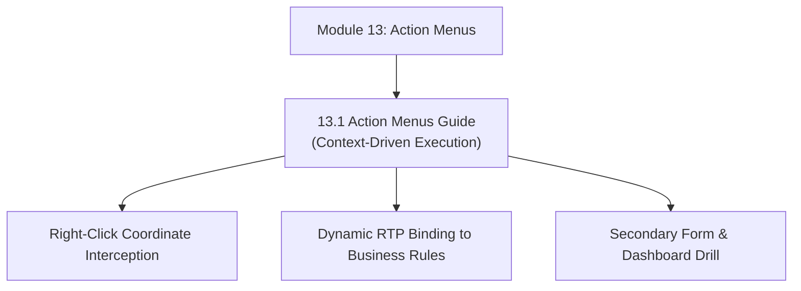

# Module 13: Action Menus & Context-Driven Navigation

## Navigation & Module Overview

This module covers right-click Action Menus on data forms, context-sensitive coordinate extraction, dynamic Runtime Prompt (RTP) binding, and target form redirection.

---

<!-- ===================================================================== -->
<!-- 🎯 LIVE INTERACTIVE VISUAL CARD: MODULE 13 ACTION MENUS -->
<!-- ===================================================================== -->

<b>🎯 Live Interactive Architecture Card: Action Menus Suite (Click to Collapse / Expand)</b>

 

> [!TIP]
> **Consultant High-Yield Summary:** Master the context-passing pipeline (Form Coordinate -> Action Menu Intercept -> Silent Business Rule Prompt Injection).

| Document | Primary Domain | Core Focus | Direct Link |
| :--- | :--- | :--- | :--- |
| **13.1 Action Menus Guide** | Context Navigation | Right-Click Architecture, Context Passing, RTP Parameter Binding, Smart View Integration | [01_Action_Menus_Guide.md](01_Action_Menus_Guide.md) |

---

## Module Documents

1. **[13.1 Action Menus: Context-Sensitive Navigation & Dynamic Parameter Passing](01_Action_Menus_Guide.md)**
   * Right-click coordinate interception and parameter passing mechanics.
   * Action item types: Forms, Business Rules, Dashboards, and external URLs.
   * Silent execution via Runtime Prompt (RTP) binding.
   * Web form vs. Smart View right-click context menu behavior.
   * Tough & twisted review questions with consultant model answers.

---
*Return to [Knowledge Base Master Index](../README.md) or advance to [Module 14: Application Lifecycle Management](../14_Application_Lifecycle/00_INDEX.md).*
