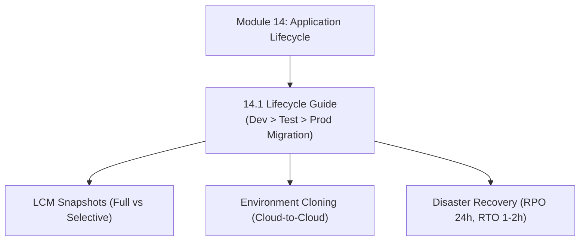

# Module 14: Application Lifecycle Management & Environment Migration

## Navigation & Module Overview

This module covers application provisioning, the 3-tier deployment pipeline (Dev -> Test -> Prod), Lifecycle Management (LCM) snapshots, environment cloning (`epmautomate cloneenvironment`), disaster recovery, and the 28-day monthly update cadence.

---

<!-- ===================================================================== -->
<!-- 🎯 LIVE INTERACTIVE VISUAL CARD: MODULE 14 LIFECYCLE -->
<!-- ===================================================================== -->

<b>🎯 Live Interactive Architecture Card: Application Lifecycle Suite (Click to Collapse / Expand)</b>

 

> [!TIP]
> **Interactive Standalone Dashboard:** Open [`card_kb_08_lifecycle_migration.html`](../interactive_cards/card_kb_08_lifecycle_migration.html) in your browser for a live interactive application lifecycle & snapshot migration simulator!

| Document | Primary Domain | Core Focus | Direct Link |
| :--- | :--- | :--- | :--- |
| **14.1 Lifecycle Guide** | Environment Migration | 3-Tier Pipeline, LCM Snapshots, Selective Migration, `cloneenvironment`, Disaster Recovery | [01_Lifecycle_Guide.md](01_Lifecycle_Guide.md) |

---

## Module Documents

1. **[14.1 Application Lifecycle Management: LCM, Migration & Environment Cloning](01_Lifecycle_Guide.md)**
   * The 3-Tier deployment pipeline (Dev, Test/UAT, Production).
   * Lifecycle Management (LCM) snapshot architecture and selective migration.
   * Direct cloud-to-cloud environment cloning (`epmautomate cloneenvironment`).
   * Disaster recovery architecture: RPO, RTO, and automated snapshot rotation.
   * Monthly patch cadence (1st Friday Test, 3rd Friday Prod).
   * Tough & twisted review questions with consultant model answers.

---
*Return to [Knowledge Base Master Index](../README.md) or advance to [Module 15: Professional Development & Reviews](../15_Professional_Development/00_INDEX.md).*
